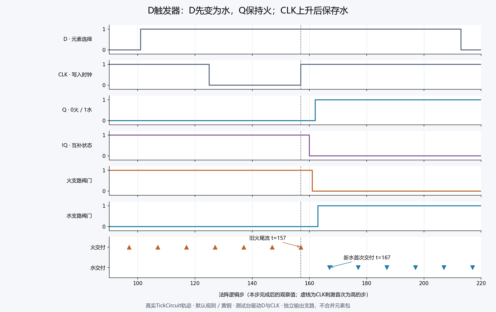

# D触发器与双元素施法实验

日期：2026-10-29。分支：`codex/minecraft-d-flip-flop`。基线：模组v0.3.0，原有规则与运行协议不变。

**结论：现有VM能用基础逻辑符文组成主从式D触发器，保存一位元素选择，并在稳定后进行“火 → 水 → 火”切换。游戏内完整操作仍缺运行时D／CLK信号输入入口；切换也存在传播尾流。** 本次提供设计、可导入的布线蓝图和真实VM实验，没有新增“D触发器成品符文”或修改现有求值器。

## 保存什么

保存的是“下一次新魔力选择哪个元素”的一位控制状态：`Q=0`选火，`Q=1`选水。现有魔力包的元素组成仍由包自己保存；切换选择不会追回、改写已经元素化或已交付的魔力。

| D | CLK事件 | 稳定后的Q | 施法选择 |
|---|---|---|---|
| 0 | 上升沿 | 0 | 火 |
| 1 | 上升沿 | 1 | 水 |
| 任意 | 高电平保持 | 保持 | 保持原元素 |
| 任意 | 下降沿及低电平 | 保持；主锁存器准备新D | 保持原元素 |

这里的“上升沿”采用门级主从电路和建立／保持窗口实现。实验将D在边沿前后各保持32个法阵逻辑步，CLK高、低阶段均至少32步；未宣称这是最短时间，也未覆盖任意窄脉冲或紧贴边沿改变D的情形。默认石英杖端20逻辑步/秒时，32步为1.6秒；其他杖端按法阵实际步速计算。

## 用基础符文搭建

`NOR(a,b)`拆为一个“或”和一个信号“反”，每条信号线读取上一步值。`M/nM`是主锁存器，`Q/nQ`是从锁存器：

```text
nD = NOT(D)                 nCLK = NOT(CLK)
Sm = AND(D, nCLK)           Rm = AND(nD, nCLK)
M  = NOT(OR(Rm, nM))        nM = NOT(OR(Sm, M))

Ss = AND(M, CLK)            Rs = AND(nM, CLK)
Q  = NOT(OR(Rs, nQ))        nQ = NOT(OR(Ss, Q))
```

低电平时主锁存器接收D，从锁存器保持。上升后主锁存器关闭，从锁存器复制已准备的M。高电平期间再改变D，M和Q保持；下一次完整低→高周期才能写入新选择。

触发器本体为16枚符文、22条信号线；连同施法部分为**28枚符文、35条线路**，处于现有64枚/64条上限内。采用黄铜半径6格盘。几何路径由现有`HexRouter`计算并通过`Blueprint`校验；交叉不接通、不能穿第三枚符文。信号按逻辑边计步；现行实际格数只用于魔力损耗，尚未用于传播延迟。

| 编号 | 作用 |
|---|---|
| 1、2 | D、CLK实验刺激源；现有常量信号符文 |
| 3、4 | nD、nCLK |
| 5、6 | Sm、Rm两个与门 |
| 7→8、9→10 | 主锁存器两组或→反；8=M，10=nM |
| 11、12 | Ss、Rs两个与门 |
| 13→14、15→16 | 从锁存器两组或→反；14=Q，16=nQ |
| 17、18 | 魔力输入、手动施法阀门（初始关） |
| 19、20 | 火、水两条支路的信号阀门，分别接nQ、Q |
| 21、22 | 火转化、水转化 |
| 23、24 | 两条支路各自的指向符文 |
| 25、26 | 两条支路各自的光束符文 |
| 27、28 | 两条支路各自输出 |

魔力线路：

```text
输入17 → 手动阀18 ┬→ 信号阀19[nQ] → 火21 → 指向23 → 光束25 → 输出27
                 └→ 信号阀20[ Q] → 水22 → 指向24 → 光束26 → 输出28
```

两个独立输出避免把火和水合并成一个混合包。18号阀门控制是否向施法部分放行，触发器控制本身持续工作。初始Q与nQ尚不合法时应保持18关闭。

## 初始化与操作时序

全部信号线冷启动为假，交叉反馈不是天然合法的0态。必须执行初始化：D=0，CLK=0保持32步；再将CLK置1保持32步，令Q=0、nQ=1；之后打开18号手动阀门，等待管线稳定后得到火光束。

写入水：先把D置1；CLK置0至少32步，让主锁存器准备水；将CLK置1并保持32步后，Q=1、nQ=0，稳定交付水。回到火时同样令D=0，再完成低→高周期。CLK持续为高时只改D，不应切换已保存状态。

为了清楚观察，可在写入前关闭18号阀门，等待已放行管线排出，再写入、稳定后重新开放。**关闭18不会清空下游缓存，现行分流也不能保证所有注入量只进入所选分支**；这不是已经完成的无缓存元素选择器。

## 实测结果

测试运行真实`TickCircuit`，沿用默认注入4点/10步、信号成本、黄铜损耗及转换成本，使用有限4096点实验供给且不恢复；没有改动玩家默认64点容量。实验资源账本逐步检查守恒。

- 主轨迹完成火→水→火，稳定观察窗口分别交付6次火、2次水；每次均为单一元素的指向光束，未把火水混为一包。
- 两个切换方向各扫描全部10种供给相位，共20次；所有稳定期均只交付目标元素。该组测试中，最后一次旧元素交付最晚为刺激后的第8步，新元素首次交付均为第11步。
- 主轨迹在t=157首次施加CLK高，t=162观察到Q=1，t=163水阀开放，t=167首次交付水。Q/nQ暂态存在同时为假的阶段，不能假定每一步都严格互补。
- 高电平改D、下降沿保持、稳定记忆、中途JSON现场恢复、切换暂态12个边界各向前恢复8步、主动停供/手动重启、供给不足停供及补能不自启均通过。
- 单独实验5696项断言通过；连同蓝图规模/编解码检查纳入统一核心测试，累计7826项断言通过。



[逐步原始CSV](experiments/d-flip-flop/timing.csv) · [机器可读结果](experiments/d-flip-flop/result.json) · [SVG时序图](experiments/d-flip-flop/timing.svg)

## 游戏内当前边界

当前`SIGNAL.on`是创建配置，运行中不能编辑；手动`SWITCH`只控制魔力通路，不具有信号输出。因此游戏内尚不能把这两枚SIGNAL直接当成可操作的D开关和CLK按钮。

实验驱动器只在测试进程中替换两枚SIGNAL常量的输入值，每次完整保留时钟、反馈、门态、缓存、在途和账本；Q由原VM自行求值。这个测试接线方法相当于外接刺激器，**不代表服务器已有运行中修改蓝图的能力**。

[可导入布线蓝图](../examples/d-flip-flop-fire-water.json)可用于查看符文与线路；先安装黄铜基板再导入、保存，导入材料须与当前载体一致。蓝图的D/CLK均为0，**直接起阵不会自动完成初始化或切换**，它是供检查的实验接线图。已保存的完整法杖现场能保留反馈；导出/重新导入配置不保存Q。

要完成游戏内人工实验，下一步应增加基础运行信号输入：手动保持开关供D、按下/释放供CLK，经服务器固定步命令与存档保存；继续由基础逻辑门搭触发器。若还要求每次切换都无旧元素尾流、无关闭支路囤积，则需要另行确定资源路由与排空协议。

## 复现

```powershell
# 编译并执行统一核心契约，随后输出蓝图、CSV及结果
./tools/run-d-flip-flop.ps1
# 同时生成PNG/SVG；额外需要Python和matplotlib
./tools/run-d-flip-flop.ps1 -Plot
# 标准Gradle统一验证
./gradlew.bat --gradle-user-home .gradle-home check
```

本次只新增测试、实验文件及说明，未改变模组运行实现或安装包版本；没有进行游戏内双元素人工验收或新一轮服务器伤害测试。
