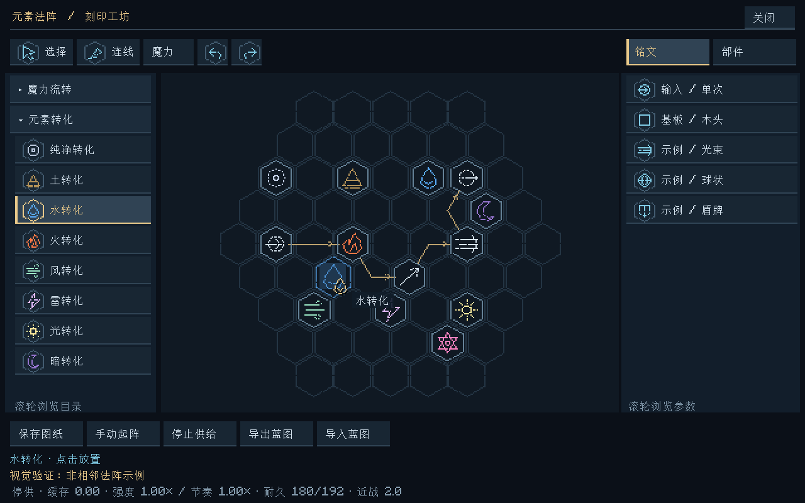
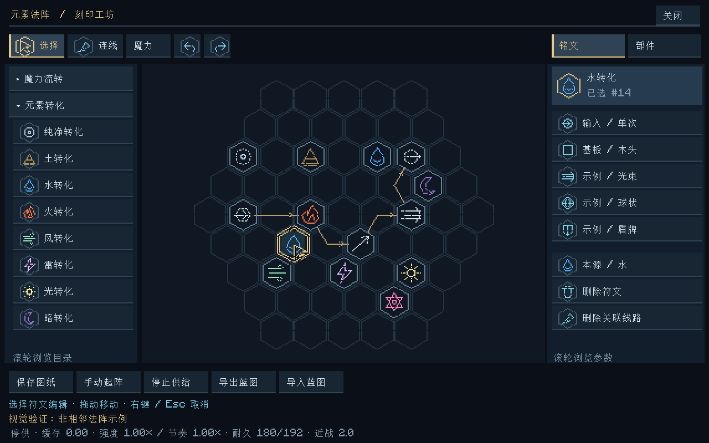
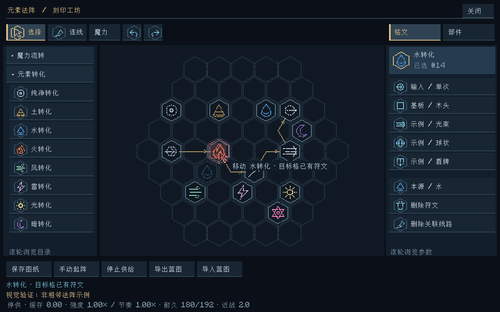

# 元素目录与交互预览（v0.3.0）

此页保留v0.3历史实现；v0.5.1将软件指针替换为原生工具指针，并修复绘制提交及重复预览的开销，见 [编辑器指针与绘制性能修复](编辑器指针与绘制性能修复.md)。

日期：2026-10-28。分支：`codex/minecraft-element-preview`。

“元素转化”成为独立父项，其子项为纯净、土、水、火、风、雷、光、暗、奥术。每个入口绑定实际的 `CONVERT + Element` 配置，点击后直接放置对应元素。运行协议、成本及正反相语义保持既有契约；没有新增客户端施法求值器。纯净入口沿用旧转化规则，不会把已元素化魔力免费还原。

`RuneShapes` 分别提供圆环、山形、液滴、火焰、风纹、折闪、放射太阳、弯月、双三角符形；颜色只是补充，单色下仍能区分。目录按钮、格盘、所选符文卡片、落笔虚影和鼠标标识都消费同一份图形。

`EditorIcon` 定义工具及动作图标；两侧按钮仍由 `CircuitButton` 统一绘制边框、图标、选中、焦点及悬浮。右侧铭文设置显示对应符文或操作图标，部件按钮显示杖端/杖身/杖尾图标。图标由装配层显式传入，不通过匹配中文按钮文字推断功能。所选卡片固定在右上方，参数滚动区域不覆盖该卡片。例行服务器状态刷新不会重建正在输入的参数控件。

鼠标进入格盘后显示软件工具指针：选择箭头、布线笔、具体落笔符形。对应选择/连线按钮使用同一图标；落笔目录子项显示选中态。离开格盘、进入部件页或关闭屏幕时恢复系统指针。软件指针不影响坐标命中、法阵时序或服务器状态。

选择符文显示双层边框和底色，右上方显示确切符形、名称、编号。选择工具下按住符文，移动超过3个GUI像素后进入拖动：原位置淡化，新格显示半透明符文及名称，相关线路同步预览。松开才提交草稿；右键或Esc取消；释放在格盘外也不移动。一次撤销同时恢复符文和线路。

`EditorDraft.placed()` / `moved()` 是纯候选构建，`EditorModel.view()` 产生独立观察快照；`EditorRenderer` 只消费观察。预览与实际放置使用相同蓝图校验，包括占用、越界、符文数量上限与不能穿符的路线。移动时保留符文身份、元素和参数；关联线以及穿过新格的线路稳定重算，其他线路原样保留。任一线路不能重算时原子拒绝，不遗留半移动的图纸。

移动和落笔均只改本地草稿；仍需“保存图纸”，服务器验证后才生效，运行中拒绝改图。已有蓝图、物品NBT和网络协议不变；JAR版本更新为0.3.0。

本次验收为契约测试与自动客户端画面检查，不代表真人交互习惯、生存平衡和长期性能全部验收。

