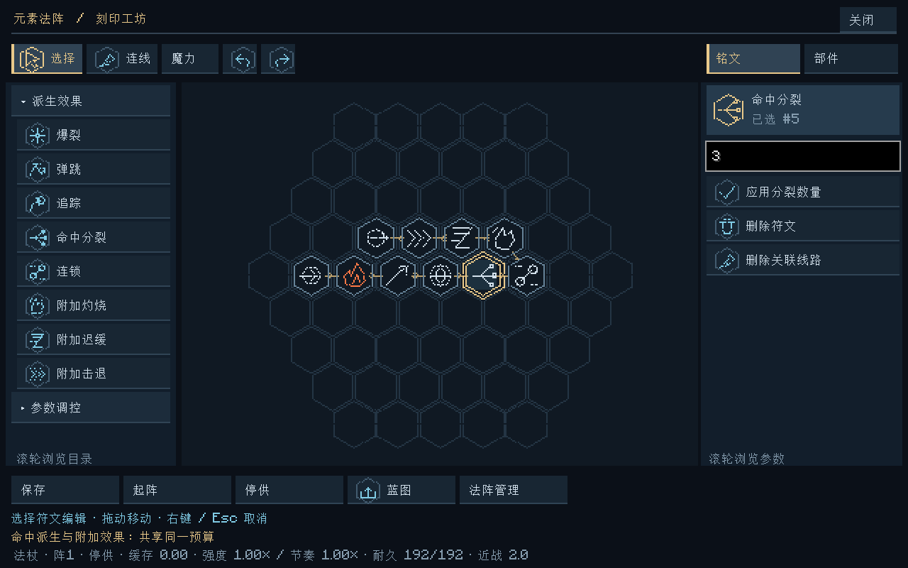
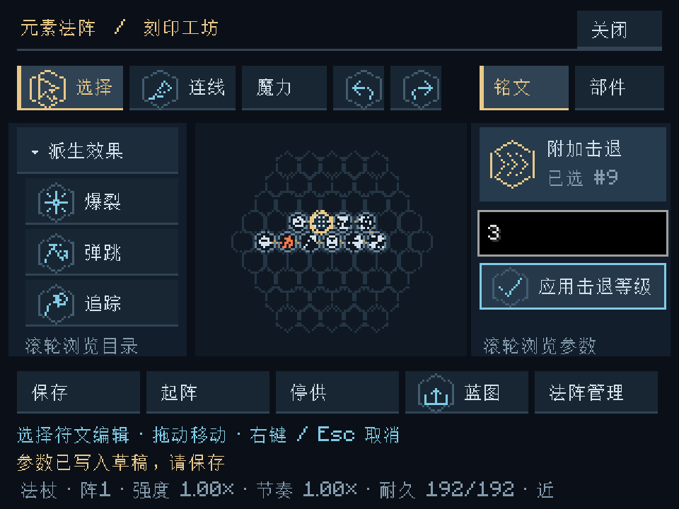

# 命中派生与附加效果 · v0.9.0

根据“投射行为、命中附加效果、二次派生三类都可以有”的选择，保留v0.8的爆裂、弹跳、追踪，新增命中分裂、连锁、附加灼烧、附加迟缓、附加击退。平台仍为Minecraft 1.20.1 / NeoForge 47.1.106 / Java 17。

编辑器中的独立“派生效果”父项统一收纳八种符文。它们都通过魔力线配置，分别属于以下三种用途，元素、形状和投送方式继续独立。

| 用途 | 符文 | 参数 |
|---|---|---|
| 投射行为 | 爆裂、弹跳、追踪 | 沿用 [v0.8规则](投射物派生效果.md) |
| 命中附加 | 附加灼烧、附加迟缓、附加击退 | 灼烧/迟缓1–5秒上限，默认2秒；击退1–4级，默认1级 |
| 二次派生 | 命中分裂、连锁 | 分裂2–4枚，默认3枚；连锁1–4跳，默认2跳 |

## 新增行为

**命中分裂**：投射物真正接触生物、物品或方块后，从接触点生成扇形子投射物。接触实体方块时向命中面外侧散开，其他接触沿原方向散开；默认展开角为左右各30°。子代共用分裂预留份额并均分各元素，转换后保留75%。只允许一代；子代不再分裂，也不获得新的连锁权限。

**连锁**：命中后选择6格内最近、可见、允许伤害且此前未直接命中的生物，发射一枚新的球状投射物。它真正飞到下一个目标后才再次触发；不会在一次函数调用内瞬间结算所有跳数。同距按UUID稳定排序。每次用剩余连锁份额继续，转换保留75%，剩余跳数递减；没有目标时该份额耗散，不返还为直接伤害。碰到方块后也可向其可见一侧的合法生物连锁，不能隔墙选中目标。

**附加灼烧 / 迟缓 / 击退**：它们是独立效果请求，不要求元素本身为火、水或风。例如雷投射物可通过灼烧符文点燃生物。迟缓为原版迟缓I，持续上限与实际支付量共同决定时长；击退每级对应0.25速度增量上限，最大1.0，另有四分之一比例的向上分量。这是Minecraft游戏作用规则，不宣称真实力学做功模型。

附加效果在本次元素响应后提交；因此玩家明确选择的附加灼烧不会被同次水元素的基础灭火悄悄取消。它们不削弱或替换既有元素的环境职责；点燃方块、水源、压暗与照明仍由原元素响应负责。生物火焰、药水时长和速度交由原版实体状态保存和推进。

## 同一份作用预算

一次接触先按启用的分支等份分配：直接命中始终占一份，允许的分裂和剩余连锁各占一份。因此只有分裂时是“直接1/2＋分裂1/2”；分裂与连锁同时启用时是各1/3。没有接触、只有射程结束时，不触发二次分支。

分裂/连锁预留份额再支付25%转换耗散；分裂的余量在所有子弹间逐成分均分。直接命中的份额如带附加效果，再分成“元素1/2＋附加1/2”，附加一侧在启用的灼烧、迟缓、击退间等分。默认每0.25点作用量可支付一秒状态或一级击退，实际时长/强度不能超过符文设置。多个接收生物继续均分各自预算，余数按稳定顺序分配。

例：3点作用量同时使用分裂和连锁，直接命中只有1点；分裂和连锁各获1点，转换后各剩0.75点。若还启用三种附加效果，直接命中的1点再分为0.5点元素与各约0.1667点附加份额。子弹不重新扣玩家槽，也不复制父法术的完整作用量。小预算可能只有很短的状态时间，这与输入框中的“上限”有意区分。

没有合法目标、转换后为空、世界弹道额度不足或路径最终未命中时，相应已分配份额耗散。其他分支不会因此领回它。关闭粒子、改变帧率或读取存档不会重新分配预算。

## 使用与示例

1. 左侧展开“派生效果”，选择新符文，用魔力线串在元素转换与输出之间；原投射行为可继续组合。分裂与连锁支持指向球状、指向光束；光束先结算首次接触，子代始终为球状投射物。范围施法与盾牌仍拒绝这组效果。
2. 选中符文，在右侧输入整数，点击相应的“应用分裂数量”“应用连锁跳数”“应用持续上限 / 秒”或“应用击退等级”。最后保存、关闭界面并手动起阵。输入错误只保留草稿，不修改服务器现场。
3. 未选中符文时，右侧滚动到“示例 / 命中派生”，载入十符文木质基板法阵：输入 → 火转换 → 指向 → 球状 → 分裂 → 连锁 → 灼烧 → 迟缓 → 击退 → 输出。可以删除某些效果并重新连线，单独比较各分支。
4. 同一配置也提供 [EC1文本码](examples/命中派生.ec1.txt) 和 [JSON蓝图](examples/命中派生.json)，从蓝图子页导入后保存即可。示例是普通单次法阵，没有额外供能；同时启用许多分支时，每项强度会较低。

## 世界步、范围与保存

- 球状命中后生成的子代进入下一世界步；光束子代先入专用队列，该边界只发布，之后才飞行。队列与在途都保存，读取不会提前执行。
- 子代最大飞行距离为父投射物剩余射程与6格中的较小值；离开接触面的偏移也扣除射程。不刷新法杖的完整射程，不重新发放弹跳次数或弹道照明预算；若父包已有追踪请求，子代可在之前已支付的请求下继续有限转向。
- 分裂只触发一代；分裂子代不继续连锁。连锁的续弹可以继续剩余跳数，但不能重新分裂。状态记录直接命中过的生物UUID，后续续弹/分裂子代的碰撞和作用跳过该名单。范围爆裂可能同时影响其他未记录对象，名单不代表曾受过范围擦伤的全世界对象。
- 所有子代与普通投射物共享每维度256枚上限。满额时只保留按顺序能放入的已分配子代，其余耗散；不会挤掉旧弹或将被拒份额转给其他弹。未加载区块冻结队列之外的飞行，不强加载世界。
- 真实法盾先吸收原预算，完全吸收后不产生分裂、连锁或附加效果；剩余量才参与接触。弹跳优先处理方块反射，反射那次不同时触发命中派生，最终真实接触才触发。
- 目标筛选沿用施法者排除、死亡/旁观排除、玩家PVP限制、已加载与遮挡检查。不会主动寻路绕墙；连锁飞行仍可能被新放置的方块截断。

世界法术现场升至v6，新投射物Effects=5。保存子代队列标记、分裂权限、剩余连锁跳数、直接命中名单与冻结的独立二次派生规则。旧v1–v5现场继续原Effects，初始化为无新二次派生，不重扣旧追踪预付或重发剩余次数。旧三字段effects包迁移为其余五项全零；若新字段部分存在、部分缺失则拒绝。

VM现场仍为v3，蓝图仍为EC1创建配置；新增的是不可变运输包效果请求。逻辑、图标、输入、派生预算、目标筛选和世界飞行继续分离。独立版本化JSON `data/elementalcircuits/rules/secondary_effects_v1.json`提供默认值、派生射程/寻敌范围、散开角、转换保留率与附加费用，每发保存冻结规则。网络协议升至6，客户端与服务器须同时更新。

正式玩家试玩、生存平衡、大规模弹群长期性能与复杂领地插件兼容尚未验收。

验证：65,756项核心断言、50项Minecraft世界测试、46张客户端截图与交互检查，以及原Godot工程23套回归全部通过。详情见 [验证记录](验证记录.md)。
