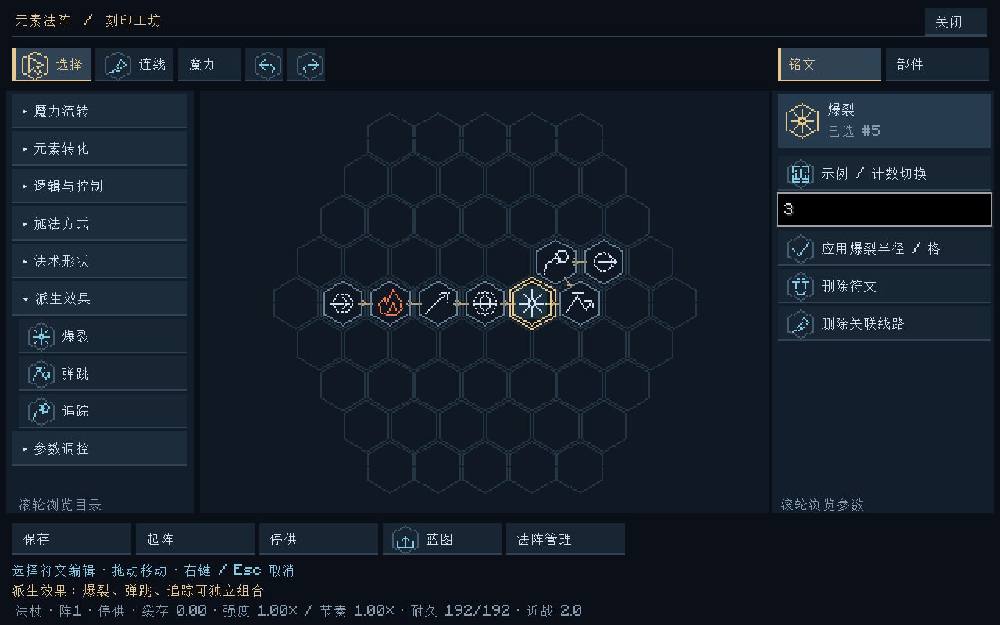
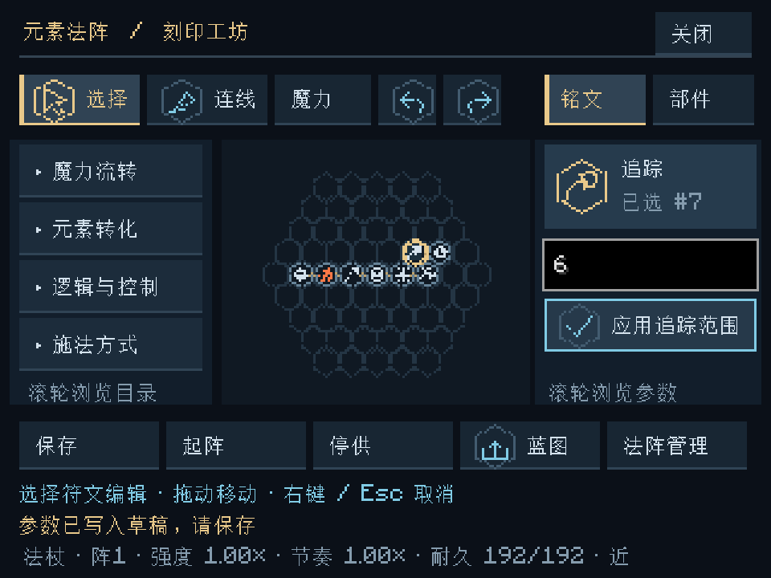

# 投射物派生效果 · v0.8.0

本文记录v0.8首批行为；v0.9新增 [命中分裂、连锁与附加效果](命中派生与附加效果.md)，更新条款以后者为准。

Minecraft 1.20.1 / NeoForge 47.1.106 / Java 17。新增独立的“派生效果”父类，首批提供爆裂、弹跳、追踪。它们与元素转化、施法方式、法术形状和数值参数分别配置，通过魔力线附在运输包上，支持跨法阵传输、蓝图导入导出及完整现场保存。

## 符文与组合

| 符文 | 参数与默认值 | 实际行为 |
|---|---|---|
| 爆裂（爆） | 整数半径1–4格，默认3 | 球状投射物或光束在命中/行程结束处释放球形元素作用，目标共享同一份预算。火可点火、水可造源、光暗可改变照明等原元素响应继续生效。 |
| 弹跳（弹） | 整数次数1–4，默认2 | 球状投射物碰到有实体碰撞形状的方块时按法线反射；每次耗散25%剩余作用量，消耗一次次数及已飞行射程。反射时不重复结算元素作用，次数用完后的接触正常结算。 |
| 追踪（追） | 整数搜索范围2–12格，默认8 | 球状投射物寻找前方可见生物，优先最近、同距按UUID；每世界步最多转向15°，仍做真实分段碰撞。发射时预付一半作用量，目标丢失后尝试重新选择。 |

三种效果可组合；相同参数重复连接幂等，不增加层数，不重复放大。相同效果的不同参数冲突时保留原输入，不覆盖。爆裂只指定命中作用半径，不调用原版破坏地形的爆炸；火焰、水等后续自然变化仍由Minecraft处理。

爆裂可用于指向光束或球状投射物，弹跳与追踪只用于球状投射物（未明确形状时沿用球状投射）。范围施法和盾牌不支持这组投射效果；不兼容输出保留缓存，需停供后改图。若同时显式设置“半径”和“爆裂半径”，二者须相同，否则拒绝输出，避免静默覆盖。

既有球状本来就有命中范围；爆裂让其范围成为明确的派生配置，并使原来只作用首次接触目标的光束能够在命中处释放范围效果。多个目标间均分预算，不先给主目标一份完整伤害再额外复制爆裂伤害。单独扩大爆裂范围不会增加总作用量，更多目标会分薄同一份份额；显式数值半径仍按原参数规则支付体积代价。

## 操作与示例

1. 左栏展开“派生效果”，选择符文，在法阵中使用魔力线串接，例如“输入 → 火转化 → 指向 → 球状 → 爆裂 → 弹跳 → 追踪 → 输出”。
2. 选中效果符文，右侧输入整数，点击对应的“应用爆裂半径 / 格”“应用弹跳次数”或“应用追踪范围 / 格”。然后保存，关闭界面并手动起阵。
3. 未选中符文时，右侧滚动找到“示例 / 派生投射”，可载入上述完整木质基板法阵。它是普通可编辑的单次配置，不赠送魔力；删除不需要的效果符文后重新连线，可单独比较每种行为。
4. 也可通过独立蓝图页导入 [EC1文本码](examples/派生投射.ec1.txt) 或 [JSON配置](examples/派生投射.json)。导入只改草稿，仍需保存。

选中、拖动虚影、落笔预览及原生工具指针共用各效果的独立矢量符形。界面只编辑副本与显示结果；命中、转向和预算由服务器结算，不依赖帧率或粒子显示。

## 飞行与世界边界

- 追踪排除施法者、旁观者、死亡生物和原版PVP规则禁止伤害的玩家；只自动获取前方目标，不选墙后目标、不做绕墙寻路。锁定对象失去视线或超出范围后失效，弹道继续运动或重新获取合法目标。实际元素作用继续使用既有友伤与目标过滤。
- 弹跳针对实体方块碰撞，不针对生物、普通流体或法术盾。正奥术仍按原规则穿方块，因此它穿过的方块不会触发反射；混合包分离奥术与其他成分后，各自拥有原来那份资源，效果请求保留。
- 射程按真实飞行距离扣除，反射离面偏移也扣射程；反射不会刷新射程或次数。每个服务器步最多处理一次反射，未使用的本步移动距离不另补算，避免同一步反射循环。
- 追踪预付后，再从剩余光成分预付照明；反射后只保留扣损后的作用包。法术盾优先吸收真实预算，完全吸收后不会再爆裂或弹跳。
- 命中与范围查询沿用现有已加载/遮挡/放置权限/可取消方块事件规则。未加载区域冻结弹道，不强加载区块、不推进剩余次数或离线时间。水、火等原版后续自然行为遵循原版世界规则。

## 数据与兼容

- `ProjectileEffects`是独立不可变请求，合并/冲突处理不依赖Minecraft；`ProjectilePayloads`负责预付与反射扣损。`SpellSpec`组合请求，现有VM负责运送和输出，未增加第二套法阵执行器。
- 图标目录与渲染继续分离；`ProjectileGuidance`仅负责服务器目标筛选与有限转向，`WorldSpells`拥有真实在途状态。
- 独立版本化JSON `data/elementalcircuits/rules/projectile_effects_v1.json`提供新符文默认值、反射保留率、追踪预付倍率及转向上限；符文参数冻结到蓝图，每发弹道保存完整规则，不依赖以后默认值变化。
- 世界法术现场从v4升为v5，保存剩余弹跳次数、锁定目标UUID及冻结规则。新弹道使用Effects=4；旧v1–v4保留旧Effects、强度、碰撞、位置、剩余射程和照明预算，明确初始化无派生效果，不重新扣预付成本。旧运输包缺少effects时迁移为NONE；字段损坏不作为旧数据放行。
- 蓝图仍为EC1配置，不保存飞行现场；VM快照保持v3，新增的是不可变包修饰。网络协议升为5，客户端与服务器需同时更新。

正式玩家试玩、复杂领地插件兼容、大型追踪弹群长期性能与跨平台体验尚未验收。

验证：52,257项核心断言、42项Minecraft世界测试、37张客户端截图与交互检查，以及原Godot工程23套回归均通过。详情见 [验证记录](验证记录.md)。
