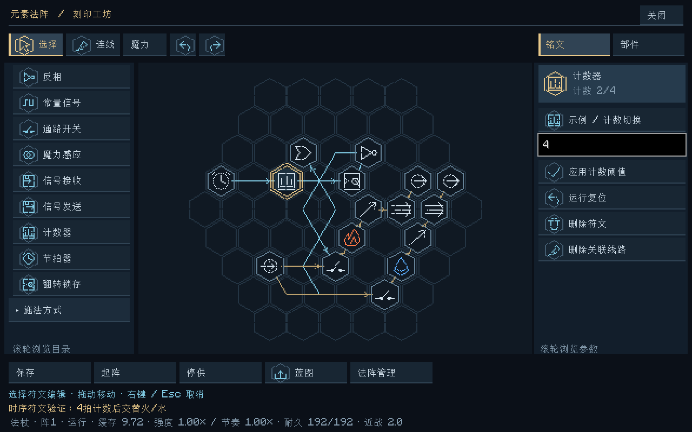
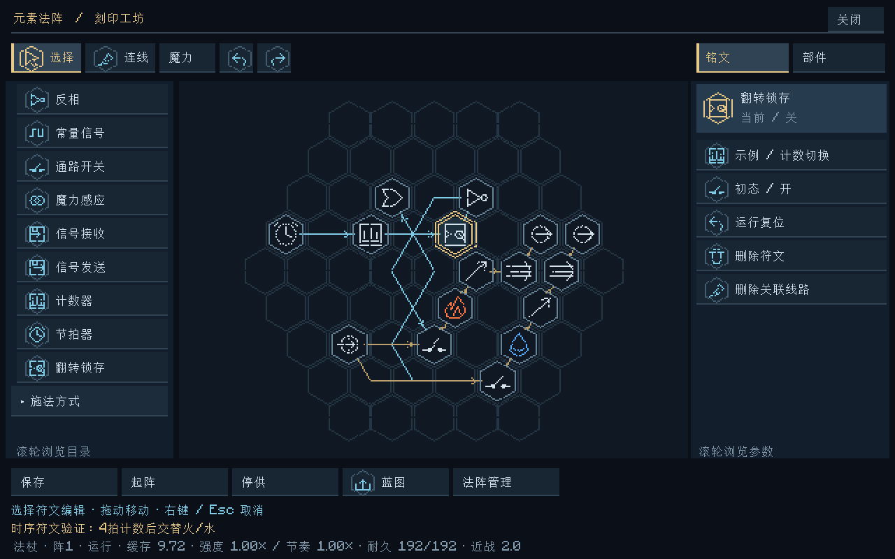

# 计数器与时序符文

已实现于 Minecraft 模组 **v0.7.0**，平台仍为 Minecraft 1.20.1 / NeoForge 47.1.106 / Java 17。本次加入计数器及两种辅助符文，沿用原法阵的有限魔力、固定逻辑步与明确连线。

| 符文 | 参数 | 行为 |
|---|---|---|
| 计数器（计） | 阈值N，整数1–1024，默认4 | 多条信号入线先取或，每次有效假→真计一次；到N时输出一个逻辑步的真脉冲并归零。持续高电平不重复计数。 |
| 节拍器（拍） | 周期T，整数2–1200逻辑步，默认20 | 无输入时自由计时；有输入时取或作为使能。每累计T个有效使能步输出一步真脉冲。假使能暂停相位；失效输入暂停相位并输出无效。 |
| 翻转锁存（存） | 配置初态，默认关 | 每次有效上升沿翻转存储位并持续输出。适合交替选择两路元素。 |

## 使用

1. 在左侧展开“逻辑控制”，选择对应符文落笔，使用信号线连接。三个符文均不接魔力线；计数器统计信号上升沿，不统计伤害次数或魔力数量。
2. 选中计数器或节拍器，在右侧输入整数，点击“应用计数阈值”或“应用周期 / 逻辑步”，再保存草稿。小数、越界值会被拒绝，原草稿保留。
3. 选中翻转锁存可配置初态。初态是蓝图配置，卡片中的“当前 / 开、关”是服务器运行状态，两者分别显示。
4. 起阵后，选中符文卡片会显示计数、相位或当前存储位。“运行复位”将计数/相位归零，锁存恢复配置初态；不改变参数或补充魔力。对尚未保存的符文须先保存才能操作服务器现场。

节拍的单位是**法阵逻辑步**。基础速度下20步约一秒；杖端速度会影响实际时间，不能将所有法杖的周期20都当作一秒。阈值1可作为上升沿单脉冲器，节拍最短周期2保证脉冲间存在低电平。

## 每四拍切换火/水

右侧点击“示例 / 计数切换”可载入16符文、16线路的木质基板草稿，保存后关闭界面并手动起阵。也可通过蓝图子页导入 [EC1文本码](examples/计数切换.ec1.txt) 或 [JSON配置](examples/计数切换.json)。载入示例会替换当前草稿；不会赠送魔力或自动启动。

控制链为“节拍器 → 计数器 → 翻转锁存”，默认每20个逻辑步一拍、每4拍翻转一次。锁存的正反信号经等长逻辑级数分别控制两路魔力通路开关，后面接火/水转化、指向、光束、输出。这样无需手工搭建多门触发器；改变计数阈值即可改变交替间隔。

相邻符文仍沿线在后续逻辑步采样，完整输出相对翻转有传播延迟。示例使用持续供给和真实控制成本；玩家槽耗尽会停阵，须等待恢复后手动重启。它验证的是两种元素轮流获得供给；先前已经放行的包不会被追回或删除。

## 运行、保存与边界

- 三者只处理信号，每个已供能逻辑步支付现有 `signal_cost` 控制成本。新符文不创造魔力；跨法阵仍使用明确收发接口、至少下一世界步送达。
- 无效输入与假信号不同。重新获得有效输入时，计数器和锁存先同步采样基线，避免失效期间的高电平形成伪上升沿；多线合并后只计一次。
- 停供或断供保留计数、相位及存储位，撤销有效信号输出，丢弃边沿采样基线。补能不自动起阵，也不补算离线时间。手动重启后继续；高电平时复位同样先同步基线。
- 停供后的配置替换创建新运行定义，时序状态重新初始化；保存世界/物品现场则保留完整控制态。运行中的参数修改仍被拒绝。
- VM现场升级为v3，保存计数、相位、存储位、上次输入和基线有效性。旧v1/v2现场显式初始化为空时序状态，已有运行数据保持；旧版本现场不能伪装携带新符文。
- 蓝图仍只保存创建配置，不含当前进度。默认参数为独立版本化JSON；修改默认值不改写已保存阈值。网络协议升级为4，客户端和服务器均需更新JAR。
- 领域状态及转换、只读观察、图标渲染和输入适配分别实现，客户端刷新不推进VM。

验证结果：50,587项核心断言、36项Minecraft GameTest、30张客户端截图与交互检查、原Godot工程23套回归全部通过，详情见 [验证记录](验证记录.md)。尚未做正式玩家试玩或大型网络长期性能验收。
