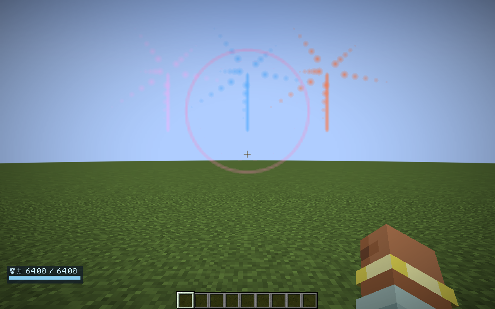
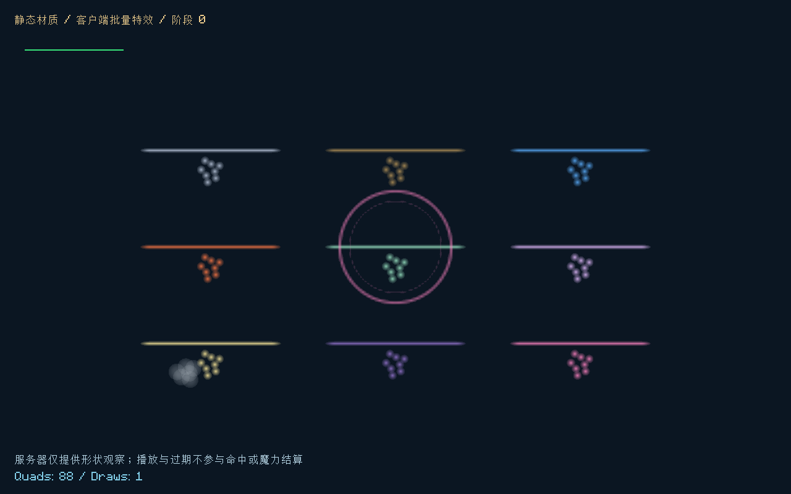

# 静态美术与批量特效

日期：2026-10-30。版本：v0.13.0。分支：`codex/static-art-and-batched-vfx`。

## 实现结果

现有符形、工具图标、六角边框移为静态矢量源和共享贴图；法杖预览复用已有部件组合贴图；光束、轨迹、屏障、命中和蒸汽改为服务器形状观察、按步批次发送和客户端共享材质绘制。运行时只做变换、着色、短期动画与提交，不重新生成 PNG 或逐线创建符形。

保留当前图案和物品／方块模型，不借本次性能工作更换整体美术风格。界面背景、选中反馈和动态线路仍由布局／状态驱动；这些不是需要烘焙成大尺寸整页截图的资源。实际命中、伤害、魔力、屏障容量／寿命和真实方块光照继续由服务器固定步决定。

## 静态资源

| 路径（`assets/elementalcircuits/` 下） | 内容与用途 |
|---|---|
| `art/glyphs.json` | 62个归一化符形：35种符文、9种元素、17种工具、1种六角边框；固定图集布局和笔画源 |
| `textures/gui/glyphs.png` | 512×512共享符形图集；每格64像素，6像素留白避免相邻格采样 |
| `textures/gui/wands.png` | 128×64法杖预览图集；复用原有27种杖端／杖身／杖尾组合 |
| `textures/effect/spells.png` | 256×64白色遮罩图集：亮点、烟雾、线段、屏障环；按元素着色 |
| `art/effects.json` | 每类特效的贴图格、视觉寿命、宽度、透明度和表现数量 |
| 原有 `models/`、`textures/item/`、`textures/block/` | 物品、方块和27种法杖组合已为静态资源，继续使用 |

`RuneShapes` 读取不可变静态线段供原生鼠标指针烘焙；GLFW句柄仍按符形／颜色／缩放缓存，退出或切页释放。界面图标通过 `GlyphAtlas` 每个符形提交一个纹理四边形，与指针共用同一份美术源，图案不再散落在 `switch` 绘图分支中。

动态线路也从逐像素 `fill` 改为每线段一个四边形；真实路线格子数和损耗仍使用领域路线，视觉顶点不参与规则。中途截图发现过一次四边形绕序导致线路被剔除，已修正，并新增真实帧缓冲像素回读；那一轮看不到线路的测量被废弃，没有作为最终优化数据。

制作／维护流程：

```powershell
# 离线美术工具需要本机 Python + Pillow，模组运行及Gradle构建不依赖它们。
python tools/bake-art.py
```

矢量和烘焙结果均随源代码保存；修改 `glyphs.json` 的形状或布局后重新运行工具并一起发布。普通 Gradle 构建直接打包已烘焙资源。重复运行烘焙的三个PNG哈希一致，证明输出可复现。图标布局、归一化笔画和容量在加载时检查；回归检查每个图集格均非空。

PNG走Minecraft原生纹理资源重载。`effects.json` 可由资源包覆盖，重载时先完整验证再一次替换，并清空旧播放状态；错误新样式不会部分应用。归一化符形源目前按启动时类路径读取，原生指针不会在F3+T后动态替换矢量；更换符形源需重启。资源包更换图集时须保持既定格位，避免图集和指针源不一致。

## 特效同步与绘制

1. 权威逻辑完成射线裁切、弹道推进或屏障结算，在服务器 `SpellVisuals` 收集表现观察。
2. 世界步结束时，按同维度玩家及距离筛选。光束／轨迹使用观察者到整条线段的距离，长光束不能只依赖中点。
3. `VisualNetwork.Batch` 一次发送多条形状，携带维度、世界步、类别、元素、端点／法线、视觉尺寸和强度；不传逐点粒子或网格顶点。
4. 客户端检查当前世界引用和维度，拒绝过旧批次，放入短期 `VisualTimeline`。
5. `SpellVisualRenderer` 在世界 `AFTER_PARTICLES` 阶段，用同一个纹理和着色器构造可见四边形，一次绘制提交。开启深度测试，关闭深度写入；屏障按实际法线定向，轨迹使用已完成的服务器线段。

新的表现类型映射：

| 表现 | 服务器观察 | 客户端处理 |
|---|---|---|
| 光束 | 实际裁切后两个端点 | 带柔边的线段，短期淡出 |
| 球状投射／派生投射 | 本步真实起点和终点 | 短轨迹，不预测下一次命中 |
| 屏障 | 位置、单位法线、半径 | 一张环形贴图，替代每步12个点 |
| 命中／吸收 | 位置、元素、表现强度 | 局部亮点，统一材质 |
| 火水蒸汽 | 实际反应位置 | 少量烟雾遮罩，客户端上浮淡出 |

这次移除了模组路径中的原版 `sendParticles` 广播。实际光源、压暗、弹道照明仍使用原来的 `WorldIllumination`／`PathIllumination`，没有用亮色贴图替代世界照明。特效材质满亮与方块照明是两个独立机制。

## 有界预算与生命周期

| 边界 | 上限／处理 |
|---|---|
| 每维度每世界步观察 | 1024条；超出只舍弃表现观察 |
| 每玩家每世界步 | 512条，按可见距离筛选；最多4批 |
| 每网络批次 | 128条；读取先校验数量，再创建记录 |
| 观察距离 | 64格；点／屏障考虑视觉半径，线段考虑整段 |
| 客户端活动观察 | 2048条；满载移除最早观察 |
| 每帧法术四边形 | 8192个；一个共享绘制批次 |
| 客户端远距绘制 | 80格外不提交 |
| 默认视觉寿命 | 光束／轨迹3步、命中6步、屏障2步、蒸汽10步；均为客户端表现逻辑步 |

以上预算不暂停或丢弃权威世界步。回归把视觉队列塞满，确认真实伤害与正常队列完全相同；有无视觉观察的两个弹道实例推进后完整NBT一致。客户端播放器没有伤害、碰撞、资源或权威对象接口。

客户端暂停时不推进表现寿命；未加载服务器对象仍遵循旧冻结规则。更换客户端世界引用、退出、资源重载会清空时间线；错误维度拒绝接收。批次世界步早于最近接收世界步20步以上时丢弃，避免积压旧观察重新播放；没有离线补播或把视觉写进世界存档。

## 验证与测量

核心与服务器验证：

- **88,188项核心断言通过**：原有时序／供能／互联／恢复全部保留，新增静态图集覆盖、线段观察筛选、预算分包、非法观察拒绝、本地寿命和视觉不反写VM。
- **78项服务器GameTest通过**：新增真实网络编码及越界拒绝、64格光束的一条观察、真实轨迹与屏障形状、视觉队列饱和后伤害及弹道现场一致。
- **Godot原工程23套隔离回归全过，失败0**，没有修改Godot运行代码或使用正式保存路径。

网络对照来自同一64格光束：旧版257条 `ClientboundLevelParticlesPacket` 的序列化载荷合计 **11,822字节**；新版单条形状批次的序列化载荷 **84字节**。消息数257→1，载荷约减少99.3%。这是编码层对照，未计Netty／压缩／TCP及自定义通道外封装，不代表整服总带宽下降99.3%。屏障每步12条逐点消息改为1条形状，并可与其他形状一起放入批次。

客户端回归包含完整61张编辑器／蓝图／法阵管理／时序／派生／书籍／工作台截图及交互检查，另有3张专门特效截图。特效GPU夹具测得：普通88四边形一次绘制，满载8192四边形一次绘制，过期0四边形／0绘制。夹具时间包含CPU构造、缓冲上传及GPU同步等待，不是纯GPU耗时，也不是实际战斗帧率。

最终完整界面日志 `build/static-visual-final.log`；服务器和长光束编码对照在 `build/static-release.log`；核心独立脚本 `build/static-core-final.log`；原工程 `build/static-godot.log`。先前 `build/static-full.log` 为首次完整通过，不包含之后的线路绕序修复。故意损坏世界法术测试仍产生已逐项确认的7条预期校验ERROR；其他错误不能据此忽略。

217格D触发器场景，1280×800、GUI2，相同原生指针和交互脚本；每阶段预热60帧，再取160个GPU同步样本。修复线路绕序后重新采样的最终结果如下（毫秒）：

| 交互 | 之前中位 | 之后中位 | 中位下降 | 之前P95 | 之后P95 |
|---|---:|---:|---:|---:|---:|
| 选择 | 4.4856 | 3.9021 | 13.0% | 6.0905 | 4.7671 |
| 落笔 | 4.3908 | 3.8979 | 11.2% | 5.4410 | 5.4484 |
| 布线 | 5.0058 | 3.4039 | 32.0% | 6.3646 | 4.7915 |
| 拖动 | 4.7179 | 3.8226 | 19.0% | 5.9799 | 4.8652 |

四个中位数改善，落笔P95基本持平，不能声称所有尾延迟下降。日志 `build/static-art-before.log` 和 `build/static-cursor-final.log`；原始样本汇总 `docs/metrics/static-art-before.json`、`static-art-after.json`。中间的未显示线路版本不用于此表。

特效夹具最终GPU同步绘制中位：普通88四边形0.6059ms、上限8192四边形3.2101ms、过期空时间线0.0248ms；相应P95为1.2695／4.5622／0.0496ms。它包括CPU构造、提交与同步等待，单次压力采样不代表整服帧率。

独立平坦世界另有两张截图和完整端到端验证：实际服务端发件箱经模组通道进入真实客户端，在 `AFTER_PARTICLES` 显示；连续40个客户端逻辑边界观察到绘制，错误维度批次不进入时间线，停止同步后过期，按原版断开连接／退出流程清空世界和特效。最终日志 `build/static-world-pass.log`，`VISUAL_WORLD_SMOKE_PASS` 通过，退出码0。测试目录为 `build/world-visual-smoke`，每次创建独立测试世界，未访问正式存档。测试首次因新客户端引导页等待，以及随后测试脚本遗漏原版disconnect步骤的两次未完成运行不算通过记录；修正了测试选项、合法模拟距离和退出步骤，最终运行无ERROR。

核心、服务器、完整UI、特效、世界烟测、最终指针采样和Godot回归均已完成，最终有效运行的退出码均为0。正式JAR元数据0.13.0，含静态源／图集及新观察／传输／渲染类，不含Contracts或Smoke测试类。

产物：`build/libs/elemental-circuits-1.20.1-0.13.0.jar`，**581629字节**。

SHA-256：`4abd673a1286ac7d91ff33bff5c4792dd558fcb92b16483423548f1210af477b`。

机器可读汇总：`docs/metrics/static-art-and-vfx.json`。两个仓库均处于本次独立任务分支，没有暂存、提交、合并、tag或推送。






## 当前验收边界

本次实现共享纹理、合批几何和有界事件传输，没有引入持久GPU实例化、完整GPU粒子模拟、着色器包适配或新美术风格。复杂透明叠层可能产生视觉叠色差异，超预算时会减少视觉密度。短期本机采样不能代替长期整服TPS／GC、多玩家带宽和各显卡／Fabulous／第三方着色器兼容验收。

模组版本0.13.0、网络协议10，两端需一起更新。VM v4、世界法术v7、程序集v1和其他玩法存储格式不变。
