# 构建与验证记录

> v0.10状态审查曾确认真实大NBT/物品网络丢失等缺陷，历史内存树往返不覆盖它们；v0.11已重构并增加字节级回归，现状见 [底层抽象与运行边界重构](底层抽象与运行边界重构.md)。

## 2026-10-30：v0.14.0 施法音效

- 分支 `codex/casting-audio`；没有暂存、提交、合并、tag 或推送。实现与使用见 [施法音效](施法音效.md)。
- 添加起阵、发射、命中和屏障展开四阶段声音；28个单声道24kHz静态OGG/Vorbis素材，总计168,015字节。原生声音系统处理24格空间衰减、玩家音量、字幕及声道回收；持续屏障不逐步重播。发送前按空间单元和世界步去重，每世界步64条、每玩家最近8条。
- 最终 `build runGameTestServer runClient -PaudioSmoke=true` 成功，退出码0：**88,526项核心断言、82项GameTest全部通过**。覆盖原生声音包往返、成功／拒绝起阵和停供、空元素输出、方块命中、过载不改变伤害与弹道保存。
- 隔离客户端真实Vorbis解码28个素材，经原生网络收到并播放28个事件，确认位置声音／玩家分类／非循环、467次活动声道采样及结束回收；批次特效实际世界接收335帧，维度拒绝、过期与退出继续通过。日志 `build/audio-boundary-final.log`。收尾修复步末命令观察被下一步新观察覆盖的问题，并验证重复排空不重置接收预算。
- 原Godot统一隔离回归23套全部通过，失败0，日志 `build/audio-godot.log`。GameTest的7条故意损坏存档校验ERROR与既有坏输入对应；Godot保留已识别的Windows证书日志，无新增非预期ERROR。首轮方块命中用例误用穿墙奥术，修正为土元素后通过，失败运行不计入结果。
- 模组0.14.0，网络协议10及既有玩法保存版本保持；两端一起更新声音事件和资源。正式包已核对28个OGG、声音声明与版本，不含测试类。仅使用测试目录，正式玩家存档未参与。首期合成音色的正式听感混音、多人带宽及长期性能仍未验收。
- 产物 `build/libs/elemental-circuits-1.20.1-0.14.0.jar`，752295字节；SHA-256：`78dc96fed42c4129a59564ec63728fd214d4b441d56d3e496f5a9f11cdf8be19`。机器汇总 `docs/metrics/casting-audio.json`，素材解码与峰值 `docs/metrics/casting-audio-assets.json`。

## 2026-10-30：v0.13.0 静态美术与批量特效

- 分支 `codex/static-art-and-batched-vfx`；没有暂存、提交、合并或推送。资源清单、传输与绘制边界、性能对照及制作流程见 [静态美术与批量特效](静态美术与批量特效.md)。
- 62个符形／工具／六角边框共享静态图集，法杖预览复用27种组合；光束、轨迹、屏障、命中和蒸汽以有界形状批次同步，客户端共享材质一次绘制，不参与玩法结算。
- **88,188项核心断言、78项GameTest、23套Godot隔离回归全部通过**。完整UI61张截图及交互、3张特效截图、2张实际世界截图、4张最终指针／交互性能截图完成；实际世界通道、渲染阶段、维度拒绝、过期和退出清理验证通过。
- 首轮图集后进一步将动态线段改为四边形，截图发现绕序问题，已修复并增加帧缓冲像素回读；未显示线路的性能数据已废弃。最终217格四阶段中位绘制从4.39–5.01ms降到3.40–3.90ms，中位改善11.2%–32.0%；落笔P95基本持平。64格光束编码对照从257消息／11,822字节载荷降为1消息／84字节，不含传输外封装。特效夹具8192四边形一次绘制，过期0绘制。
- 最终UI `build/static-visual-final.log`；服务器／网络对照 `build/static-release.log`；实际世界 `build/static-world-pass.log`；最终GPU采样 `build/static-cursor-final.log`；核心脚本 `build/static-core-final.log`；原工程 `build/static-godot.log`，均退出码0。世界烟测的初次引导页等待及脚本退出问题已修正，早期未完成运行不算通过。GameTest保留7条故意损坏法术现场的预期校验ERROR；Godot保留已识别证书日志，无其他新增错误。
- 模组0.13.0、网络协议10；VM v4、世界法术v7、程序集v1等玩法保存格式保持。新资源烘焙可复现，正式包不含测试类；未执行长期整服TPS、多人带宽和完整着色器兼容验收。
- 产物 `build/libs/elemental-circuits-1.20.1-0.13.0.jar`，581629字节；SHA-256：`4abd673a1286ac7d91ff33bff5c4792dd558fcb92b16483423548f1210af477b`。机器汇总 `docs/metrics/static-art-and-vfx.json`。

## 2026-10-29：v0.12.0 状态机审查与稳定性修复

- 分支 `codex/minecraft-state-machines`，没有暂存、提交、合并、tag 或推送。转换规则、复现、版本迁移和剩余建议见 [状态机审查与稳定性修复](状态机审查与稳定性修复.md)。
- 完整客户端组合 `build runGameTestServer runClient -PeditorSmoke=true` 成功，覆盖 **61张本轮截图及交互检查**，新增 `EDITOR_REQUEST_STATE_SMOKE_PASS` 验证真实刻印界面的旧刷新失效、操作完成、超时和迟到回复。日志 `build/states-final.log`（当时88,096项核心断言、74项GameTest）。
- 收尾加强重复身份停止现场提交、固定载体放置失败原子拒绝后，最终 `build runGameTestServer` 成功：**88,097项核心断言、74项GameTest全部通过**，日志 `build/states-release.log`。客户端代码没有再改变。核心包含4,320次确定种子的起停、阀门/逻辑复位、重配、推进及保存恢复组合。
- 新增七项GameTest覆盖真实物品转交、非法世界状态原文保留、非法显化出生、卸载冻结不写回、冻结屏障碰撞隔离、实际网络令牌编解码、固定载体元数据与放置。故意损坏世界法术的测试产生7条预期校验ERROR，与七个坏输入对应；没有其他ERROR。
- 原Godot统一隔离回归 **23套全部通过，失败0**，日志 `build/states-godot.log`，保留已识别的Windows证书日志。两个Gradle运行和Godot运行退出码均为0，仅使用测试目录，不访问正式玩家存档。
- 模组0.12.0、网络协议9、VM快照v4、世界法术v7；合法历史现场可读取，坏数据保持原文并停用。其他创建/存储协议保持。长期整服性能和正式试玩仍未验收。
- 最终JAR `build/libs/elemental-circuits-1.20.1-0.12.0.jar`，527720字节；SHA-256：`43559129b881801d67b8f21ca431654e86d91d54e5db399bbc2df8595e8e649a`。已检查元数据和正式包不包含测试类。机器摘要 `docs/metrics/state-machines.json`。

## 2026-10-29：v0.11.0 底层抽象与运行边界重构

- 分支 `codex/minecraft-runtime-boundaries`；没有暂存、提交、合并或推送。现行职责与状态所有权见 [架构说明](../ARCHITECTURE.md)，审查/迁移/性能对照见 [重构报告](底层抽象与运行边界重构.md)。
- 最终 `build runGameTestServer runClient -PeditorSmoke=true` 成功，退出码0：**74,252项核心断言、67项服务器GameTest、61张真实客户端截图与交互检查全部通过**。原Godot隔离回归23套全部通过。
- 新增纯调度因果/故障隔离/重复身份测试、依赖边界自动检查和变更标记测试；真实NBT压缩字节与物品网络验证合法大卷册/多槽法阵，覆盖旧数据迁移、非法UTF-8/格式/根类型/缺身份拒绝、待机无写回、离线固定设备、权限及销毁端点的守恒清理。
- 稳定施法测试显式配置零散布精度，保留玩法默认散布。网络协议8，存储封装Format1、世界互联v2，内层现有JSON协议不变。
- 最终日志 `build/refactor-final.log`，无ERROR；Godot日志 `build/refactor-godot.log`，保留已识别的Windows证书日志。仅使用测试目录/世界，不访问正式玩家存档。
- 产物 `build/libs/elemental-circuits-1.20.1-0.11.0.jar`，520862字节。SHA-256：`360fedeff15b8f5edbcbd137e0ff19d644266444d7d686fdcf478b5cc31f271b`。仍未完成长期整服TPS/GC、多人带宽及正式生存体验验收，粒子批处理留待后续。

## 2026-10-29：v0.10.0 独立工作台、蓝图簿与法术书

分支：`codex/minecraft-workbench-books`。独立Minecraft子仓库和工作区使用同名任务分支；没有暂存、提交、合并、tag或推送。操作、配方和保存契约见 [工作台与书籍](工作台与书籍.md)。

- 最终构建 `build runGameTestServer runClient -PbookSmoke=true` 成功、退出码0，日志 `build/books-targeted-final.log`。**73,950项核心断言、59项GameTest、15张书籍专项真实客户端截图及交互检查全部通过**。独立核心脚本 `build/books-core.log` 同样通过。相比v0.9增加8,194项核心断言与9项世界测试。
- 此前完整 `build runGameTestServer runClient -PeditorSmoke=true` 已通过73,950项核心、59项世界测试及61张截图（原46张＋新增15张），日志 `build/books-final.log`。目视后补充“打开蓝图簿自动滚入当前选页”、将实体簿的网络文本码长度与现有EC1上限统一；最终再次构建并运行全部核心/世界测试及15项书籍专项，保留旧46项通过记录，无无关运行改动。
- 新核心覆盖空簿、16页容量、不可变配置、稳定且不复用的页编号、选页/命名/删除、异常名称/重复编号/小数/深层与超长JSON拒绝、EC1往返、观察副本、法术书切页不推进或重置逻辑态和账本、完整程序集保存、工作台库存快照和多分辨率61/127/217格只读预览边界。
- 新GameTest覆盖三种生存配方与不可堆叠书籍；空书独立身份、无额外魔力；副手书刻印及新增/更换基板真实消费并回收、不改变主手杖法阵；书中光束实际命中、魔力只扣一次且磨损落在主手杖；换杖保留书法阵；快速切页保留计数和运行现场、伪造身份/迟到请求拒绝；换手排队任务停供冻结、损坏杖不能启动或继续书法阵；实体簿改名/保存/删除和非法文本原子拒绝、库存所有权及NBT恢复；独立工作台安装/修缮、旧编辑器修缮请求拒绝、距离/拆台/活动副手书保护；损坏书保留原始NBT。
- 客户端专项检查独立工作台三部位切换及强度/速度/耐久预览；蓝图簿16页目录滚动、当前页初始可见、复制选页EC1、载入当前草稿并正确返回、空卷与独立文本导入页；法术书四槽预览和服务器选择/起停状态回传。检查1280×800/GUI2与960×720/GUI3，全部控件在边界内，目视无覆盖；格盘和部件绘制由独立渲染器消费观察数据。
- 首轮服务端59项全部通过；首次扩展视觉驱动在创建合成父刻印页时没有先初始化，调用其tick导致空引用。只修正测试驱动初始化流程，完整61项随后通过，未放松实际交互或布局断言。保留初轮日志 `build/books-release.log`。
- 原Godot统一隔离回归 **23套全部通过、失败0**，日志 `build/godot-books.log`。保留既有Windows根证书日志与负例资源校验输出；统一入口退出码0，未修改Godot运行代码，未使用正式存档测试。
- 最终Minecraft组合日志无ERROR，保留平台资源、音频和弃用WARN。JAR元数据0.10.0，包含三种新物品/方块的模型、像素纹理、配方和中文资源，确认不包含Contracts/Smoke测试驱动。网络协议7要求两端同时更新；原程序集v1/VMv3/世界法术v6保持兼容，新增蓝图簿v1。

产物：`build/libs/elemental-circuits-1.20.1-0.10.0.jar`，496590字节。SHA-256：

```text
3b609392aca7520f8917d716d03c488f84590138c5f03be934c22a849e651fdf
```

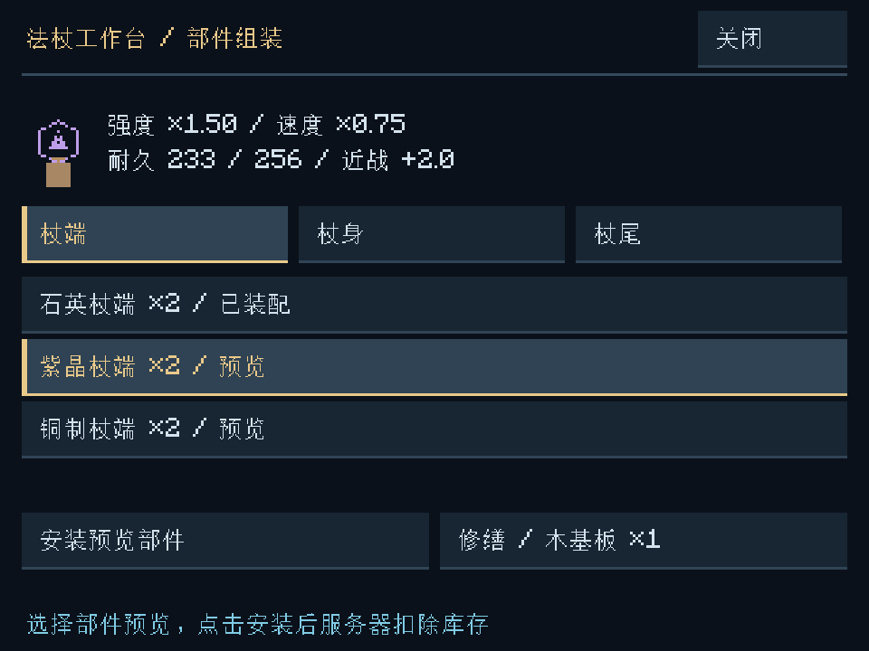

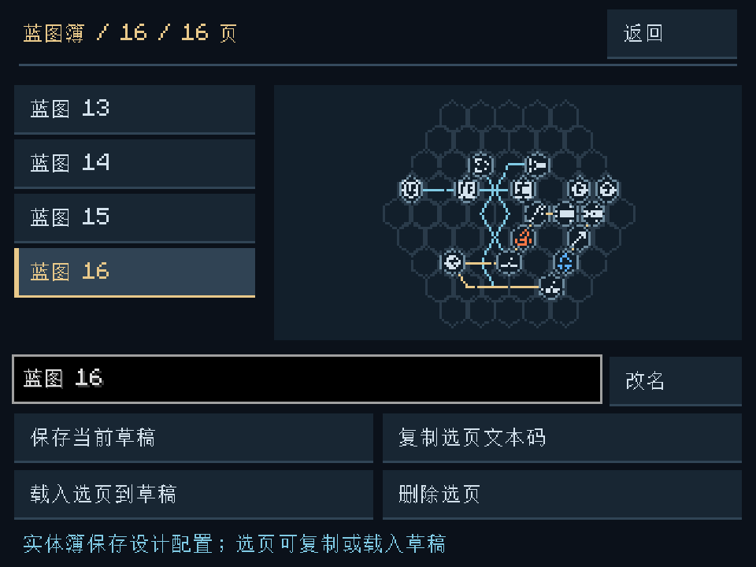

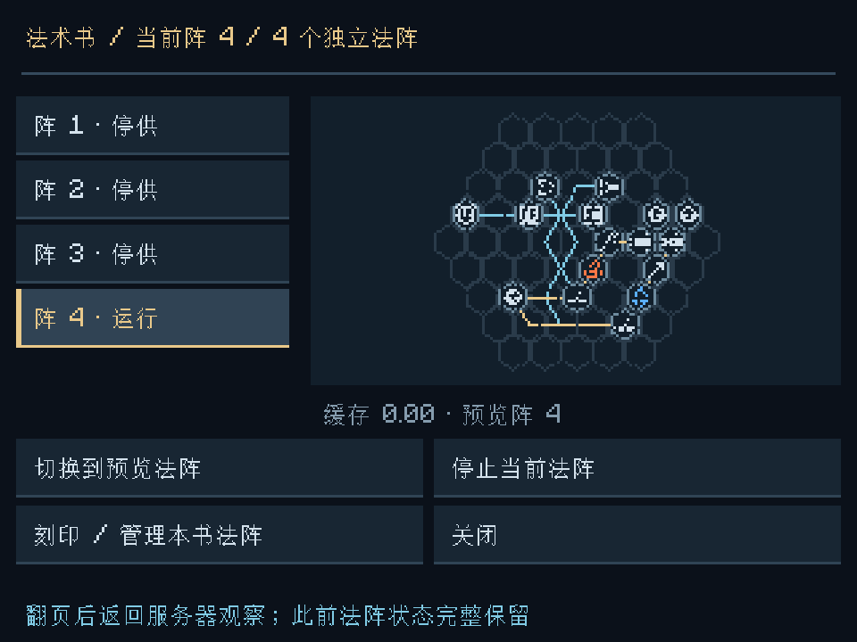

验收边界：未做正式玩家试玩、生存数值平衡、多人权限插件兼容或长期性能测试。翻页只修改所选目标，不自动起停其他槽位；移出副手/主手失去法杖后书停供冻结，重新装备须手动起阵。书内支持既有互联，未增加移动载体间的跨对象外部网络。新书不会赠送高级示例或额外魔力。

---

## 2026-10-29：v0.9.0 命中二次派生与独立附加效果

分支：`codex/minecraft-secondary-spells`。实现规则与示例见 [命中派生与附加效果](命中派生与附加效果.md)。

- 最终 `build runGameTestServer runClient -PeditorSmoke=true` 成功，退出码0，日志 `build/secondary-release.log`。**65,756项核心断言、50项GameTest、46张真实客户端截图与交互检查全部通过**。相比v0.8新增13,499项核心断言、8项世界测试及9张新符文截图；独立 `tools/test-core.ps1` 同样通过。
- 核心覆盖五种新符文的端口/目录/符形/创建默认值、上下界及小数拒绝、同值幂等与异值冲突、完整包和旧三字段效果迁移、部分新字段损坏拒绝、命中名单不可变/去重与权限验证。300组17成分随机包在四种分裂/连锁组合下验证各分支和三种状态逐成分守恒、时长/击退上限和零资源不产生效果。
- 普通十符文示例在每个VM边界恢复并比较后续轨迹与严格账本，蓝图EC1往返、跨阵分裂/连锁/灼烧请求传输通过。新增预算与规则不依赖Minecraft，也不在渲染层执行；世界只接收已交付份额。
- 新GameTest验证真实命中生成3枚后续步子弹、直接2点/子代总1.5点的实际支付、仅一代/排除原目标和恢复后同轨迹；连锁到不同目标、剩余次数与名单保存、墙后不选目标、无目标预留耗散；非火元素附加灼烧/迟缓/击退的精确时长/速度和基础伤害下降、实体NBT保存；光束生成二次弹且专用队列该边界只发布不移动、队列恢复不提前执行；256上限与法盾全吸收不再派生；无接触射程耗尽不触发子代；旧v5迁移以及卸载冻结不强加载。
- 首轮编译通过；图标边界测试发现分裂最右圆环超出统一预览边界0.03，已缩回范围，保留原断言。第一次世界测试50项全过后，审查补齐了光束子代的独立排队边界与保存，并扩展原世界断言；最终50项再次全部通过。日志 `build/secondary-tests.log` 为此前检查，最终以 `secondary-release.log` 为准。
- 新增客户端截图覆盖命中分裂、连锁、灼烧、迟缓、击退的实际参数按钮、独立八符文父项、紧凑窗口越界5拒绝/合法3写入、分裂落笔虚影及原生指针。原37张保留编辑器、蓝图剪贴板、四槽互联、基板、计数时序及v0.8三效果回归。检查1280×800/GUI2与960×720/GUI3，目视确认文字与按钮无覆盖。正式JAR不含测试驱动。
- 原Godot工程统一隔离回归 **23套全部通过、失败0**，退出码0，日志 `build/godot-secondary.log`。保留此前已识别的Windows证书读取日志；未修改Godot运行代码或用正式存档测试。
- 最终Minecraft组合日志无ERROR，保留历史平台资源/音频/弃用WARN。JAR元数据为0.9.0，含新预算/派生状态、世界适配与版本化JSON，确认无Contracts/Smoke测试类。世界法术v6显式兼容v1–v5；网络协议6，需两端更新。

产物：`build/libs/elemental-circuits-1.20.1-0.9.0.jar`，423930字节。SHA-256：

```text
a2af4d9419aeb441b85f1f2ab3d4c4b222a3f61d6cae59b2e62bc8995728a116
```

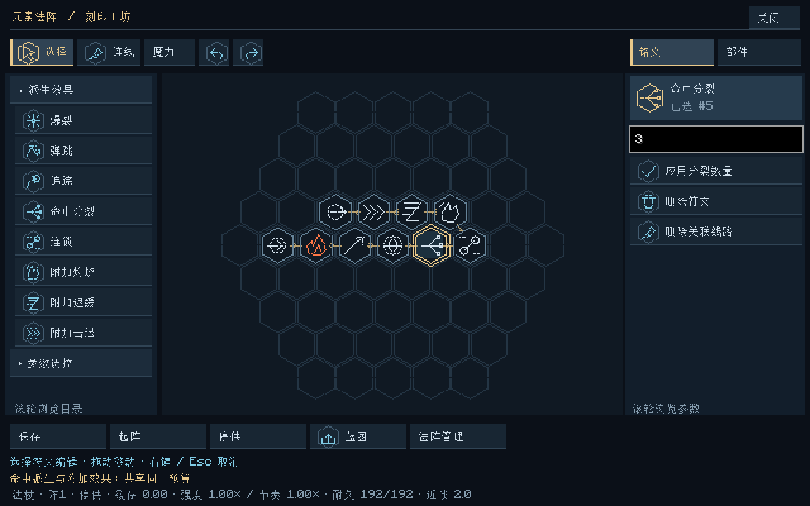

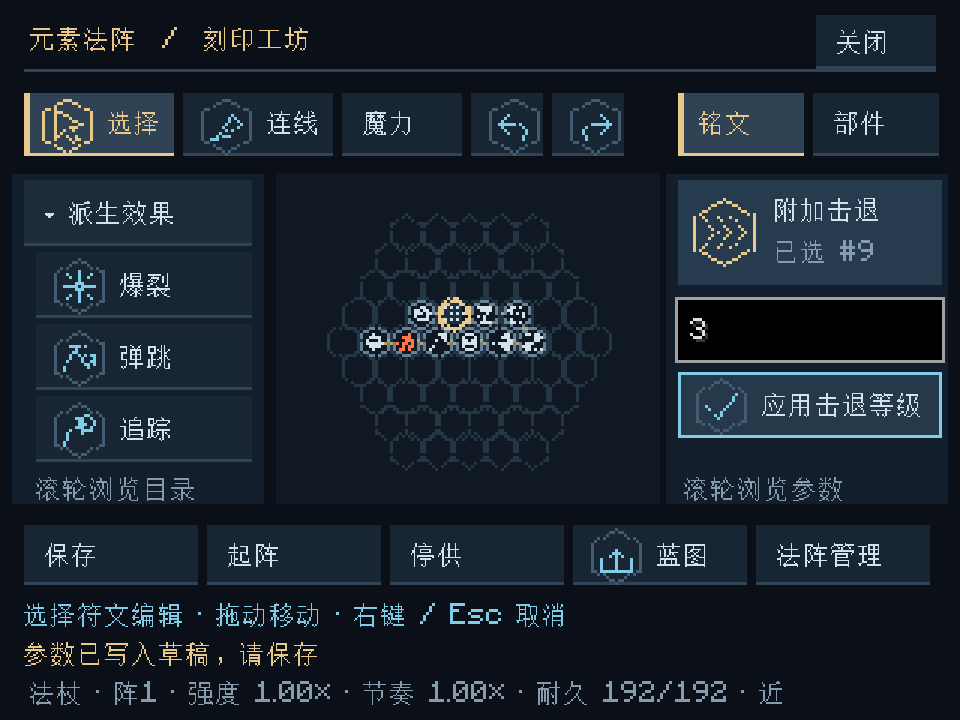

验收边界：未做正式玩家试玩、生存平衡、大规模弹群长期性能或复杂领地插件兼容。只允许一代分裂，连锁名单记录直接接触目标；范围擦伤不加入该名单。满额/无目标/小预算的派生份额耗散，不复制或返还。没有暂存、提交、合并、打tag或推送。

---

## 2026-10-29：v0.8.0 独立投射物派生效果

分支：`codex/minecraft-projectile-effects`。规则、兼容矩阵及可导入示例见 [投射物派生效果](投射物派生效果.md)。

- 最终 `build runGameTestServer runClient -PeditorSmoke=true` 成功，日志 `build/projectile-release.log`。**52,257项核心断言、42项GameTest、37张真实客户端截图及交互检查全部通过**。相比v0.7新增1,670项核心断言、6项世界测试及7张派生效果截图；独立核心脚本同样通过。
- 核心覆盖独立目录/符形/默认值注入、整数与上下界、效果组合/同值幂等/异值冲突、方式与形状兼容、旧包缺字段显式迁移/损坏字段拒绝、实际落笔、蓝图文本码往返、每个边界恢复后的VM轨迹与严格账本、跨法阵修饰传输。240组随机17成分包验证追踪预付、最多4次反射扣损及奥术分包不复制资源。
- 新GameTest覆盖碰撞法线反射、次数/预算/已飞行射程扣除及NBT恢复后同轨迹；前方/遮挡目标选择与15°转向限制；恢复后实际命中偏离直线的生物；光束爆裂同时伤害两目标且总伤害只对应原预算；两点水爆裂初始仅创造两个原版水源；旧v4弹道迁移不赋予新效果，以及卸载冻结且不强加载。
- 首轮 `build/projectile-tests.log` 有2项失败：旧迁移断言仍要求输出世界v4，现已随新增字段更新为v5，保留旧Effects=1和原强度断言；反射测试假定射线端点恰停方块面时已报告接触，现改为在最多4步内等待实际接触，并继续严格断言反射方向、一次扣损和真实距离。运行反射代码未因此放松或绕过碰撞。最终42项全过。
- 客户端流程新增爆裂/弹跳/追踪符形、独立折叠父项与参数、紧凑窗口、越界13被拒绝/合法6写入草稿、原生指针及虚化落笔预览。原30张继续覆盖元素、布线、蓝图剪贴板、四槽/互联/基板和计数时序符文。检查1280×800/GUI2与960×720/GUI3实际窗口，目视无文字覆盖或按钮裁切；截图驱动不进入正式JAR。
- 原Godot工程统一隔离回归 **23套全部通过、失败0**，日志 `build/godot-projectiles.log`；保留已识别的Windows根证书读取日志。未修改Godot运行代码，未使用正式存档测试。
- 最终Minecraft组合日志无ERROR，保留历史平台资源/音频/弃用WARN。JAR文件名和元数据0.8.0，含派生领域模型、目标筛选/转向适配器及独立规则JSON，确认无Contracts/Smoke测试类。网络协议5要求两端同时更新；世界法术v5显式兼容旧v1–v4。

产物：`build/libs/elemental-circuits-1.20.1-0.8.0.jar`，399136字节。SHA-256：

```text
5d6ea44d9673bbbf6bb3857c4f84a72477d83895dc1ecf09731e4cdea513f132
```

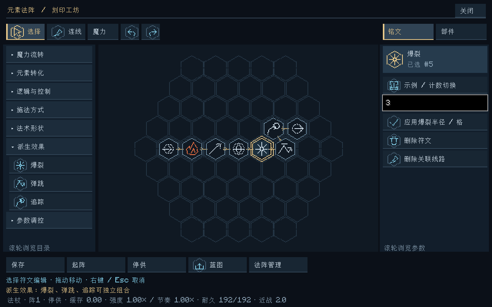

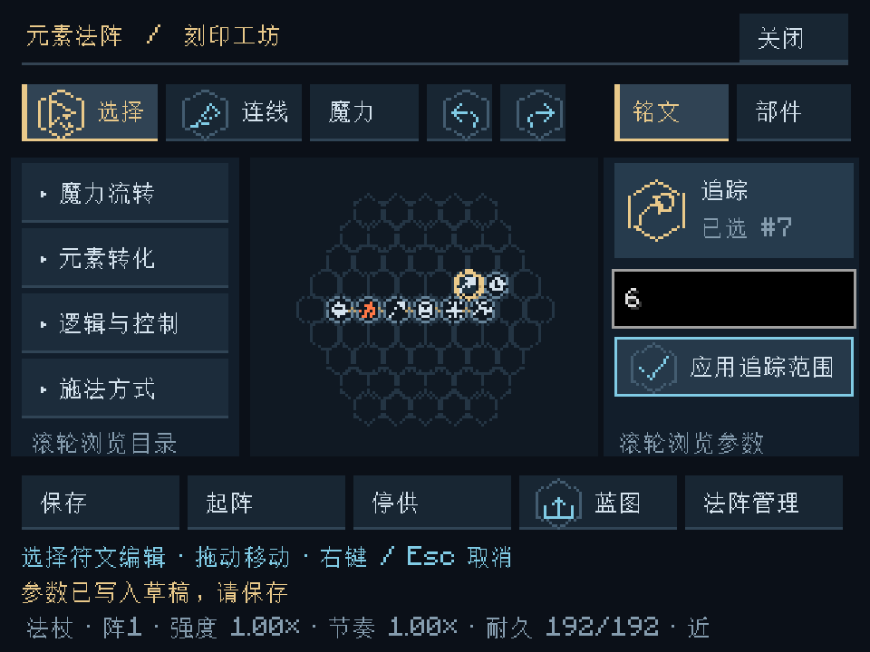

边界：爆裂共享原作用预算，不执行原版地形爆炸；追踪不自动绕墙，弹跳不重置射程；没有正式玩家试玩、复杂领地插件兼容或大规模追踪弹群长期性能验收。本次没有暂存、提交、合并、打tag或推送。

---

## 2026-10-29：v0.7.0 计数器、节拍器与翻转锁存

分支：`codex/minecraft-counter-logic`。规则、使用及可导入示例见 [计数器与时序符文](计数器与时序符文.md)。

- 最终 `build runGameTestServer runClient -PeditorSmoke=true` 完整成功，日志 `build/logic-release.log`。**50,587项核心断言、36项GameTest、30张真实客户端截图及交互检查全部通过**；相比v0.6新增1,342项核心断言及3项世界测试。独立 `tools/test-core.ps1` 同样通过。
- 核心覆盖持续高电平不重复计数、多入线取或、阈值回绕、节拍使能/暂停、翻转初态、失效/恢复及停止/重启不造伪边沿、高电平复位、真实控制成本、非法整数参数与损坏现场拒绝。400步随机有效性/输入序列在每个边界JSON往返恢复并比较后续结果；旧v1/v2现场迁移有明确分支。
- 16符文火/水切换示例推进330步，验证4次翻转、两种元素实际输出、完整魔力账本及中途恢复同轨迹，生成JSON与EC1配置。既有快杖、多子步/跨阵因果等回归继续通过。
- 新GameTest覆盖固定法阵43步后的计数/相位、精确控制扣费与方块NBT恢复；真实法杖现场、服务器复位动作和非法参数拒绝；两个固定方块通过延迟网络驱动计数与锁存、源端停供后的无效输出和目的端状态保持。
- 客户端新增8张截图覆盖三种符形、实时进度、初态与当前位分离、原生指针/落笔虚影、紧凑窗口整数输入。实际点击验证小数3.5被拒绝而整数3写入草稿；调整右栏间距，使960×720/GUI3下输入框及应用按钮同时可操作。其余22张继续覆盖原编辑器、蓝图剪贴板、基板及多法阵管理。目视检查新截图文字与按钮无覆盖，测试驱动不进入正式JAR。
- 原Godot工程统一隔离回归 **23套全部通过、失败0**；日志 `build/godot-logic.log`。未修改原Godot运行代码，正式存档未用于测试。
- 最终日志无ERROR，保留平台历史资源/音频/弃用WARN。JAR元数据为0.7.0，包含新领域类及独立逻辑默认值JSON，确认不含Contracts/Smoke测试类。客户端与服务器须一起升级到网络协议4。

产物：`build/libs/elemental-circuits-1.20.1-0.7.0.jar`，382711字节。SHA-256：

```text
80773ace78023f13f685be11daa8ffb7e4100aa437cb6ab2dba2e64df4f598ec
```

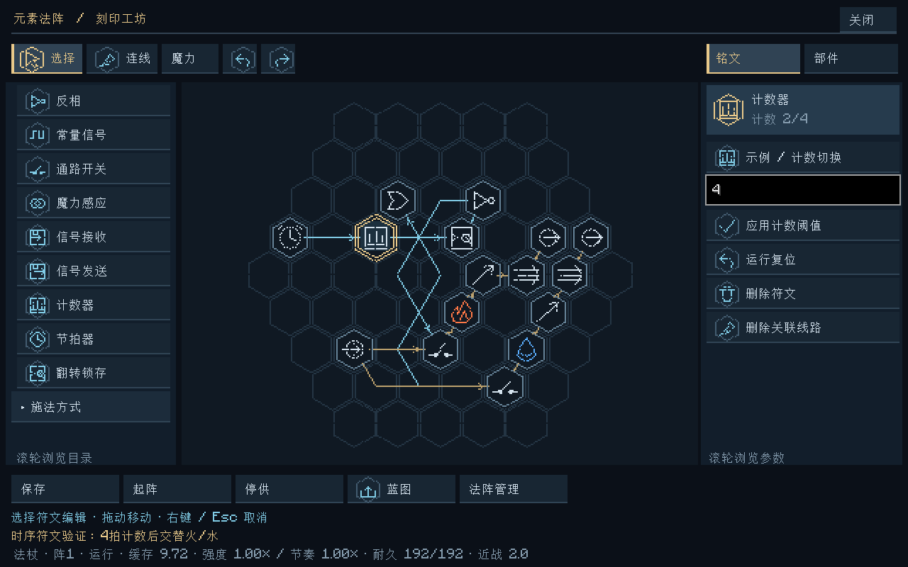

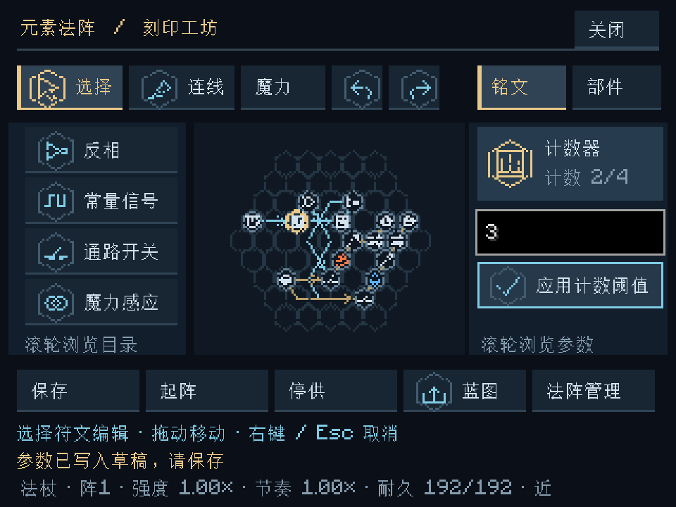

验收边界：未做正式玩家试玩、跨平台/DPI和大型网络长期性能验收。时序单位为法阵逻辑步，实际秒数受杖端速度影响；断供冻结控制态且须手动重启。本次没有暂存、提交、合并、打tag或推送。

---

## 2026-10-29：v0.6.0 基板安装、多法阵互联与固定方块

分支：`codex/minecraft-circuit-assemblies`。使用及边界见 [多法阵与固定法阵](多法阵与固定法阵.md)。

- 基板原问题：旧按钮每次仅轮换到下一档，背包缺黄铜时无法直接用已有水晶。改成独立安装页，明确选择目标，库存消费、旧板回收和草稿应用一起校验；原子拒绝缺板/超规格/运行中/仍被互联引用。
- `build runGameTestServer runClient -PeditorSmoke=true`完整通过、退出码0；日志`build/assembly-final.log`。**49,245项核心断言、33项GameTest、22张真实客户端截图**。新增5项GameTest覆盖真实材料安装、明确槽位请求、旧物品迁移、世界调度共享供给、固定方块配方/充能/所有权、NBT与掉落重放、在途保存与卸载等待、锚点拆除保护、朝向真实发射。
- 核心新增475项断言（同版本先前48,770项），覆盖四槽上限/独立基板/闲置时钟、快杖两子步的一世界步因果、元素与法术修饰跨阵传输、多路分流守恒、背压/未起阵等待、停供不丢包、保存后相同轨迹、输出额度原子拒绝、坏账本拒绝。信号有效性与真假分离，验证非门不会把失效输入变成伪真。
- 最后追加固定方块收支严格校验及损坏NBT原样保留，再执行`build runGameTestServer`通过、退出码0；日志`build/assembly-storage.log`。核心49,245项、33项GameTest再次通过，包括新增的方块伪造储量和非法载体保留断言。此后只更新文档/复制截图，未再修改运行代码。
- 有渲染验证覆盖宽屏与960×720窗口/GUI缩放3（320×240 GUI），查看四槽/起停/充能行、互联端点及在途量、三种基板、滚轮和上下按钮、返回路径。测试原先错误地将未保存草稿作为“服务器新配置”返回，已改为返回原服务器定义；真实草稿保留断言通过。正式素材不含此合成观察数据或截图驱动。
- 原Godot工程统一隔离回归**23套全部通过，失败0**，退出码0；日志`build/godot-assemblies.log`。没有改动原Godot运行代码或使用正式存档测试。
- 最终日志无ERROR；保留NeoForge弃用、开发注册ID、资源URL及音频/着色器历史WARN。JAR内元数据与文件名均为0.6.0，含固定方块模型/纹理、配方、规则；确认不含Contracts/Smoke测试类。

产物：`build/libs/elemental-circuits-1.20.1-0.6.0.jar`，364763字节。SHA-256：

```text
f3429662d536a3392bbd3521c2b7303e047d32937cd93c0bdb4dcd67881b61c0
```

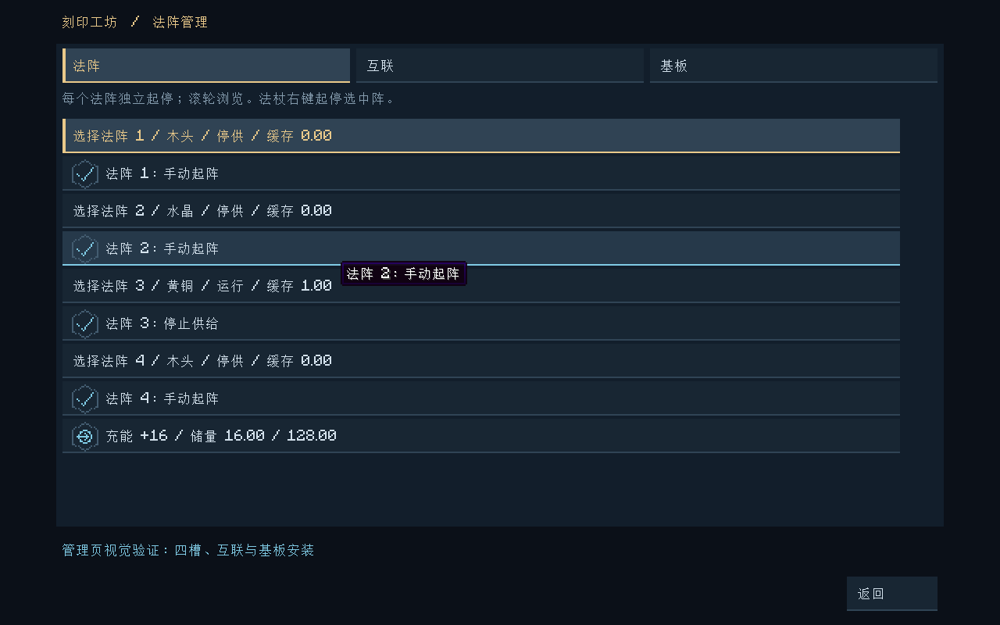

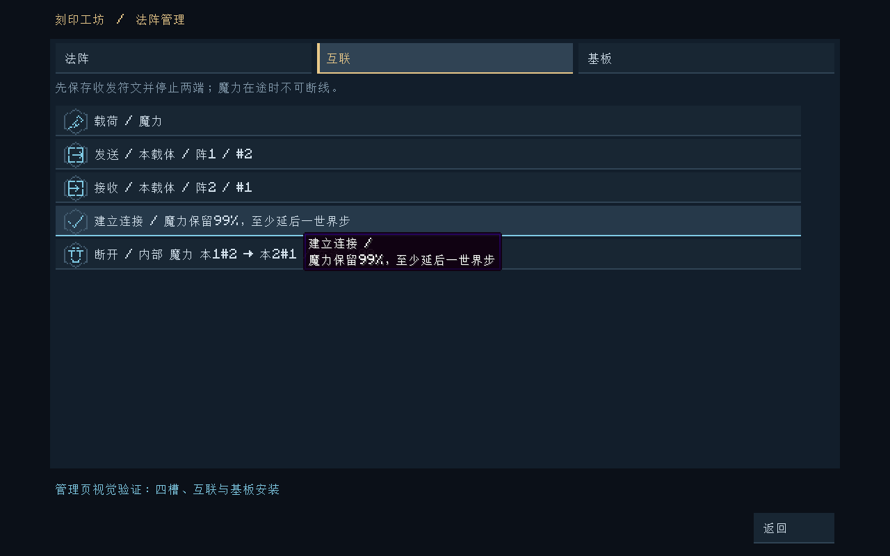

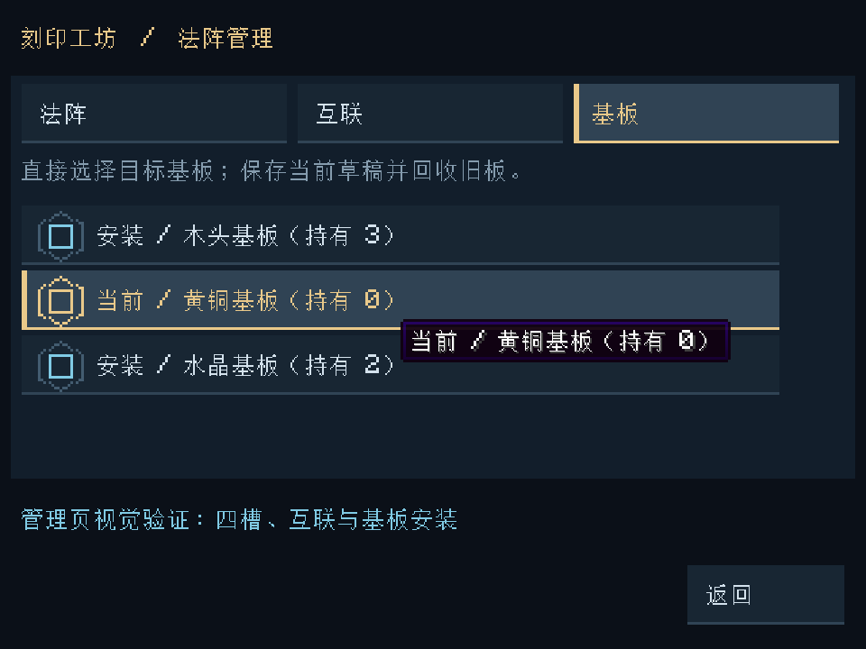

运行边界：跨载体仅固定方块、同所有者/维度、16格、已加载；所有者离线或换维度冻结，不强加载或补算时间。没有崩溃时跨区块文件原子保存、大型网络/多人压力或正式玩家试玩验收。本次没有暂存、提交、合并、打tag或推送。

---

## 2026-10-29：v0.5.1 绘制界面鼠标卡顿修复

分支：`codex/minecraft-editor-cursor`。根因、修改与测量方法见 [编辑器指针与绘制性能修复](编辑器指针与绘制性能修复.md)。

- 修复前真实客户端采样`build/cursor-baseline.log`成功；217格/28枚符文/35条线，选择、放置、布线、拖动各预热60帧，再各取160个GPU同步样本。四项绘制中位耗时66.74–69.27ms，P95为75.30–76.84ms。
- 最终`build runGameTestServer runClient -PcursorSmoke=true`成功、退出码0，日志`build/cursor-after.log`；**48770项核心断言、28项GameTest全部通过**。同场景优化后四项中位耗时3.38–4.21ms，P95为4.78–5.66ms。原始JSON副本在`docs/metrics/editor-cursor-before.json`和`editor-cursor-after.json`；这是局部编辑器绘制耗时，不能称为完整世界帧率。
- 新增原命中算法随机对照及所有格心验证、预览缓存/失败缓存/失效与撤销、原生指针符形与热点、不可变像素数据。客户端断言四种工具原生句柄非零、系统指针未被隐藏、离开格盘恢复普通指针、进入蓝图页释放句柄、返回和关闭正常。
- 追加`runClient -PeditorSmoke=true`成功、退出码0，日志`build/cursor-ui.log`；**16张GPU截图**及实际剪贴板/导入返回断言通过。目视检查符文、选中、拖动虚影、布线、紧凑页面及蓝图页，没有因批处理产生显示缺失或文字覆盖。Minecraft截图不含原生指针，另输出位图PNG检查其形状和颜色。
- 原Godot统一隔离回归**23套全部通过、失败0**，退出码0；日志`build/godot-cursor-regression.log`。运行代码和正式存档未用于本次改动或模组测试。
- 最终构建及客户端日志无ERROR，保留历史平台弃用/资源WARN。新JAR保持v0.5玩法和存档协议，包含原生指针代码，不包含性能采样驱动、契约测试或截图程序。

产物：`build/libs/elemental-circuits-1.20.1-0.5.1.jar`，289314字节。SHA-256：

```text
ce460e774ccf56f72454eb02dd3e55dc5b2c04be73a655dd7069c5c7ed07e992
```

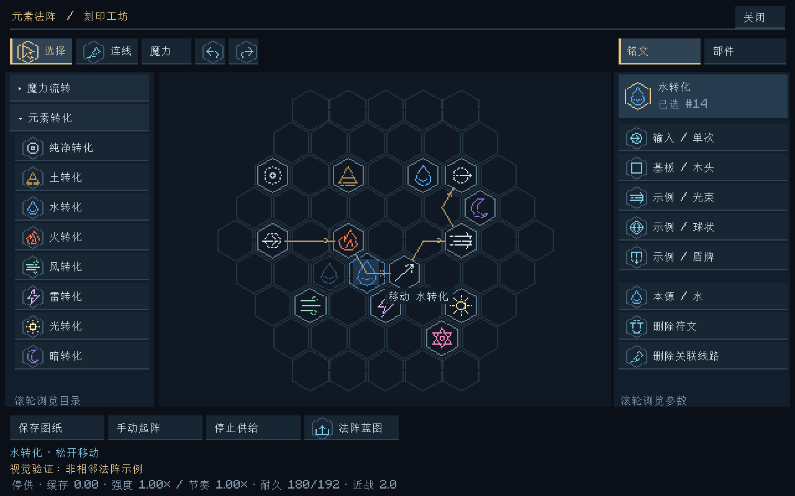

安装时替换旧版JAR。新指针由系统显示，符形、合法性提示和格盘虚影仍随界面更新。只在Windows开发机执行了原生指针和短时性能验证；未将结果扩大为其他平台/DPI、完整世界或长期性能验收。本次没有暂存、提交、合并、打tag或推送。

---

## 2026-10-29：v0.5.0 光暗照明、奥术穿透与独立蓝图页

分支：`codex/minecraft-light-arcane-blueprints`。规则、迁移与边界见 [光暗奥术与蓝图子界面](光暗奥术与蓝图子界面.md)。

- 最终组合命令`build runGameTestServer runClient -PeditorSmoke=true`成功，退出码0，日志`build/radiance-release.log`；平台仍为NeoForge 47.1.106。
- **42210项核心断言通过**，包含既有契约和新增文本码/D触发器配置往返、旧JSON兼容、校验/版本/压缩/UTF-8/解压上限拒绝、导入格盘边界、纯校验状态保留、正奥术分包逐成分守恒、不同杖端强度下照明预付及其他成分保留。独立`tools/test-core.ps1`也通过。
- **28项真实Minecraft GameTest全部通过**。新增9项验证：命中处15级方块光与光照引擎邻格亮度、光束短光清理、租期完整恢复/到期/玩家替换保留/重叠取长/卸载冻结、暗瞄准无碰撞火把且实际熄光、破坏按原火把掉落、营火与法术光熄灭、孤立标记恢复原灯与朝向、事件取消、正奥术穿墙及反奥术普通碰撞、混合包仅奥术穿透、墙体不变、旧v3弹道碰撞、新弹道恢复后穿透、移动光实际落格且扣费/剩余预算保存、奥术弹道仍受法盾容量约束。原19项一并通过。
- 首轮营火测试射线高度高于营火轮廓，修正瞄准高度后通过；保留原断言。随后补齐到期恢复相邻区块检查和重叠租期断言，最终服务器测试再次全过。中间日志`build/radiance-tests.log`、`build/radiance-final.log`不替代最终结果。
- 自动客户端流程产出**16张GPU截图**，覆盖原编辑器交互与新增蓝图导入页、错误保留、导出生成并复制、紧凑/宽窗口切换、有效导入返回父页，并以实际剪贴板和草稿比较做断言。窗口分别为960×720/GUI3（320×240）和1280×800/GUI2（640×400）。目视检查文字、输入框、滚动、提示和按钮无重叠；修正了多行框计数与状态提示的间距。测试不创建或连接世界。
- 原Godot统一隔离回归**23套全部通过、失败0**，退出码0；日志`build/godot-radiance-regression.log`，正式存档未用于测试。
- JAR含光照规则、光源方块状态/模型、文本码与子页代码，不含GameTest和客户端截图驱动。构建和客户端日志无ERROR；保留历史NeoForge API弃用及平台资源/音频WARN，不视为新功能失败或GPU性能验收。

产物：`build/libs/elemental-circuits-1.20.1-0.5.0.jar`，278204字节。SHA-256：

```text
b1fe58092b29c42c701803513463e1c7707e3fec619e20e8701df80a20ad1129
```

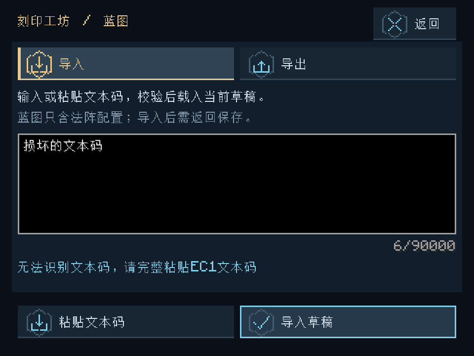
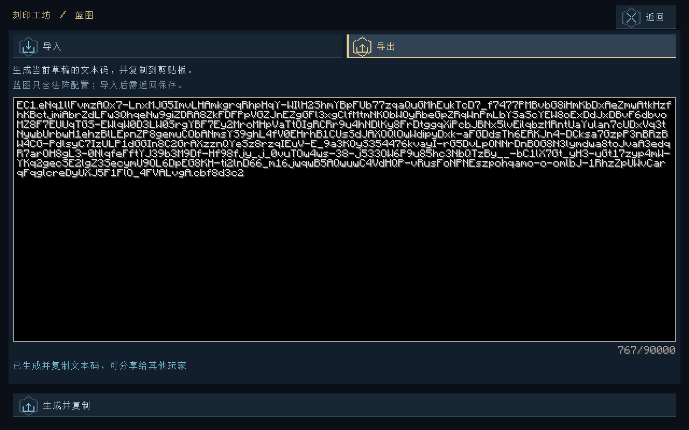
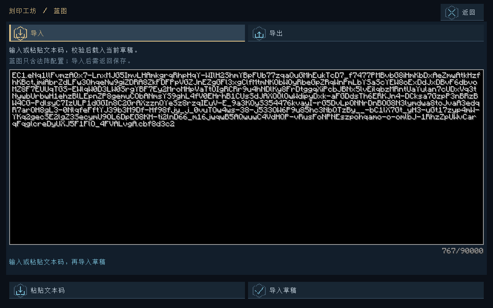

更新时替换旧版JAR，客户端和服务器一起更新。临时光和压暗源有固定寿命；暗不消除天空光，也不涵盖所有模组灯具。真人生存平衡、完整领地插件矩阵、长期区块/崩溃恢复与GPU性能仍未验收。本次没有暂存、提交、合并、打tag或推送。

---

## 2026-10-29：v0.4.0 首批元素世界交互

分支：`codex/minecraft-element-world`。实现范围、规则与操作见 [元素世界交互](元素世界交互.md)。

- Gradle构建阶段完成，**19995项核心断言通过**；新增多元素正/反相统一分配、动作最低成本、接收顺序稳定、余数、无响应耗散及重复目标拒绝。日志：`build/world-verified.log`。该次组合命令末尾的下界测试仍失败，未把整条命令记为成功；修正测试场景后按下一条完成服务器验收。
- 最终独立 `runGameTestServer` **19项全部通过**、退出码0、`BUILD SUCCESSFUL`。日志：`build/world-server-final.log`。包含原6项及新增真实火焰/水源、水流、灭火/营火、耕地、融冰/冻结、掉落物推拉与共享预算、避雷针红石及结束/泄放、铜锈、源数量阈值、事件取消且无提前岩浆反应、容器保留、真实水/岩浆反应、范围遮挡、新旧弹道及恢复、下界实际放水蒸发、未加载区块防护、纯净占多数的混合元素作用。
- 追加的边界验证曾暴露垂直射线区块检查、农业场景上方残余水，以及复用主世界测试高度导致下界未执行等问题；分别修正区块检查和测试布置，并让下界测试观察实际生成请求。没有删除断言或降低成功标准。中间日志保留在 `build/world-final.log`、`build/world-release.log`、`build/world-verified.log`。
- 原Godot统一隔离回归 **23套全部通过，失败0**。日志：`build/world-godot-regression.log`。未修改原工程运行代码。
- 世界SavedData升v3，旧v1/v2弹道明确保留历史实体响应，新增弹道冻结环境效果版本。JAR规则资源可解析，正式包包含世界交互资源，不含测试契约、GameTest或截图驱动。

产物：`build/libs/elemental-circuits-1.20.1-0.4.0.jar`，243167字节。SHA-256：

```text
11b8d2c8205755d81b2417dcd2affe01de7ec2c1c6c069bbe6ff7b67bf6a76f7
```

安装时替换旧版JAR，客户端和服务器同时更新。首批为火/水/风/雷环境响应；土系临时物质、光暗照明和奥术环境响应仍未完成。本轮未新增客户端画面验收，未做真人生存平衡、领地插件矩阵或长期性能验收。本次没有暂存、提交、合并、打tag或推送。

---

## 2026-10-29：基础门电路D触发器与火/水切换实验

分支：`codex/minecraft-d-flip-flop`。完整接线、初始化约束、输入边界与结果见 [D触发器与双元素施法实验](D触发器与双元素施法实验.md)。

- 使用已有与/或/反组成主从存储器，连同双施法支路28枚符文、35条线路；生成黄铜格盘配置 `examples/d-flip-flop-fire-water.json`，经既有蓝图及编解码校验。
- `./tools/run-d-flip-flop.ps1 -Plot`成功，独立实验5696项断言通过，输出真实VM逐步CSV、JSON与PNG/SVG时序图。双向扫描全部10种注入相位，共20次切换均在稳定期仅交付所选元素；旧元素最晚到第8步，新元素首次交付为第11步。
- 统一Gradle `check`成功、退出码0，**7826项核心断言通过**。日志：`build/d-flip-flop-check.log`。覆盖冷启动初始化必要性、保持/采样、停供和重启、缺能不自启、JSON现场恢复及切换中途恢复等。
- 测试台以完整保留运行现场的方式驱动两枚常量信号，现行游戏服务器没有运行中D/CLK输入接口；可导入蓝图供接线检查，不能直接作为已完成的游戏内切换功能。实验使用有限4096点供给，未改玩家64点容量或运行规则。
- 本次只改实验测试与文档、工具；未修改模组运行核心、版本或JAR，未重复执行服务器伤害、客户端画面或Godot回归。本次没有暂存、提交、合并、打tag或推送。

---

## 2026-10-28：v0.3.0 元素目录、统一图标与拖动预览

分支：`codex/minecraft-element-preview`。规则与截图见 [元素目录与交互预览](元素目录与交互预览.md)。

- 最终 `build` 成功，退出码0；**2128 项核心断言通过**。新增独立元素目录与九种符形、精确元素落笔、只读放置/移动预览、占用与穿符拒绝、移动重算线路、取消和整步撤销等契约。日志：`build/element-release.log`。
- **6 项真实 NeoForge GameTest 全部通过**，覆盖注册、现场持久化、伤害、屏障及法杖部件；日志：`build/element-acceptance.log`。随后补齐客户端落笔候选校验并完成上述最终构建；该补充由核心契约覆盖，未改变服务器规则。
- **10 张真实客户端截图已查看**：元素目录、九种符形、落笔虚影与工具指针、选择卡片、有效/无效拖动、相关线路预览、紧凑布局及部件页。窗口1280×800 / GUI640×400、960×720 / GUI320×240。日志：`build/element-visual.log`；完整原图在 `build/client-smoke/screenshots/elements-*.png`，选图保存在 `docs/images/element-*.png`。
- 原 Godot 工程统一回归本次 **23 套全部通过，失败0**。日志：`build/element-godot-regression.log`。没有为模组修改Godot运行代码，也未放宽测试标准。
- 正式JAR版本为0.3.0，不包含测试契约、GameTest或截图驱动类；已有蓝图、NBT现场和网络协议2兼容。

最终产物：`build/libs/elemental-circuits-1.20.1-0.3.0.jar`，220467 字节。SHA-256：

```text
0fe980f9617bf1975e48f6ae47ace66f21528a43e2241cf2b43b8921ba867dbf
```

安装时替换旧版JAR，客户端与服务器同时更新。自动画面检查不代表真人交互、生存平衡、多人压力或长期GPU性能验收。本次没有暂存、提交、合并、打tag或推送。

---

## 2026-10-28：v0.2.0 编辑器、自动布线与法杖部件

分支：`codex/minecraft-wand-editor`。设计与规则见 [编辑器与部件化设计](编辑器与部件化设计.md)。

- 最终 `build` 成功，进程退出码0；**1937 项核心断言通过**。新增最短绕障路径、格数/损耗与VM一致、自动连线撤销/重做、目录折叠与全部符文入口、共享矢量图形边界、四档GUI尺寸命中、三部件属性分工和施法节奏余数契约。
- **6 项真实 NeoForge GameTest 全部通过**：原3项保持；新增部件消费/回收、缺件原子拒绝、总耐久与近战属性、磨损不重置/耗尽不销毁/材料修缮、物品现场往返、精确节奏续算、杖端真实伤害和世界v1弹道强度迁移。日志：`build/editor-acceptance.log`。
- **7 张真实客户端截图已查看**：1280×800 / GUI 640×400，960×720 / GUI 320×240；包含父项折叠、符文矢量预览、部件结构、紧凑页、滚动到底修缮入口，以及远距离路线预览（6格、木头1点参考损耗26.64%）。日志：`build/editor-final-client.log`；原图：`build/client-smoke/screenshots/`。
- 原 Godot 工程统一23套回归：正常进程环境中22套通过，机械承载套件未在30秒内产生完成标记；Minecraft客户端退出后，单独 `-Suite carriers` 的65项全部通过（`SUITES: 1, FAILED: 0`）。这不是一次全套同时通过的记录。日志分别为 `build/editor-godot-regression-final.log`、`build/editor-godot-carriers.log`。首次受限运行有7套未完成，未当作通过；未为此改动Godot代码或放宽超时标准。
- JSON资源可解析，9个部件及27套组合模型/贴图引用完整；正式JAR不含测试类或截图驱动器。

最终产物：`build/libs/elemental-circuits-1.20.1-0.2.0.jar`，209148 字节。SHA-256：

```text
f625a1212d4077374d2318cd27dad8d994febbf437607dd46907f13cdb912ce7
```

新版双方网络协议均为2，需要客户端与服务器同时更新。安装时替换旧模组JAR，不要并存两个版本。客户端截图驱动仅在 `-PeditorSmoke=true runClient` 启用，不包含在安装包中。未执行真人生存平衡、多人压力或长期GPU性能验收。

预览：

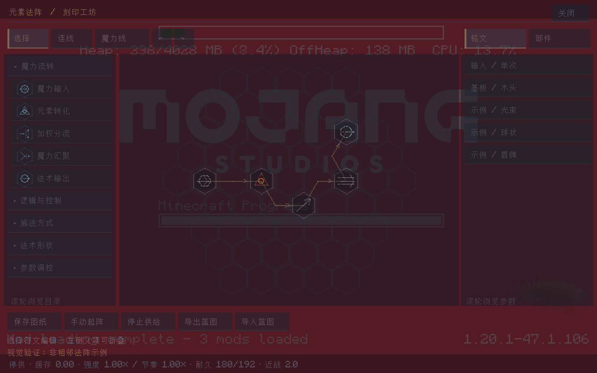
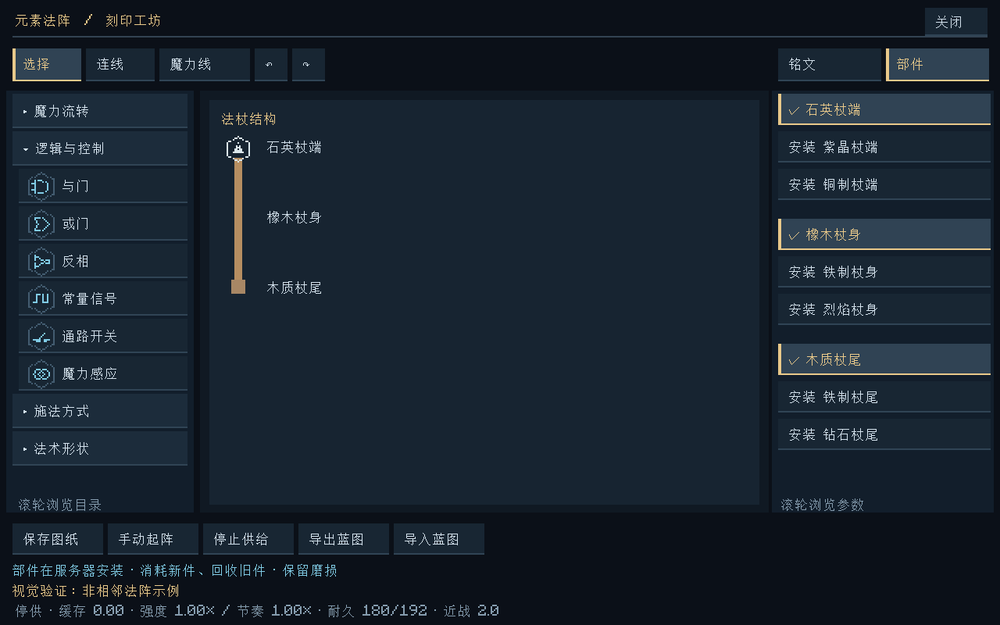
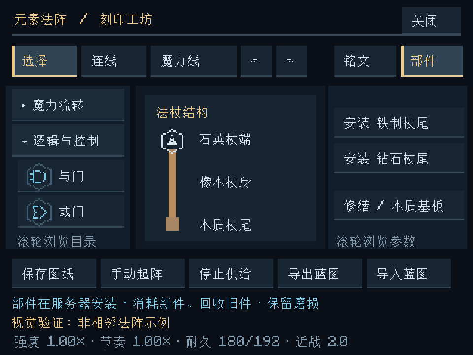
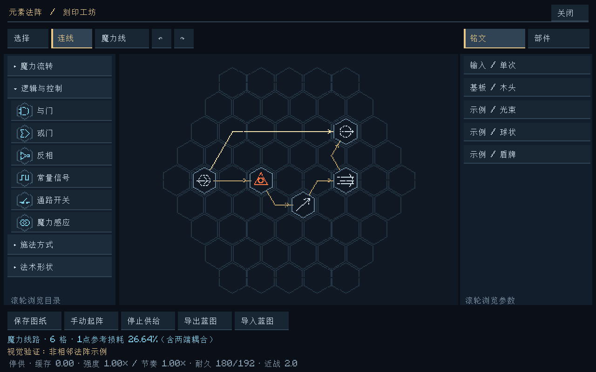

本次没有暂存、提交、合并、打tag或推送。

---

## 历史：v0.1.0 初次移植

日期：2026-10-28。工作分支：`codex/minecraft-neoforge-1.20.1`。

## 已执行

- Java 17 独立核心契约：`./tools/test-core.ps1`，**1472 项断言通过**。覆盖六邻接与旋转、路线及材料校验、定点/混合数量、守恒与缓存归属、分流和合流、逐步信号、停供/恢复、回收重配、调控成本、蓝图/现场序列化与恢复后一致性、异常数值及损坏数据拒绝；包括最大数量下的精确比例支取。
- 原 Godot 工程：仓库根 `./tools/run_tests.ps1 -Suite all`，**23 套全部通过，失败 0**。原工程已有的证书存储日志仍会出现；统一测试未因此忽略其他错误。正式存档未用于模组测试。
- Gradle Wrapper：8.1.1，分发包及 Wrapper JAR 校验和与 Gradle 官方发布记录一致。构建目标明确为 `net.neoforged:forge:1.20.1-47.1.106`，不是普通 Forge 替代物。

## 集成验证范围

三项 NeoForge GameTest 已在真实的无界面服务器中全部通过：物品注册/配方及 NBT 现场恢复、光束阻挡和实际服务器伤害、弹道/屏障持久化及恢复后推进。第三项同时验证容量耗尽时屏障消失、超额弹道只扣除吸收份额后继续飞行。执行命令：

```powershell
.\gradlew.bat --gradle-user-home .gradle-home build
.\gradlew.bat --gradle-user-home .gradle-home runGameTestServer
```

NeoForge 官方仓库在本机连接不稳定，验证使用 `-PuseDependencyMirror=true`；首次构建还需要下载 Minecraft 原版客户端、服务器、映射与反编译工具。

实际执行 `build runGameTestServer`：**BUILD SUCCESSFUL**；日志显示 `CORE CONTRACTS PASSED: 1472`、`3 GAME TESTS COMPLETE`、`All 3 required tests passed`，进程退出码 0。运行目标为 `forgegametestserveruserdev`，平台识别为 NeoForge 47.1.106。完整日志位于忽略的 `build/integration.log`；Godot 回归日志位于 `build/godot-regression.log`。

产物：`build/libs/elemental-circuits-1.20.1-0.1.0.jar`，124632 字节。SHA-256：

```text
eed3dd9d3d4eeaf86d73a1754743699492ec810d8dae61512d6d84654c2c8b45
```

编译存在该历史平台的 API 弃用提示（包括 DistExecutor），Gradle 也提示插件不兼容未来 Gradle 9；此工程固定 Gradle 8.1.1。最终集成运行没有 ERROR 日志。首次运行生成默认配置的 WARN 以及 FML 内部库缺少 mods.toml 的 WARN 仍会由平台输出。

## 未覆盖与已知边界

尚未执行真人生存流程、多人联机压力测试、GPU 帧率与不同 GUI 缩放下的画面验收。已有契约通过不代表这些体验验收完成。

首批为单法杖、单法阵。跨法阵网络、常驻设备与独立能源节点、完整热学/机械学、临时物质、材料过载后果、安全/危险铭刻均未迁入，不能把当前有限资源与模板示例视为完整系统。蓝图不直接兼容 Godot 历史文本码。

没有暂存、提交、合并、打 tag 或推送。
