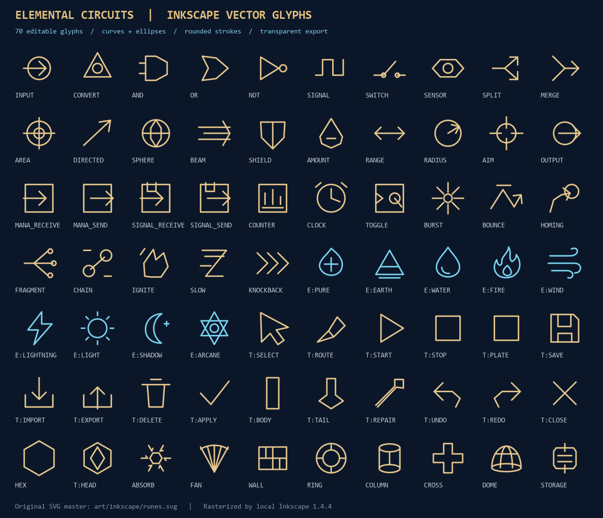
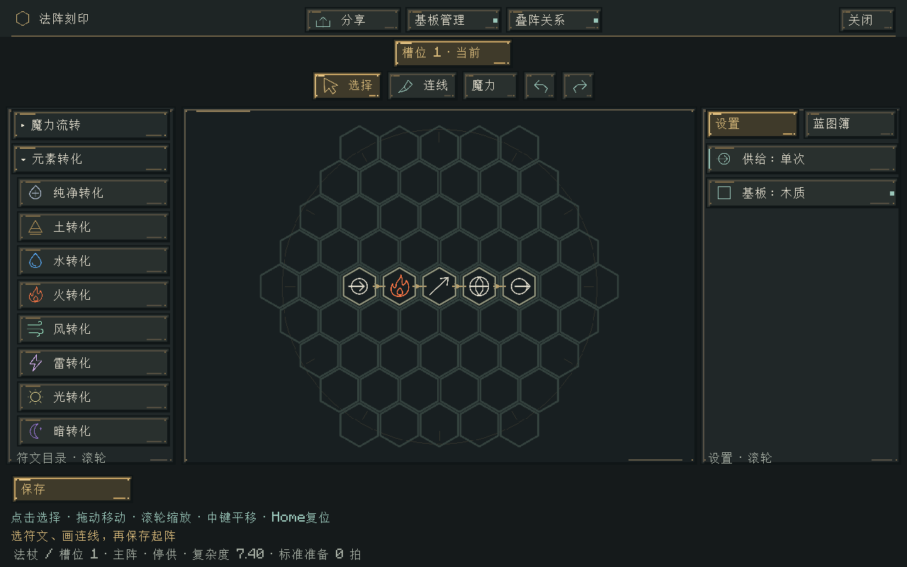
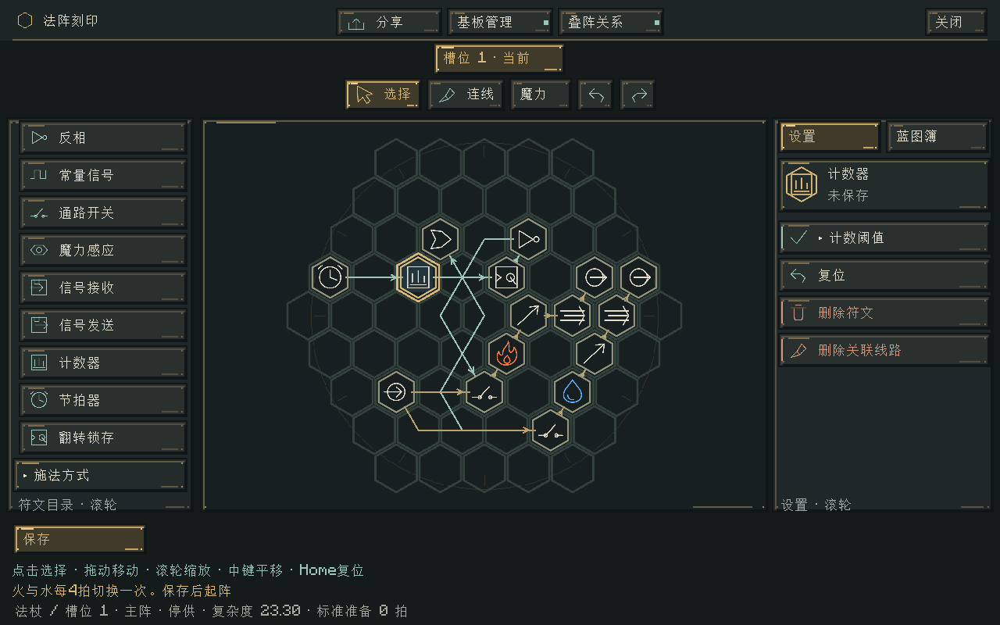

# Inkscape符文矢量化 · 0.48.0

70个符文、元素与工具图标改为可编辑SVG源稿。保留现有逻辑符号的辨识方式，圆环改为真实椭圆，水、火、风、光、暗、奥术与纯净魔力使用独立曲线形状。材质仍沿用深蓝背景、黄铜符印与元素色。

源稿位于 [runes.svg](../../art/inkscape/runes.svg)，制作与导出命令见 [美术工作流](../../art/inkscape/README.md)。本次实际使用用户提供的本地Windows商店版Inkscape 1.4.4导出。

| 环节 | 实现 |
| --- | --- |
| 编辑 | Inkscape命名图层、矢量路径、椭圆、圆角描边 |
| 离线导出 | Inkscape生成1024×1152图集，每格128像素；原有显示尺寸不变 |
| 侧栏与法阵 | GlyphAtlas使用同一纹理与渲染类型，保留批量四边形绘制 |
| 选中与拖放 | 继续使用同一图集，保留元素色、选中框与虚化预览 |
| 鼠标指针 | 从同一SVG生成24/48/72像素图集；运行时裁切、染色并缓存原生句柄 |
| 几何检查 | SVG派生JSON轮廓与索引，不用轮廓重新画位图 |

SVG是制作源文件；Minecraft实际使用它离线导出的抗锯齿PNG。放大到超过导出精度时仍受纹理分辨率限制。相比原图集，每格分辨率提高一倍，单个RGBA主图集约4.5 MiB；指针图集解码后合计约2.2 MiB，首次使用对应档位时加载。没有新增每帧矢量解析或曲线细分。

本次不改变魔力、施法、蓝图和世界数据规则。完整测试范围见 [验收记录](../verification/符文矢量化验收.md)。
