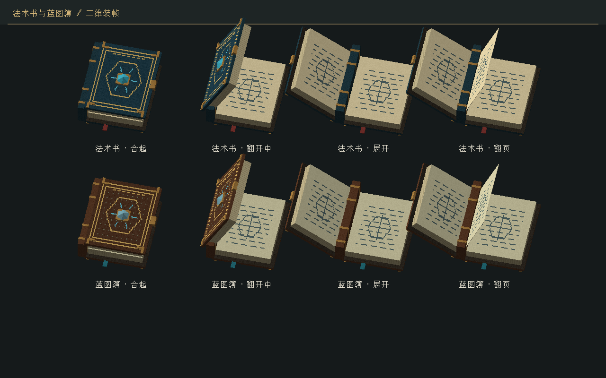
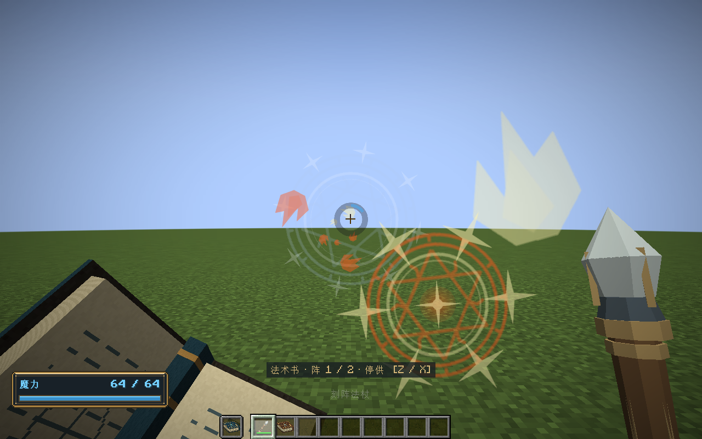

# 三维书籍与稳定持杖 · 0.24.0

Minecraft 1.21.1 / NeoForge 21.1.265 / Java 21。

## 玩家可见的变化

- 法杖在施法、冷却、磨损和法阵数据更新后保持持握，不再反复收回、抬起。真实换槽、换一根法杖或更换外形部件时仍保留装备过渡；近战仍有挥动动作。
- 准星蓝环继续显示施法冷却。快捷栏、背包中的每一根法杖另外显示原版风格的灰白冷却遮罩；它读取该物品自己的冷却，不把全部法杖绑定到原版按物品类型共享的冷却器。
- 法术书采用深蓝皮革，蓝图簿采用棕色皮革；都有黄铜包角、书脊束带、水晶扣、厚纸页和书签。拿到手中约半秒翻开，换阵或换蓝图页时有翻页及原版纸页声。物品栏、掉落物和展示框显示合起的三维模型。
- 书籍页面标题旁有三维缩略图，打开页面和换页也能看到动画。手持书本缩小、下移，减少对准星和世界视野的遮挡。





## 制作与实现

使用本机 **Blender 5.2.3 LTS** 制作模型，**Aseprite 1.3.15.5** 绘制贴图。两种装帧各有书脊、前封、后封、前纸页、后纸页和翻动页六个部件，另有合起的静态模型。共用一张512×512贴图，16个材料区域各含64×64画稿及32像素外延。黄铜、水晶和纸页采用独立几何，沿用现有工作台、法杖的材质风格。

- `art/blender/articulated-books.blend`：带封面铰链动画的可编辑源文件。
- `art/blender/books-studio.png`、`book-metrics.json`：源模型预览及网格统计。
- `art/aseprite/books.aseprite`：可编辑贴图源。
- `tools/artwork/paint-books.lua`、`tools/artwork/model-books-blender.py`：离线重做流程。
- `models/item/book3d/`：14个烘焙OBJ模型；两种书的12个活动部件合计368个四边形/三角片。

贴图、模型导出命令，从1.21.1工程目录执行：

```powershell
& 'E:/Aseprite-v1.3.15.5/build/bin/aseprite.exe' -b --script-param root='D:/某种基于元素编程的剑与魔法游戏/minecraft-neoforge/1.21.1' --script tools/artwork/paint-books.lua
& 'D:/blender/blender-5.2.3-windows-x64/blender.exe' --background --python tools/artwork/model-books-blender.py
```

模型由NeoForge原生OBJ加载器烘焙，动态物品通过[原生BEWLR入口](https://docs.neoforged.net/docs/1.21.1/blockentities/ber/)绘制，不增加动画库依赖。`BookItemRenderer`只读取姿态，对已烘焙部件施加铰链旋转；不逐帧生成网格、读取法阵现场或修改物品。模型从当前ModelManager取得，资源重载不持有旧烘焙模型。

`BookMotion`是独立的客户端固定步时钟，渲染只插值。`BookAnimationClient`只有主手、副手和当前书籍页面三个轨道；密集换页最多保留一个待播放方向，换物品、世界切换和退出会清理。法术书换阵及蓝图簿选页根据服务端确认触发，周期性的状态刷新不反复启动动画。本地第一、第三人称及页面具有动画；其他实体持书采用固定展开姿态，本版未增加远端玩家开书状态同步。

`ItemAppearance`只读取身份和部件投影，不调用会创建身份的仓储加载。法杖只比较身份、槽位和部件外观；蓝图簿从既有编码器的UTF-8头部读取身份，最多查看512字节，不解码整本蓝图。

原版有两种引起法杖收回的路径：物品数据变化的重新装备判定，以及使用物品时的`itemUsed`高度重置。本版分别通过`shouldCauseReequipAnimation`和客户端手部变换处理；稳定持握后忽略原版CD下沉，并保留近战挥动。右键施法返回消费结果，不再请求原版挥砍动画。冷却计算、释放许可、伤害和法阵固定步均保持原有规则。

## 验证

- **94,389项**纯Java核心契约通过；含动画边界连续、暂停采样不推进、密集换页有界、重置清理。
- **127项**Minecraft服务端集成测试通过；新增检查覆盖冷却/磨损/法阵更新不收回、真实换槽/换身份/换部件仍过渡、蓝图簿选页不收回及显示读取不反写。
- 独立`test-core.ps1 -JavaHome 'C:/Program Files/Java/jdk-21.0.10'`通过相同94,389项；补齐该入口已有形状检查的源清单及随包署名资源。
- 工作区隔离统一回归 **23套通过**。
- 真实图形客户端检查12个活动部件和贴图烘焙、真实VM施法与物品冷却同步、原版持物高度重置后的60次稳定姿态矩阵检查、开书、服务端确认的换页、左手、两种书籍页面、资源重载及退出。完成标记为`BOOK_MODELS_GPU_PASS`、`BOOK_HAND_WORLD_PASS`。

```powershell
./tools/build.ps1 -Tasks build,runGameTestServer -Mirror -Offline
./tools/build.ps1 -Tasks runClient -BookSmoke -Mirror -Offline
```

测试日志为`build/animated-books-contracts.log`、`animated-books-standalone-core.log`、`animated-books-godot.log`和`animated-books-gpu.log`。图形运行使用独立`build/book-smoke/`世界；服务端测试现为每次新建`build/gametest-runs/`子目录，避免旧测试存档的互联线路长期累积达到上限。没有删除或修改正式世界。首次检查还发现蓝图簿身份存于封装UTF-8，而非直接NBT字段，已按真实格式修正只读投影。

本版没有修改存档、蓝图或网络协议（仍为`1.21.1-8`）。未进行多人主观体验或GPU长期性能验收。

## 安装包

`../releases/elemental-circuits-1.21.1-0.24.0.jar`，2,251,280字节。SHA-256：`2d78d1455cf69bfb3f7d4a5b32b1e1ff30189828c73415c5ba9e79107c99a7ca`。已核对既有13个归档安装包保持原校验值；本版保留74个音频文件及素材署名、授权全文。
