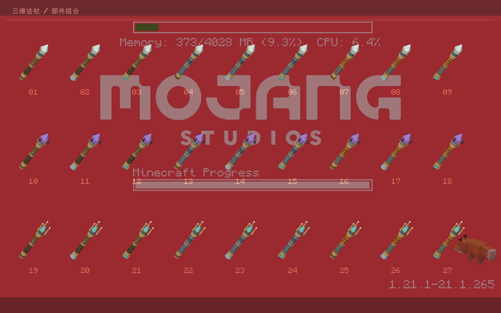
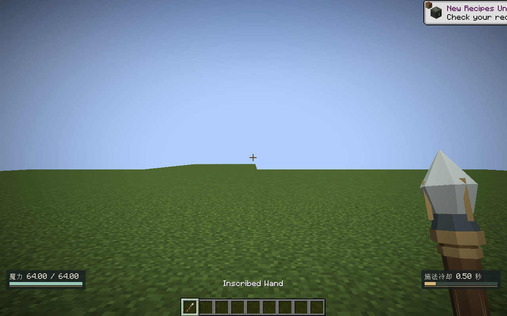
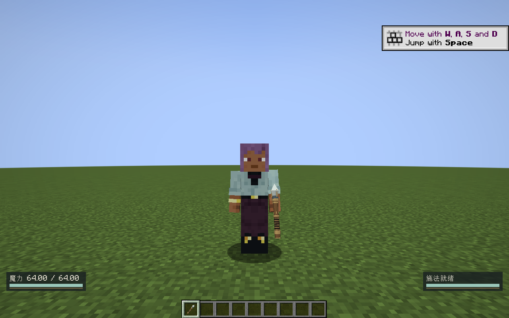
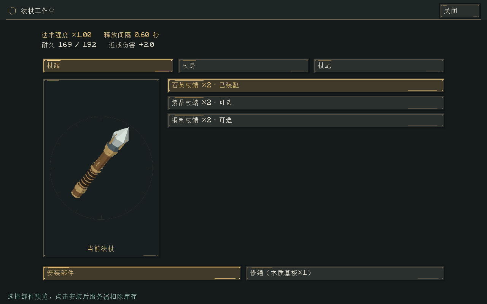

# 三维法杖与施法冷却

2026-10-30，v0.18.0（初始实现），Minecraft 1.21.1 / NeoForge 21.1.265 / Java 21。

法杖改为真正的低模网格。石英晶尖、紫晶簇、铜制分叉杖端，木质/铁制/烈焰杖身和三种杖尾共27种组合，背包、持握和工作台共用相同模型。工作台预览使用独立显示物品，不改玩家背包。Blender文件保留9组可编辑部件，游戏只加载静态模型，不需要安装Blender或MCP。









## 冷却规则

| 杖端 | 速度 | 释放间隔 |
|---|---|---|
| 石英 | 1.00× | 12步，0.60秒 |
| 紫晶 | 0.75× | 16步，0.80秒 |
| 铜制 | 1.50× | 8步，0.40秒 |

公式为 `ceil(12 / 速度)`，按服务器20Hz固定步计算。基准值在版本化资源 `data/elementalcircuits/rules/wand_cooldown.json` 中。杖身继续贡献耐久，杖尾继续决定近战伤害；后续有部件贡献速度时也由最终部件属性统一报价。

同一支物理法杖的所有法阵共享释放间隔。副手法术书使用主手法杖的同一份CD；换书、翻页、停供、换部件都不能清除它。更换部件后，当前冷却按原间隔完成，下次释放使用新速度。换成另一支法杖则使用另一支自身的状态。

CD只限制元素法术在输出端释放。被拒绝时保留完整魔力、修饰和账本，其他符文继续按一世界步一逻辑步运转，恢复就绪后再交付。纯净魔力没有元素世界作用，不触发CD或磨损。固定法阵方块不受手持法杖CD限制；命中后的分裂、连锁不再次收费。多个待输出按既有槽位和符文顺序竞争，当前没有新增公平轮转保证。

0.18.0的HUD右下显示剩余秒数和就绪条（0.18.1已改为[准星冷却环](准星冷却环与魔力条.md)），左下魔力槽独立。只读取服务器同步的状态，插值只影响显示。隐藏界面、换下主手法杖和打开页面时隐藏；0.18.0损坏显示“法杖损坏”，0.18.1损坏时只显示空底环。暂停不推进CD，未加载或离线物品不按墙钟补算；背包法杖和已加载掉落物按固定步冷却。

## 状态与边界

`CastCooldown`是纯Java状态及数值校验；`ReleasePermit`是释放能力，由`CircuitHost`注入，VM不引用Minecraft或HUD。许可在输出支付验证后、消费魔力之前申请；拒绝不丢弃支付。

独立原版数据组件 `elementalcircuits:wand_cooldown` 保存版本1、剩余步数和总间隔，使用持久Codec与网络StreamCodec。小组件每步更新，不重写整份法阵NBT，也不另建逐帧同步消息。缺少组件的旧法杖显式视为就绪；原法阵/蓝图保存格式不变。旧 `WandAssembly.Remainder` 只校验保留兼容，不再加速VM，旧法杖的阵内逻辑会按新统一时钟运行。

两端必须升级到0.18.0，协议标识为 `1.21.1-3`。组件持久化后，旧版模组不能读取新组件，降级前须保留世界备份。

## Blender与MCP复现

使用本机 `D:/blender/blender-5.2.3-windows-x64/blender.exe`，通过[Blender MCP项目](https://github.com/ahujasid/mcp-for-blender)调用。本次固定源码提交 `992233bb258975a05eec8b5691465c50c2831e34`，包版本2.2.6，MIT。源码与Python虚拟环境位于忽略目录 `../../tooling/blender-mcp/`、`../../tooling/blender-mcp-env/`，没有改全局Codex配置或用户Blender偏好。

任务专用Blender以 `--factory-startup --python tools/artwork/blender-mcp-bootstrap.py` 启动。插件仅监听 `127.0.0.1:19876`；Python客户端使用真实MCP stdio会话调用 `execute_blender_code`。该上游提交缺少 `blender_mcp.config`，本地启动器注入禁用遥测配置使其可运行；此兼容补丁只在本进程生效。不使用外部素材服务。

```powershell
# 已准备上述本地虚拟环境，并启动任务专用Blender后：
../tooling/blender-mcp-env/Scripts/python.exe tools/artwork/blender-mcp-client.py tools/artwork/model-wands-blender.py
python tools/artwork/bake-wand-palette.py
```

源文件：[modular-wands.blend](../../art/blender/modular-wands.blend)。制作脚本：[model-wands-blender.py](../../tools/artwork/model-wands-blender.py)。网格清单：[mesh-metrics.json](../../art/blender/mesh-metrics.json)。OBJ与材质在 `assets/elementalcircuits/models/item/wand3d/`，由NeoForge原生[OBJ模型加载器](https://docs.neoforged.net/docs/1.21.1/resources/client/models/modelloaders/)烘焙，不引入运行时模型库。所有模型、配色和网格均本地原创；MCP代码不打进JAR。

## 验证

- `build/wand-validation-final.log`：88,941项纯Java契约、90项Minecraft集成测试通过，涵盖等待守恒、多个槽位共享、保存恢复、换部件不清CD、副手书共用、固定逻辑时钟。
- `build/wand-editor-gpu.log`：61张实际客户端界面截图及控件边界检查，包含工作台三维预览与紧凑界面；8,192四边形单次特效绘制和过期清理通过。
- `build/wand-hold-final.log`：27个不同实际烘焙模型的几何与厚度检查、物品组件同步、冷却/就绪HUD、左右手和第三人称截图。
- `build/wand-godot-regression.log`：原Godot工程23套回归通过；既有系统证书警告单独记录。

这些是自动契约与短时图形检查，尚未完成长期多人负载和完整生存试玩验收。
