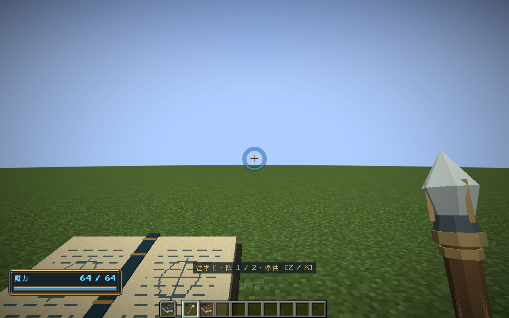
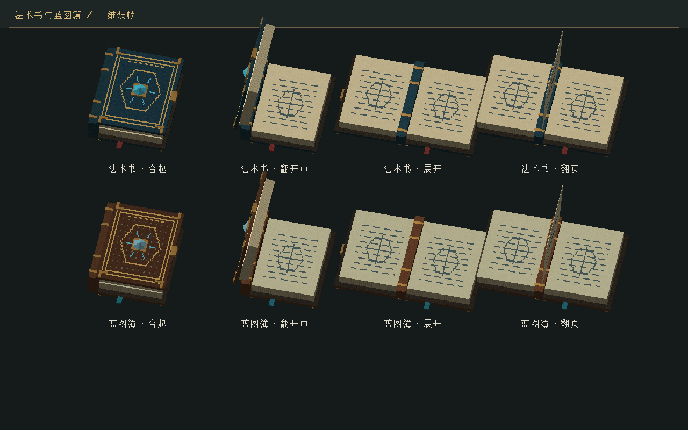

# 书籍姿态与魔力流转加速

2026-11-01 · 0.28.0 · Minecraft 1.21.1 / NeoForge 21.1.265 / Java 21

法术书和蓝图簿现在展开到180°。法阵默认每个服务器逻辑步执行8轮魔力传输，缩短长法阵首发和排空的等待；控制仍按20Hz推进。

## 书籍

两侧书页完全摊平，展开时重新居中；书脊随封面放平、压低，避免竖在页面中央。第一人称去除原先的左右扭转，调整为15°的阅读角度并抬高位置；第三人称抵消原版手部变换后水平持书。远端实体也采用完整展开姿态。

继续使用原有Aseprite图集与Blender静态OBJ部件。运行时只变换已有部件，开合与翻页动画、资源重载和退出清理仍由原有独立动画轨道处理。离线源文件 `art/blender/articulated-books.blend` 与生成器 `tools/artwork/model-books-blender.py` 同步更新了180°开封和书脊形变动画，没有新增贴图或逐帧生成网格。






## 流转规则

原VM每个世界逻辑步只允许魔力通过一层符文。测试用的“输入 → 元素 → 指向 → 光束 → 输出”需要5步，约250ms；增加CPU算力也不会自动缩短这段规则等待。现在同一个世界步内可以执行多轮传输，默认8轮，该测试法阵在第一个逻辑步内输出，约50ms。实际等待还受服务器tick相位、法杖冷却和供能影响；不能将此数字当作所有法阵的总施法时间。

| 操作 | 每个世界逻辑步的次数 |
|---|---|
| 玩家输入、场汲取、信号供能 | 维持一次及原有注入间隔 |
| 计数器沿检测、节拍、锁存、信号发布 | 一次 |
| 魔力交付、符文处理、下一轮在途 | 默认最多8轮 |
| 单次窗口、逻辑时钟 | 各推进一次 |
| 装备释放 | 仍须通过同一把法杖的CD许可 |
| 跨法阵接口 | 保留下一世界步交付，不能在一帧内穿过所有设备 |

每轮先接收上一轮的在途包，再处理节点，最后发布本轮在途包；没有进展时提前结束。反馈环每步最多推进配置的轮数，不无限求解。关闭阀门、等待与门另一侧或等待CD时继续持有原魔力，不重复收费。逐格和端点损耗、分流顺序、整数取整顺序没有改变。

服务器可在模组配置页调整“魔力流转速度”，或使用权限2指令：

```text
/ec config get circuit.manaSteps
/ec config set circuit.manaSteps 16
```

默认8，范围1–64；1接近旧传播速度。较高轮数缩短阵内等待，也增加单步工作预算。该选项写入世界的 `serverconfig/elementalcircuits-server.toml`。长法阵仍可能需要多个世界步；计数器、节拍和跨设备延迟有各自独立语义。

## 旧法阵与保存

`Rules` v3严格保存 `manaSteps`，VM现场升为v8。纯读取历史v1/v2规则和v1–v7现场时仍保留原始节拍；Minecraft宿主在调度准备边界显式采用当前服务器流速。已存在的法杖、书中法阵和固定法阵均会受益，服务器配置改变后在下一次有效调度时采用。

迁移逐项保留时钟、注入倒计时、单次窗口、开关/信号/计数状态、节点/在途/待发送/端口缓存、回收储量及全部账本；不补魔力、不改材料、容量或输入参数。不会用“重新安装蓝图”代替现场迁移。空闲提交只在首次采用新策略时需要一次写入，之后继续使用变更标记避免重复序列化。

蓝图与程序集外层版本保持不变，魔力场、世界法术和玩家槽没有新增格式。新网络协议为 `1.21.1-12`，客户端与服务端需同时更新。

## 计算开销

- 构造VM时一次建立符文编号、入线和出线索引，取代逐节点重扫全部线路；按载荷分别缓存索引。
- 缓存魔力出口和分流权重，处理包时不再反复执行Stream筛选和创建权重数组。
- 线路损耗改为直接处理每个非零成分，只创建最终结果，消除逐格临时数组和Mixture对象；仍逐格取整，耗尽成分提前退出。
- 控制采样与魔力传输分成独立方法；无进展的额外轮次提前结束。
- 部分支付复用已有的精确比例支取，避免上界数量的中间乘法溢出。

这些优化减少重复工作、载荷判断和分配。硬件分支预测与JIT由JVM/处理器处理；没有推测执行扣款、伤害或世界写入，也没有将有反馈依赖的节点随意并行。

独立预热基准：Java21，400次1024格线路传输，17种非零成分；4批预热，7批交错测量，取中位数。测量代码为 `ManaTransportBenchmark`，结果归档于 `art/books/2026-11-01/mana-transport-benchmark.csv`。

| 单批400次 | 旧逐格分配 | 新实现 |
|---|---:|---:|
| 耗时 | 16.870ms | 10.968ms |
| 当前线程分配字节 | 131456000 | 256000 |
| 结果校验和 | 8619355815 | 8619355815 |

该样本耗时约降低35%，分配约降低99.8%。这只是线路运算的局部基准，不能代表整个世界或GPU帧率。复现前运行构建，然后在PowerShell执行：

```powershell
& 'C:/Program Files/Java/jdk-21.0.10/bin/java.exe' -Xms256m -Xmx512m -cp 'build/classes/java/main;build/classes/java/test' dev.elementalcircuits.domain.ManaTransportBenchmark
```

## 验证与交付

- 核心检查115346项通过：新增速度梯度、单次/持续注入、64轮反馈、场汲取、控制因果、CD等待、现场迁移、逐格取整和上界部分支付；原有契约继续通过。
- Minecraft GameTest143项通过：真实旧法杖在途迁移、物品持久化、多槽CD、控制计数、跨阵下一世界步交付、卸载接收端和空闲提交等。
- 实际客户端通过：左右手、第三人称、开合/翻页、两个书籍页面、资源重载、退出及60次稳定法杖姿态检查；12个烘焙部件、368个四边形使用实际贴图。
- 原Godot工程23套统一回归全部通过；仅已有的根证书库日志被测试入口识别。
- 构建日志：`build/mana-transport-final.log`、`build/mana-transport-release-build.log`；原工程日志：`build/mana-transport-godot.log`。长时间多人负载与GPU帧率没有据此宣称通过。

安装包：`../releases/elemental-circuits-1.21.1-0.28.0.jar`，2560269字节。

SHA256：`97bdbda1d796776a0281acecbd11b83392f1c71f9f875f4dd2cc23136aac1c00`。

18个历史及当前安装包逐一核验大小与SHA256；此前17包保留原字节。74个音频及许可声明保持不变，素材图集和其他美术资源保持原字节。
