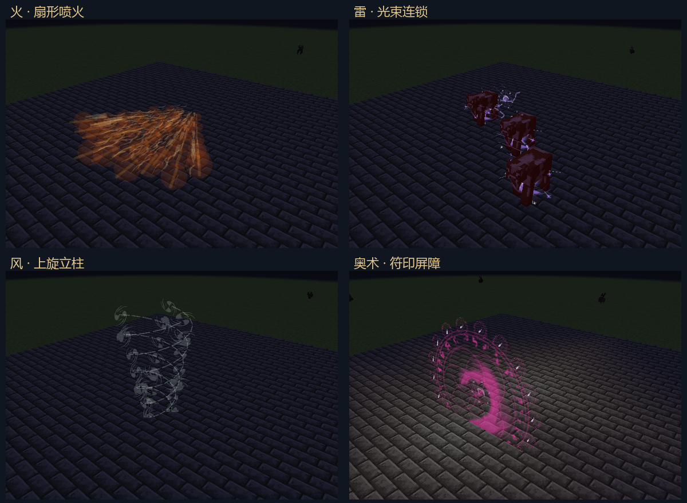
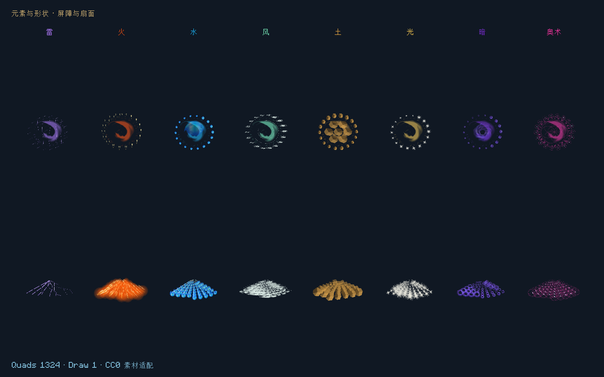

# 元素组合与奇幻施法特效

2026-11-01 · Minecraft 1.21.1 · NeoForge 21.1.265 · 0.26.0

这一版替换运行时的旧程序化特效图集，并让元素决定法术的材质、运动和展开方式。雷束新增真实连锁；火扇改为沿扇面向外流动的喷火。其余组合按已有元素作用完善表现，不另造一套由粒子触发伤害的系统。

## 素材选择与改造

以下均从作者发布页核验为CC0，可修改并随模组分发。发布时间早于当前生成式图像素材潮；这里只使用下载包内的原始PNG，不引入其他模组的资源。

| 作者与素材 | 采用部分 | 适配 |
|---|---|---|
| [Luke.RUSTLTD：4 summoning circles](https://opengameart.org/content/4-summoning-circles) | 四种法阵 | 黑色线稿转透明白色遮罩，三套起阵符印与奥术阵面 |
| [Mikodrak：2D Spell Effects](https://opengameart.org/content/2d-spell-effects) | Nyrthos火舌、电团、烟雾 | 火舌重调为橙黄，电团和烟雾转可着色遮罩 |
| [Cethiel：Pure Projectile](https://opengameart.org/content/pure-projectile-magic-effect) | 投射物与星芒 | 奥术色阶、光系星芒与冲击碎光 |
| [Cethiel：Water](https://opengameart.org/content/water-magic-effect) | 水球、涡旋、涟漪 | 水球序列、风系白色涡旋、接触波纹 |
| [Cethiel：Fire Wrath](https://opengameart.org/content/fire-wrath-magic-effect) | 火焰球面 | 火系碎屑遮罩，避免将深色轮廓当作发光主体 |
| [Cethiel：Cosmic Time](https://opengameart.org/content/cosmic-time-magic-effect) | 旋涡 | 暗系收缩与负向旋转 |

Kenney Particle Pack也核验为CC0，但本次下载返回网页而非有效资源包，未纳入最终图集或发行素材。

`art/vfx/sources.json`记录原包哈希、作者、网址和授权，`art/vfx/sources/`保存原包及授权页。`tools/artwork/fetch-spell-art.py`只下载白名单文件并验证ZIP，不执行包内文件。

`tools/artwork/bake-spell-assets.py`逐帧读取原包，按整段动画的共同边界裁切，保留锚点与尺寸；生成1024×1024、8×8格的RGBA图集。每格128像素并留透明边缘，原生纹理启用线性过滤。柔光、软线条和岩片为项目代码绘制的静态遮罩，与改造贡献一并按CC0提供。没有使用生成式位图。

运行时仅加载一张图集。JAR内的`art/spell_sources.json`逐格记录来源文件、SHA-256、处理操作和最终图集哈希；`META-INF/THIRD_PARTY_NOTICES.md`与完整CC0许可随包交付。原始下载包不打入JAR。旧图集和生成器只留在`art/vfx/legacy/`及历史工具中，不再作为运行时资源。

## 元素与形状的评估

同一种形状保留其作用范围和结算规则。元素改变材质、轮廓、流动方向与接触反馈；只有雷束需要新增目标选择规则。这样可以辨识不同组合，也保留玩家对范围、布线和有限魔力的预期。

| 元素 | 球状投射物 | 光束 | 屏障 |
|---|---|---|---|
| 火 | 火舌包裹、上升余烬 | 密集火流与明亮尾核 | 火焰边缘、燃烧碎屑 |
| 水 | 水球、尾迹涟漪 | 脉动水柱与环状波纹 | 水面核心与旋转水珠 |
| 土 | 岩块与短碎尾 | 分离岩片列阵，取消光滑激光外观 | 岩片拼接阵面 |
| 风 | 风旋核心、螺旋尾流 | 双股螺旋气流 | 多层旋转气环 |
| 雷 | 跃动电团与折线尾迹 | 服务端命中决定的闪电链 | 交错电弧与边缘放电 |
| 光 | 星芒与明亮核心 | 细亮光矛、垂直光环 | 星芒边缘与淡符印 |
| 暗 | 旋涡核心、内收碎屑 | 三股盘旋暗流 | 中央暗涡与向内旋转的边缘 |
| 奥术 | 紫色能量箭与符纹 | 沿光路展开多重符印 | 完整法阵主面与环绕符纹 |

| 元素 | 扇形 | 墙 | 环带 | 立柱 | 十字 | 穹顶 |
|---|---|---|---|---|---|---|
| 火 | 交叉火舌、暖色体积柔光，沿扇面向外喷出 | 向上窜动火舌 | 环形火舌 | 上旋火柱 | 四向火流 | 弧面焰浪 |
| 水 | 水珠与短水流向外喷洒 | 下落水珠 | 回旋水环 | 螺旋水柱 | 四向水流 | 分层水波 |
| 土 | 扇面岩片 | 网格岩片 | 环绕碎石 | 螺旋岩片 | 四向碎石 | 弧面岩片 |
| 风 | 扩散涡流与短气流 | 层叠风旋 | 环行风旋 | 三股连续上旋气流 | 四向气流 | 弧面风旋 |
| 雷 | 多道扇面放电 | 交错电网 | 环带短电弧 | 螺旋放电 | 四向放电 | 弧面电弧 |
| 光 | 扇形星芒 | 星芒幕 | 光环与地面符印 | 上旋星芒 | 十字光芒 | 星芒弧面 |
| 暗 | 扇面暗涡 | 暗涡幕 | 向内收缩 | 螺旋暗涡 | 四向暗涡 | 收缩弧面 |
| 奥术 | 扇面小符印 | 符印阵列 | 环绕符印与地面法阵 | 螺旋符印 | 十字符印 | 分层符印 |

这些是视觉组合；土墙、火墙等仍是有限体积法术，不生成免费的永久地形或持续伤害区域。火、水、土、风、雷、光、暗、奥术原有世界作用继续由服务器结算：例如水源、点火、临时光照、熄灯和奥术穿块。反元素和混合运输保留原有逐成分行为，以主导元素显示材质，不按混色猜测新的玩法。

## 雷束的真实连锁

纯正雷元素、指向方式、光束形状默认可跳转两次，即最多三个接触目标。明确的连锁符文覆盖默认跳数，最大四跳。组合了分裂或爆破时保留原有二次派生管线，避免一次施法重复产生两套连锁。

每次从实际命中处寻找5格内、已加载、可见、权限允许且未命中过的最近活体，距离相同以UUID稳定排序。每跳扣除原总射程；初始命中方块不隔空跳向活体。候选查询及视线检测不强加载区块。没有玩家权限时不能借连锁绕过原有PvP限制。

有下一目标时，当前魔力分为两份：一份用于当前接触，一份保留约85%后传向下一目标。没有下一目标则结算现有剩余量。后续接触继续分配，命中附加效果仍从各自接触份额付款。跳数、跳距和保留率在`elemental_combos_v1.json`中；不会每跳复制完整伤害。仅保留一个权威调用内的有限链，不产生新常驻计时器或额外飞行对象。

网络同步实际命中线段；客户端的折线抖动和小分叉只表示放电，不选择目标。原生世界作用仍在命中处执行，不沿装饰分叉免费触发。

## 火扇与连续施法

扇面采样沿既有`ShapeVolume`范围展开，局部坐标与服务器`ShapeFrame`使用相同轴系，支持抬头和低头喷洒。火舌沿各方向拉长，柔光与短亮核连接喷流，避免一排互不相连的小图标。

每次喷火仍是一笔有限的范围结算。持续喷火由现有持续法阵重复支付并释放；动画不会自行增加伤害步。墙后遮挡、元素化损耗、形状预算和原版方块权限保留。

## 生命周期与渲染边界

`ElementalCombos`是纯规则；`LightningBeams`适配真实世界；`ElementalGeometry`只生成表现网格。`SpellAtlas`保存离线图集格号，`SpellVisualRenderer`负责GPU提交。纹理、几何与玩法不互相反写。

时间线将有限寿命与动画相位分开：重复屏障/形状只刷新寿命，相位继续推进；暂停不推进，退出和资源重载清理。最多2048个活动观察、每帧8192个四边形，同一图集一次批次绘制；保持深度测试，不写深度，不添加逐粒子网络广播。

世界法术保存升为v8，保存屏障元素。v1–v7明确保留原奥术屏障外观及容量、寿命，不反推未记录的历史元素；非法元素保留原始NBT并停用。物品程序集、蓝图和VM格式不变。两端网络协议统一为`1.21.1-10`，须一起更新。

## 验证与交付

- `build/elemental-visuals-package.log`：最终构建与114,061项核心契约通过。`build/elemental-visuals-final.log`：八种实际服务端施法、网络线段、真实GPU绘制、过期与退出、三页动画画廊通过。
- `build/elemental-visuals-contracts.log`：137项Minecraft GameTest通过。新增真实雷链、有限伤害、遮挡、总射程、排除所有者、屏障v8往返/旧版迁移及非法字段保留。
- `build/elemental-visuals-godot.log`：工作区统一回归23套、零失败。引擎已有根证书读取日志单独识别。
- `art/vfx/previews/visual-batch-profile.json`：实际GPU饱和批次8192个四边形、1次绘制；停止后0四边形、0次绘制。该批次测量包含几何生成、提交及`glFinish`等待，中位1.81ms、P95约3.35ms。它是本机隔离样本，不代表整游戏帧时、多玩家或所有显卡性能。
- JAR核对全部编译类与图集一致、74个既有音效逐字节保留、许可与逐格来源完整；不包含测试类、原始素材ZIP或旧特效图集。15个旧安装包的体积和SHA-256全部保持。

安装包：[elemental-circuits-1.21.1-0.26.0.jar](../../../releases/elemental-circuits-1.21.1-0.26.0.jar)，2,528,051字节。

SHA-256：`0669d4a027ac4c9f70036f5caa307b58b03cd34bd170686df1530eb82825ecaf`。

正式世界存档未用于测试。旧协议读取测试不等于整张真实世界的长期升级验收；自定义着色器、大型整合包、远程多人和长期帧率尚未验证。本次未暂存、提交或推送。

实际截图经过裁切和排版，未修改特效像素：

