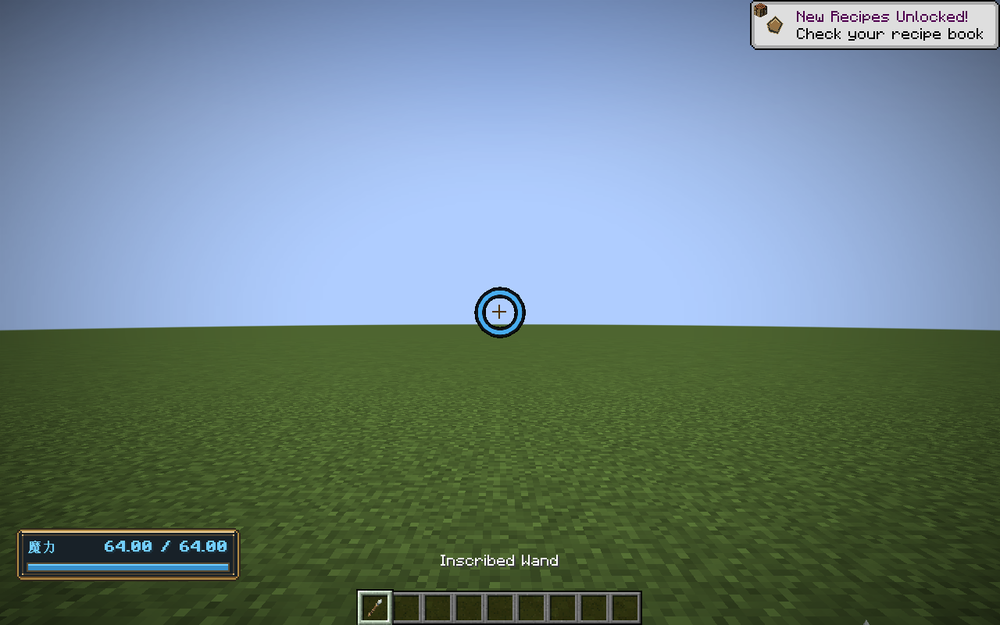
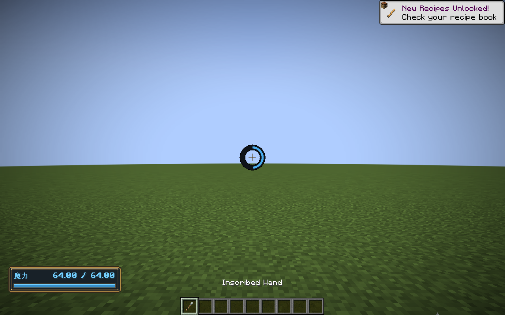
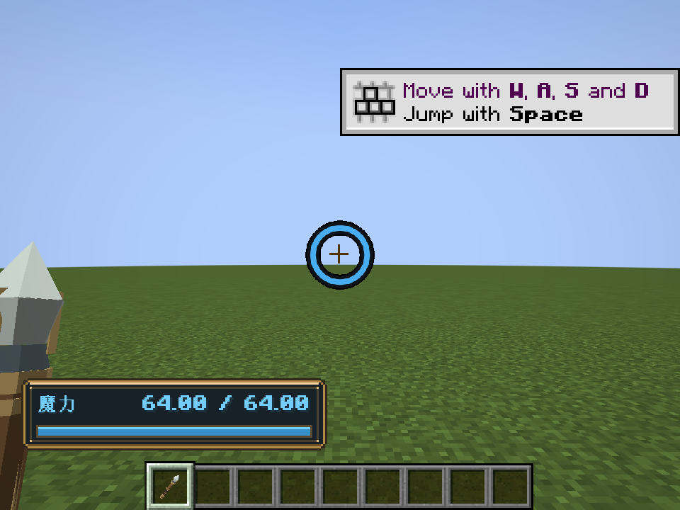

# 准星冷却环与魔力条

2026-10-31，v0.18.1。

施法CD改为准星外的圆环。就绪时蓝色满环，实际释放后清空，从十二点方向顺时针恢复；灰黑色底环在恢复期间保留。中央留空，保留原版准星。主手没有法杖、打开页面或隐藏HUD时不显示。

左下魔力条使用黄铜外框、亮边和暗色内衬；文字使用原版字体的粗体样式、浅蓝色与暗色阴影，蓝色填充对应当前魔力。位置上移，为快捷栏留出空间，GUI缩放后仍保持完整边框。

静态美术由 `tools/artwork/bake-hud.py` 生成到 `textures/gui/hud/`。`CastingHudRenderer`只绘制已同步状态：静态背景和边框使用PNG，蓝色圆环使用同一张抗锯齿纹理按比例裁切；方向表缓存，最多96段。`ClientHooks`提供魔力观察，`CooldownHud`提供冷却观察，表现不反写施法状态。

本次没有更改CD、法阵、伤害、魔力或存档规则。协议继续为 `1.21.1-3`。实际客户端截图分别检查就绪、恢复和紧凑GUI；正式JAR不包含截图验证器。

验证记录：`build/hud-ring-gpu-final.log`（构建、88,941项核心契约和实际客户端绘制），`build/hud-ring-godot.log`（Godot统一回归）。原版已知渲染/系统证书日志单独识别，不代表正式长期性能验收。
