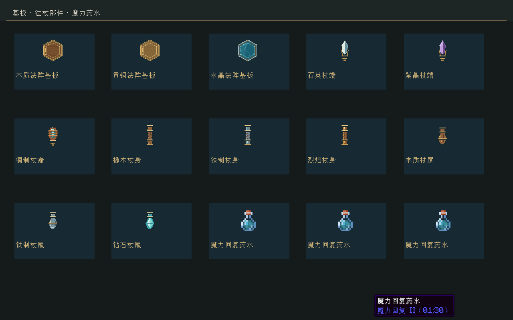
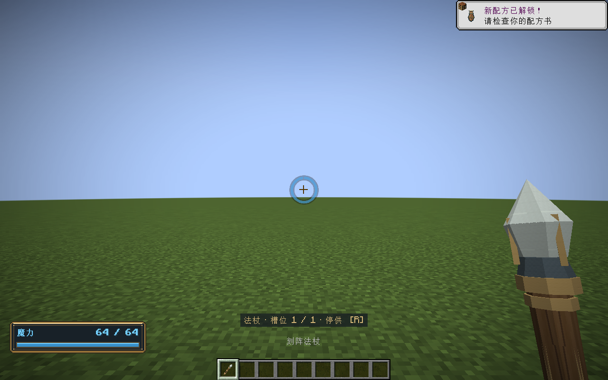
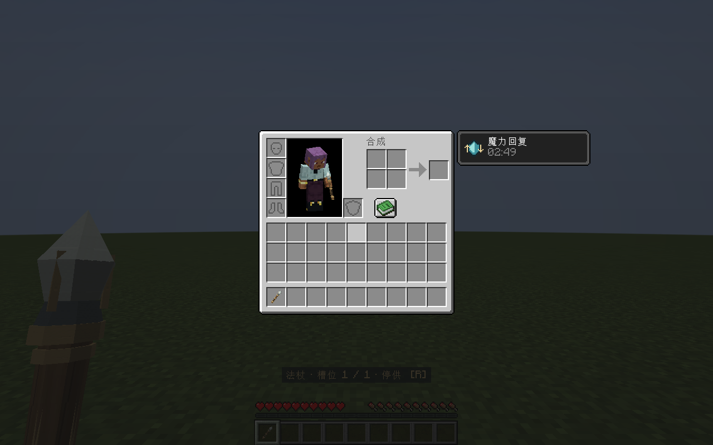

# 基板、法杖部件与魔力药水

2026-11-01 · v0.32.0 · Minecraft 1.21.1 / NeoForge 21.1.265

## 使用

在原版酿造台放入烈焰粉作为燃料。水瓶加地狱疣酿成粗制药水，再加入一颗魔力水晶，一次最多酿三瓶魔力回复药水。

| 后续材料 | 结果 | 持续时间 | 默认恢复速度 |
|---|---|---|---|
| 魔力水晶＋粗制药水 | 魔力回复 I | 3分钟 | 基础值×2 |
| 普通魔力回复＋红石 | 延时魔力回复 I | 8分钟 | 基础值×2 |
| 普通魔力回复＋萤石粉 | 魔力回复 II | 1分30秒 | 基础值×3 |

可继续用火药和龙息制作喷溅、滞留药水。饮用返还玻璃瓶，效果使用原版状态图标与倒计时；牛奶可以清除。原版规则决定不同等级和持续时间的覆盖。喷溅距离和滞留时长沿用原版，不强行改成饮用时长。

药水加快自然恢复，保留施法后的恢复等待，不瞬间补满、不提升魔力上限。默认基础恢复4/秒，I与II分别8/秒、12/秒。玩家专用恢复值优先于服务器基础值，再乘以药效；基础值为0时仍为0。效果消失后回到原有基础值，不会永久叠加。

服务器配置`manaPotion.bonusPerLevel`默认1，范围0～16；有效速度为`基础速度×(1＋加成×效果等级)`，按定点安全上限饱和。0表示不增加速度。时长与初始加成在`data/elementalcircuits/rules/mana_recovery_v1.json`中版本化保存；当前由模组类路径资源加载，修改时长需重新构建，不是可热重载的数据包配置。

## 美术

用本机Aseprite实际执行`tools/artwork/paint-plates-parts.lua`，导出64×64基板与部件图标、32×32三维材质、18×18药效图标。共29份分层`.aseprite`源文件保存在`art/aseprite/parts/`。木质采用横向木纹，黄铜采用锤纹与铆钉，水晶采用冷色晶面；基板中央保持空白，避免与玩家绘制的法阵混淆。杖端、杖身和杖尾有不同轮廓、包边与握柄细节。

27个部件组合OBJ补全静态UV，旧模型所有顶点、面、组和材质保持一致；原来的单点取色改为使用整张材质。重导出Blender模型会重新执行相同离线UV步骤。无需安装Aseprite或Blender即可游玩；不增加模型面数、运行期纹理生成或绘制提交。

重新绘制：

```powershell
& 'E:/Aseprite-v1.3.15.5/build/bin/aseprite.exe' --batch --script-param root=$PWD.Path --script tools/artwork/paint-plates-parts.lua
python tools/artwork/bake-wand-palette.py
python tools/artwork/unwrap-wand-materials.py
```

`tools/artwork/bake-wand-palette.py`默认使用同一Aseprite路径，可通过`ASEPRITE`环境变量覆盖。它重新导出已绘制的源文件，避免把纹理恢复成纯色。

## 验证

- 117,177项纯Java核心检查通过；覆盖倍率、定点饱和、0恢复、255放大等级、等待保留、实际逐步恢复和效果消失后的基础速度。
- 174项Minecraft GameTest通过，新增5项覆盖原版酿造配方、真实酿造台400tick燃料/水晶消费、三瓶产出、原版饮用与空瓶、牛奶清除、玩家独立策略、重复读取不叠乘、NBT药效保存和强弱覆盖。
- OpenGL客户端检查27个真实三维模型、3种基板、9种部件、3种药水、原版药效提示与HUD。日志在`build/mana-art-gpu-final.log`，截图如下。
- `build/parts-art/verification.json`记录导出尺寸、像素颜色数与SHA-256，确认29份源文件与27个OBJ几何不变。所有测试使用build下隔离实例；不宣称长期多人压力验收。







安装包：[0.32.0](../../../releases/elemental-circuits-1.21.1-0.32.0.jar)，2,821,773字节；SHA-256：`321d6238e6b9d420301034c2b5a613bd37c82d1056bd40d1638ea5e059f0c573`。22个历史归档、74个OGG、两份素材授权及项目许可证保持原字节；正式包不含测试类。核验记录为`build/mana-release-verification.json`。网络协议仍为1.21.1-15；药效采用原版同步和保存。
