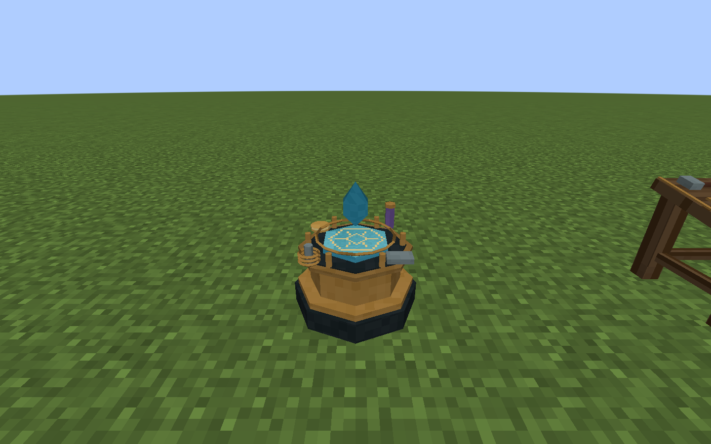
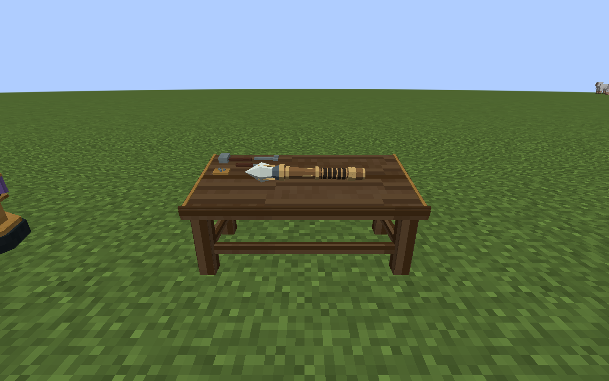

# 工作台模型与交互

2026-10-31，Minecraft 1.21.1 / NeoForge 21.1.265，模组 0.21.0。

刻印和组装现在通过对应的实体工作台进行。法杖对空右键仍用于起停施法，蹲下对空使用只提示工作台用法。法术书仍可随身查看、选阵和施法；修改书中法阵也需要刻阵台。

## 外观与源文件

法阵工作台采用八角黄铜基座、深色台面、悬浮蓝水晶与聚焦铜环。编辑中的六角基板位于水晶下方，随木质、黄铜、水晶材质切换；台面配有线圈、金属支架、小瓶和刻度盘。空闲时收起基板预览。

法杖工作台占两格，采用四脚云杉桌、12°倾斜桌面与横撑。左上角保留木槌、刻刀、扳手和零件盘；正在修改的法杖横放中央，采用实际杖端、杖身、杖尾的三维组合。关闭界面、换下原物品、走远或重新加载后清空。





模型由本机 Blender 5.2.3 LTS 实际生成，贴图由用户指定的 Aseprite 1.3.15.5 实际绘制和保存。源文件分别为 [workstations.blend](../../art/blender/workstations.blend) 和 [workstations.aseprite](../../art/aseprite/workstations.aseprite)。图集256×256，共16块32×32画稿，各自带16像素外延，减少缩小时的跨材质串色。

导出包含七个OBJ：空闲刻阵台560个面，三种基板刻阵台各574个面，完整法杖台138个面；世界中的桌子按主/副半边分别烘焙（110/44个面）。面数包含为Minecraft正确封口而拆分的三角形；不把Blender多边形直接交给只接受三角形/四边形的加载器。模型资源在加载时静态烘焙进区块，只有桌上法杖使用独立渲染器，复用已有27种缓存模型。

## 使用流程

| 持有物与交互 | 结果 |
|---|---|
| 主手法杖 → 右键法阵工作台 | 刻印法杖自身法阵；有副手法术书时刻印书中法阵 |
| 主手法术书 → 右键法阵工作台 | 刻印书中保存的法阵 |
| 主手法杖 → 右键法杖工作台任意半边 | 组装部件或修缮，桌面同步预览该法杖 |
| 木质/黄铜/水晶基板 → 右键法阵工作台 | 先进入刻印草稿；完成刻印才消耗一张并得到同材质固定法阵 |
| 未放置的固定法阵 → 右键法阵工作台 | 先刻印，再放置到世界 |
| 持法杖蹲下右键已放置的自有固定法阵，再右键附近刻阵台 | 在工作台修改选定固定法阵；之后选定状态消费完毕 |
| 普通右键已放置的自有固定法阵 | 起阵或停止供给 |
| 蹲下且不持法杖右键固定法阵 | 从玩家魔力槽充入本地储量 |

修改须在工作台8格内完成，并保留原来的实际持物；已放置固定法阵还须在玩家8格内且归其所有。关闭刻印界面会结束授权。查看蓝图簿、切换法术书页面、起停法阵和运行开关继续作为随身运行操作。

桌面是只读预览，法杖实际仍在玩家手中；它没有第二个物品库存。关界面和拆桌都不会凭空掉出一根复制法杖。基板先在刻阵台绘制法阵，再点击“完成刻印”。只有通过校验的非空蓝图才交付成品，关闭会取消且保留基板。成品保存刚绘制的法阵，不赠送运行状态或魔力。单张板会在原手持槽替换为产物；多张板只扣一张，产物进入背包，背包放不下则落地。

两格法杖台需要侧面连续空位，四个朝向都支持；任意半边拆除都移除整桌且只掉落一张。旧单格台在玩家持杖互动时尝试向侧面展开，遇到方块、实体或权限限制不会覆盖它们，需先清出空间。

## 配方与兼容

刻阵台的合成格为 ` A /CBC/CCC`：A紫水晶碎片、B木质基板、C铜锭。法杖台为 ` Q /CWC/PPP`：Q石英、C铜锭、W工作台、P云杉木板。固定法阵旧工作台合成配方已移除，改由三种基板与刻阵台互动制作。

原两种工作台、法杖、法术书和固定法阵的注册ID保留；旧法阵定义和完整运行现场不升级或重置。旧固定块的材质从已保存的第一块基板恢复；创造中键只复制空白材质，不复制身份、魔力或运行状态。

网络协议为 `1.21.1-7`，客户端与服务端都要更新0.21.0。完整旧世界长期试玩和多人并发操作仍需后续实机验收。

## 重建与验证

在1.21.1工程目录运行：

```powershell
& 'E:/Aseprite-v1.3.15.5/build/bin/aseprite.exe' --batch --script-param "root=$((Get-Location).Path.Replace('\','/'))" --script tools/artwork/paint-workstations.lua
& 'D:/blender/blender-5.2.3-windows-x64/blender.exe' --factory-startup --background --threads 4 --python tools/artwork/model-workstations-blender.py
python tools/artwork/check-workstations.py
./tools/build.ps1 -Tasks build,runGameTestServer -Mirror -Offline
./tools/build.ps1 -Tasks runClient -StationSmoke -Mirror -Offline
```

常规安装不需要Blender、Aseprite、Python或MCP。旧占位资源生成器已保护当前工作台状态、物品模型和配方；更新新工作台资源请使用上述专用脚本。

0.20.1修复使用模型空间UV和连续桌面，工具随坡面摆放，法杖按实际几何拟合两处支撑；模型与碰撞一同从Blender导出，水晶和预览均位于占用格子内。验证见 [贴图与穿模修复](工作台贴图与穿模修复.md)；0.20.0历史基线见 [工作台更新验证](../verification/工作台更新验证.md)。

0.21工作台只显示占用方块边界，实际碰撞保留。固定法阵改为低矮六角阵盘，完整流程与新资源见 [固定法阵刻印与外观](固定法阵刻印与外观.md)。

0.21.1细化固定阵盘贴图，当前美术源与UV规格见 [法阵贴图细化](法阵贴图细化.md)，工作台和刻印流程保持原规则。
