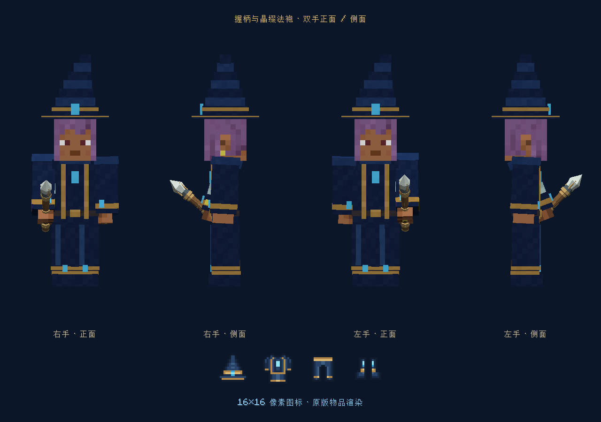
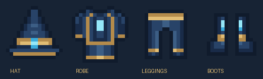
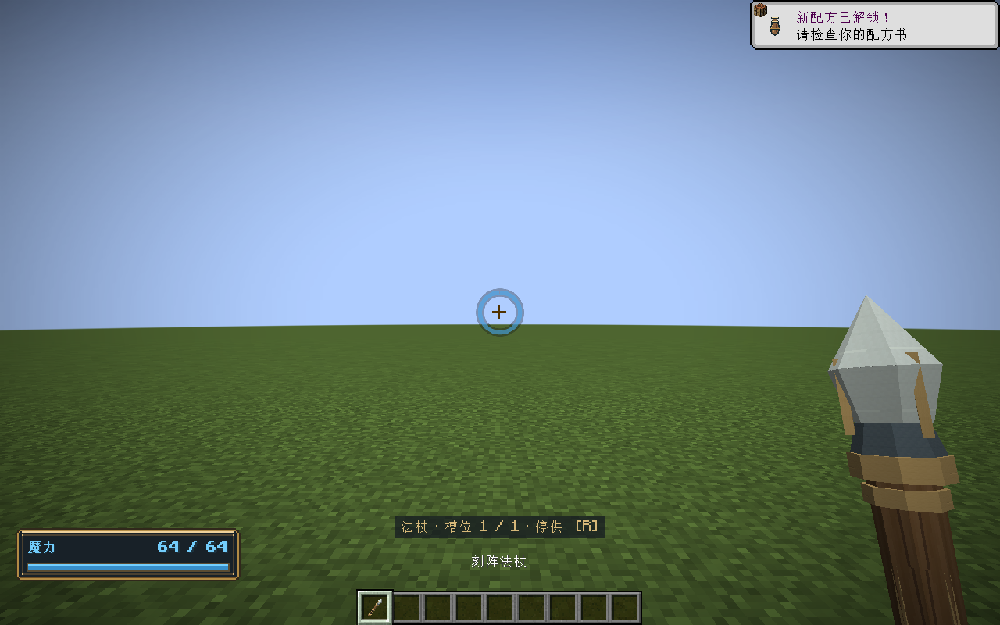

# 握持与法袍美术修正 · 0.36.1

27 种部件法杖统一改为按握柄中心对齐原版手掌。第三人称持杖从贴着前臂改为向前上方倾斜，左右手各自沿用原版持物层；第一人称、物品栏、掉落物和工作台上的模型显示保持原设置。

帽饰、胸口、双袖、双膝及双靴共 8 处水晶取消 45° 倾斜，长轴竖直。四件装备物品图标重绘为 16×16，使用左右对称的轮廓和像素、有限的深蓝/黄铜/水晶蓝色板，无平滑缩放。保留 Blender 模型与 Aseprite 源文件。

## 可复现资源

- `tools/artwork/align-wand-grip.py`：由 OBJ 握柄中心、原版持物变换和手掌位置计算 54 个握持变换。绕 X 轴 25°，缩放 0.8，模型像素平移约为 `(0, 1.016192, 2.406474)`；实际 JSON 使用计算值。最终握柄坐标误差小于 0.000001 格。
- `tools/artwork/model-wands-blender.py`：重新导出模型时复用同一握持计算，避免回退。
- `tools/artwork/model-wizard-blender.py`、`art/blender/wizard/wizard-equipment.blend`：水晶旋转和静态模型源。
- `tools/artwork/draw-wizard-icons.py --aseprite E:/Aseprite-v1.3.15.5/build/bin/aseprite.exe`：导出运行 PNG 与 `art/aseprite/wizard/` 下四份可编辑源文件。

## 验证

`tools/build.ps1 -Tasks build,runGameTestServer -Mirror -Offline`：161,126 项核心断言、217 项原生 GameTest 通过。纯显示修正没有修改玩法规则或存档结构。

`tools/build.ps1 -Tasks runClient -EquipmentSmoke -Mirror -Offline`：`WIZARD_EQUIPMENT_GPU_PASS`。隔离世界真实穿戴模型，同时预览左右手的正面、侧面和四个原版物品图标。逐图检查确认握柄穿过手掌，水晶竖直；装备属性、轮盘及刻印界面既有验证通过。

`tools/build.ps1 -Tasks runClient -WandSmoke -Mirror -Offline`：`WAND_MODELS_GPU_PASS`、`WAND_WORLD_GPU_PASS`、`MANA_STATUS_GPU_PASS`。27 个原生立体模型、第一人称双手、第三人称、冷却显示均通过；首视角及第三人称截图已检查。

资源审计确认 54 个握柄锚点误差满足上述范围，8 处水晶旋转为零，四个图标均为镜像对称的 16×16 PNG，并实际进入安装包。保留 27 个历史安装包和 74 个原有 OGG 的内容；新 jar 不包含测试类或 Curios 类。日志中的 Yggdrasil 公钥请求失败属于离线认证请求，未影响完成标记。不包含其他玩家模型插件和全部动作的兼容性验收。

日志：`build/grip-art-tests.log`、`build/grip-art-equipment-gpu.log`、`build/grip-art-wand-gpu.log`。资源与归档记录：`build/grip-art-verification.json`。全部测试使用 `build/` 下隔离世界，不修改正式世界。

## 更新包

[下载 0.36.1](../../../releases/elemental-circuits-1.21.1-0.36.1.jar)，3,000,083 字节。SHA-256：`df48e99166882ac33532f18d2620596cba7deefc0e1a7146a70fa4f905d3dcfa`。

仍需 Curios API 9.5.1+1.21.1；已有相同依赖可继续使用。用新 jar 替换旧版元素法阵 jar。

## 实机与图标

