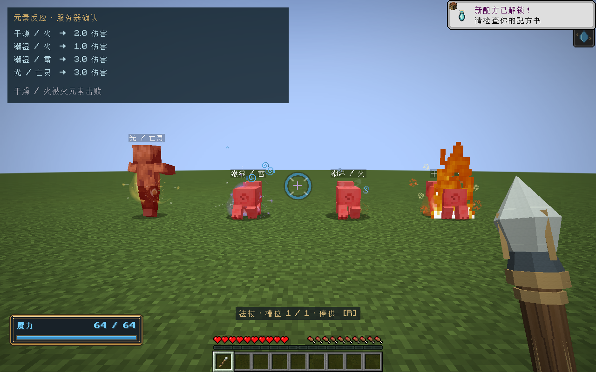
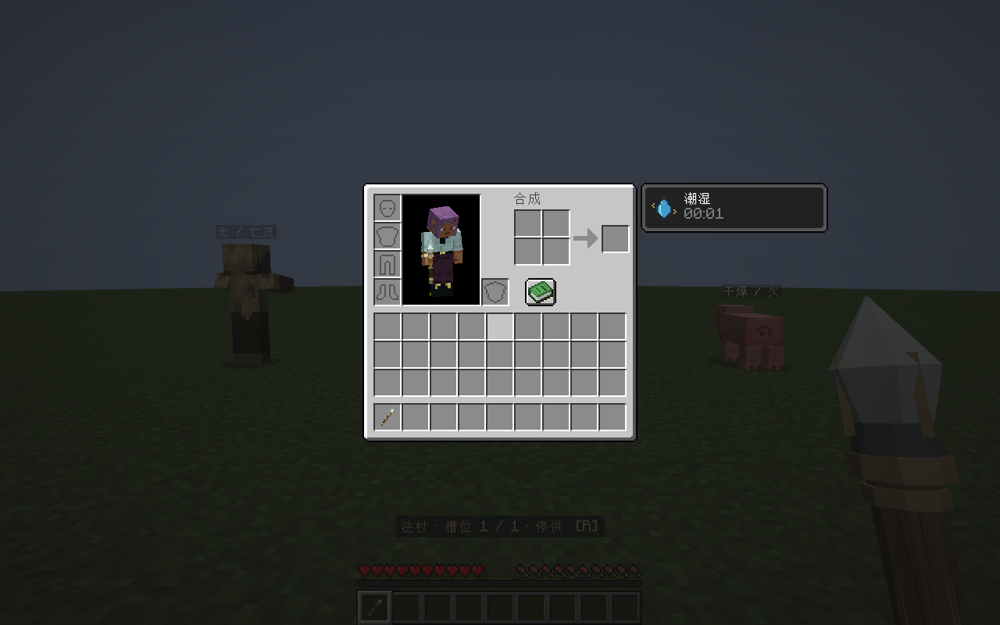

# 元素伤害与反应

> v0.34更新：同次命中的相克元素先按实际到达队列抵消，再让剩余元素依次生效。本文的同时聚合说明由 [元素反应队列](元素反应队列.md) 替代。

2026-11-01 · 0.33.0 · Minecraft 1.21.1 / NeoForge 21.1.265

## 伤害命名

所有新伤害ID使用`elementalcircuits:ec_damage`前缀。按`ec_damage/fire`、`ec_damage/water`等分组，中文显示“火元素”“水元素”。Minecraft资源路径只能使用规范的ASCII字符，中文放在本地化文本。纯净、土、水、火、风、雷、光、暗、奥术均有独立类型；反火的寒霜使用`ec_damage/frost`，混合伤害使用`ec_damage/mixed`，通用类型为`ec_damage`。

以伤害类型JSON注册，支持原版`/damage`、死亡消息、伤害标签和第三方事件。`/damage`直接指定类型只施加原版伤害，不伪造法阵魔力量或触发组合反应。旧`elementalcircuits:spell`通用类型退出新版本注册；法阵、投射物和世界存档不保存此ID，因此不需要改写原有法阵现场。

## 反应原则

以命中瞬间的状态和整包元素统一求值，再提交一次伤害和相应状态。反应只改变这次已经分配的作用，不复制魔力，不额外扫描目标，不创建递归伤害；抵消的作用消散且不返还魔力。

| 组合或条件 | 结果 |
|---|---|
| 水命中 | 熄火，留下6秒潮湿；水与反水在同包先抵消，剩余反水干燥目标 |
| 火命中潮湿目标 | 火伤减半，不点燃；消耗魔法潮湿并出现蒸汽。站在水中或雨中会继续潮湿 |
| 雷命中潮湿目标 | 雷伤×1.5；只增强该目标的雷成分，不免费连锁 |
| 反火（寒霜）命中潮湿目标 | 冻结积累×2；原版抗冻装备、免冻实体受到保护 |
| 火与寒霜 | 同包热/冷先相消；火减少已有冻结，寒霜熄火并积累冻结 |
| 土命中已冻实目标 | 土伤×1.5，消耗冻结积累；同一包新加的寒霜不立即触发碎冰 |
| 土命中潮湿目标 | 泥泞，获得更强减速；反土仍为短暂悬浮 |
| 风命中正在燃烧的目标 | 助燃，延长已有火势，仍受上限控制；潮湿、寒霜和水会阻止助燃 |
| 光与暗同包 | 正光与正暗先按量抵消，剩余一方发挥效果；不会先治疗再按顺序覆盖 |
| 光命中 | 治疗正常生命，伤害亡灵；驱散致盲与黑暗。暗施加致盲，后续光可清除 |
| 奥术 | 稳定魔法伤害，保持既有穿透方块行为，不再额外套增幅 |

普通火、寒霜、雷、奥术基础伤害2/魔力，土与暗1/魔力，水与风0.5/魔力。光治疗2/魔力，正光对亡灵造成4/魔力；逆光保留伤害用途。反相仍沿用现有符文体系，不增加冰元素转换符文。数值属于独立v1资源，不影响格盘资源守恒。这里的每魔力指交付给目标的量：光束已有的照明预付份额仍先扣除，例如1魔力光束对亡灵实际交付0.75，造成3点伤害。原版会自然减少冻结积累，加大寒霜投入可延长后续碎冰的窗口。

## 结算与边界

混合攻击合并为一次原版hurt调用，防止后续元素被原版受击无敌帧吞掉，也不重置无敌帧。伤害源保留不可变的逐元素伤害明细，方便其他模组读取；纯元素使用对应ID，混合使用mixed。火免疫/抗火只过滤火成分；免冻只过滤寒霜成分。保留旧法术忽略护甲、尊重抗性和原版受击间隔的规则。混合攻击的原版附魔保护以mixed类型整体求值，不能冒充每一元素分别经过一次原版保护计算。

本次元素状态只在元素伤害被接受后提交；伤害事件取消、无敌帧拒绝时，不额外附赠点燃、潮湿和击退。纯治疗仍走原版治疗事件。施法者、玩家友伤、创造/观察者及不可伤害实体在服务器边界检查。权威结算与视觉分离。

潮湿采用原版MobEffect，持续、保存、联网、覆盖和牛奶清除由原版负责；冻结使用原版FrozenTicks，其他控制使用原版效果。无需全世界逐帧扫描，也不新增独立实体状态数据库。

## 接口、资源与兼容

| ID后缀（统一前缀`elementalcircuits:ec_damage/`） | 中文含义 |
|---|---|
| `pure` | 纯净元素，保留扩展类型；纯净魔力仍不造成法术伤害 |
| `earth` / `water` / `fire` / `wind` | 土 / 水 / 火 / 风元素 |
| `lightning` / `light` / `shadow` / `arcane` | 雷 / 光 / 暗 / 奥术元素 |
| `frost` | 寒霜，现有反火的伤害用途 |
| `mixed` | 多种实际伤害成分合并的一次命中 |

此外注册无后缀通用类型`elementalcircuits:ec_damage`。全部12个类型加入`#elementalcircuits:ec_damage`标签。沿用`bypasses_armor`、`bypasses_wolf_armor`、`no_knockback`、`witch_resistant_to`和`panic_causes`；火、霜、雷分别加入原版`is_fire`、`is_freezing`、`is_lightning`标签。`is_fire`没有覆盖混合类型，避免抗火吞掉整包混合伤害。原版霜弱点先纳入预算，纯霜交给原版施加5倍时作一次补偿，混合直接使用已算好的分量，二者都不会重复放大或绕过默认128伤害预算。

`ElementalDamageSource.components()`提供不可变16.16逐元素伤害，已计反应与霜弱点、尚未计护甲/抗性等防护；`ownerId()`保留施法归属，即使施法者实体暂时不可用。纯霜对原版霜弱点实体的incoming事件参数为补偿后的请求量，原版内部随后恢复倍率；读取最终分量的兼容逻辑应使用components，不能把这两个阶段当成同一个数值。

`ElementalCombatRules` / `ElementalCombat`为无Minecraft依赖的规则与纯求值，`ElementalCombatResources`加载`data/elementalcircuits/rules/elemental_combat_v1.json`，`ElementalCombatAdapter`负责原版状态快照与提交，`SpellDamage`只负责类型寻址和伤害源。战斗规则JSON目前从模组类路径加载，修改需重构建；DamageType JSON和标签属于原版数据包注册，可由数据包覆盖。注册方式依据[NeoForge 1.21.1官方伤害类型文档](https://docs.neoforged.net/docs/1.21.1/resources/server/damagetypes/)，原版伤害、冻结和效果行为同时按本地1.21.1源代码核对。

反应效果每次最多提交一条既有`SpellVisual`观察，复用预算、距离筛选、批量消息和客户端批量渲染。优先显示碎冰、蒸汽、导电等主要反应，替代普通命中效果；没有逐粒子网络消息、额外目标扫描或新特效协议。

潮湿图标由`tools/artwork/paint-combat-status.lua`通过Aseprite实际绘制，源文件`art/aseprite/drenched.aseprite`，导出为18×18 PNG。燃烧、冻结后续的环境伤害仍由原版负责；本次新类型用于模组直接法术命中。独立投射物修饰符保留原有单独付费路径，本页接受/取消契约针对元素命中本身。

网络协议仍为1.21.1-15，但新增了原版状态注册，客户端与服务器应安装同一0.33.0版本。法阵与世界自有保存格式未变；新规则用于之后发生的命中，包括升级前已经保存的在途投射物，不改写魔力、在途数量或法阵现场。

## 验证

- `build/combat-release-tests.log`：134,727项核心检查、188项Minecraft GameTest通过。新增纯领域契约覆盖状态组合、抵消、结果只读、最大数值和2,500组固定种子的混合/状态样本；新增14项原版集成覆盖注册/标签、原版damage命令、实际光束路径、潮湿链式命中、霜弱点预算、护甲/免疫/保护、受击间隔、NBT与牛奶/自然到期，以及特效满载不改变伤害。
- `tools/build.ps1 -Tasks runClient -CombatSmoke -Mirror -Offline`在`build/combat-smoke/`创建隔离客户端与世界；检查四组真实光束、服务器与客户端实际血量一致、中文死亡消息、原版潮湿同步和图标。截图中的对照面板为测试专用，不进入正式模组。
- 所有历史安装包保留，不使用正式玩家世界测试。不宣称长期多人压力或任意第三方战斗模组组合验收通过。

安装包：[0.33.0](../../../releases/elemental-circuits-1.21.1-0.33.0.jar)，2,857,086字节；SHA-256：`947211ce576070c889456c7b68ea320aa14f10e19c96bb3fa60207e420c803fb`。23个历史归档、74个OGG、两份素材授权及项目许可证保持原字节；正式包不含测试类。核验记录为`build/combat-release-verification.json`。
