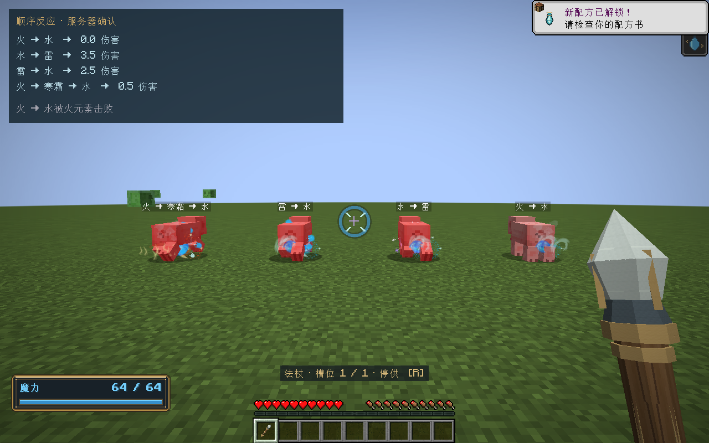
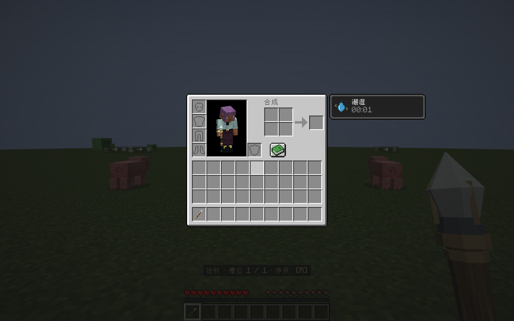

# 元素反应队列

版本：0.34.0 · Minecraft 1.21.1 / NeoForge 21.1.265 / Java 21。

同一次命中先完成相克抵消，再让剩余元素按顺序生效。前一发法术已经造成的伤害不追溯撤销。

## 顺序如何产生

法阵传输包保存有序的「成分、数量、接收序号」片段。每次真实接收成功后才增加所属法阵的序号；缓存合流按序号稳定归并，不按元素枚举或符文编号重新排列。同一传输轮内同时抵达的线路，以保存的连线声明顺序确定先后。分流、支取、转换、反转、损耗、派生预算和世界目标分配都保留源片段的子序列。

不同法阵拥有各自的接收计数。跨阵接收时重新标记本阵接收序号，同时保留包内部的元素顺序。拒收不会消费供给或增加接收序号。

## 抵消和生效

处理一个新片段时，先寻找队列中最早的相克片段，双方按数量一比一消费；未消耗完的部分继续匹配，剩余量才进入队列。整次命中的队列抵消完成后，才计算伤害、治疗和状态。每个片段最多被消费一次。

相克表包含八种元素各自的正反相，以及正火/正水、正土/正风、正光/正暗。纯净魔力不参与抵消。表来自 `data/elementalcircuits/rules/element_reactions_v1.json`，是构建时加载并验证的版本化资源；当前不提供运行中热重载。

等量示例：

| 输入顺序 | 抵消后的结果 |
|---|---|
| 火 → 水 | 全部抵消，无伤害、点燃或潮湿 |
| 2火 → 水 | 剩1火，按1火结算 |
| 水 → 火 → 寒霜 | 水消耗火，剩寒霜 |
| 火 → 寒霜 → 水 | 火消耗寒霜，剩水 |
| 水 → 雷 | 先潮湿，后续雷导电 |
| 雷 → 水 | 雷按干燥状态结算，随后潮湿 |
| 4寒霜 → 土 | 足够冻结后，土可在同次命中碎冰 |
| 土 → 4寒霜 | 土不获得未来冻结的增伤 |

以上每份指1魔力，强度1。水自身基础伤害0.5；水→雷总伤害3.5，雷→水总伤害2.5。四份寒霜是正火的反相。连续相同成分的片段在效果计算时合为一段，避免运输分包改变状态阈值；运输记录仍完整保存。

实体结算使用一个原版 `hurt` 调用，保留 `ec_damage` 逐元素明细及原版受击间隔。伤害事件被取消时不提交任何后续状态或推力。伤害预算沿幸存队列依次分配，治疗和推力仍有原有总预算。随后按序提交状态，粒子只消费结果。对上一发留下的潮湿、燃烧、冻结仍使用原版状态；本版没有新增跨命中的定量元素残留槽。

世界作用在目标份额分配前完成抵消，避免火水已抵消却依旧生成方块。每个方块每次接触仍只执行一次原子状态变更，按剩余队列选择第一个可支付、可适用的作用。已有水源、冰、火焰等使用原有世界反应，不回滚先前变更。

## 边界与存档

- 单包最多16,384个归一化片段。相邻且接收序号相同的同成分可合并；非相邻片段不会被排序折叠。容量不足时背压或拒收，不截断队列。
- `Mixture.equals` 包含片段顺序和接收序号；资源账本使用 `sameAmounts` 比较逐成分数量。两种判断不互相替代。
- VM现场为v9，保存完整队列与接收计数；独立包为v2，世界法术为v10，递归运行表为v2；网络握手为 `1.21.1-16`。
- 真实旧数据只有数量向量，无法恢复当时未记录的顺序。读取时明确使用成分编号升序、接收序号0的兼容队列，随后按新格式保存；不会重置余额、在途魔力或供给账本。蓝图仍是创建配置，不增加伪造的历史顺序。
- 新格式缺少队列、金额与队列不一致、悬空序号或越界计数会拒绝恢复。长包采用有界UTF-8字节NBT，避免字符串64K限制；短包保留字符串，读取同时验证格式与容量。

## 验证

- `build,runGameTestServer`：160,960项核心契约、193项Minecraft服务端集成测试通过。覆盖FIFO抵消、幸存顺序、真实VM接收、分流守恒、满队列原子拒收、计数耗尽、旧格式迁移，以及2,000片段真实NBT写入/恢复/命中。
- 客户端隔离世界：四束真实混合光束的伤害依次为0、3.5、2.5、0.5；客户端实体血量与服务器一致，潮湿状态和中文伤害提示同步正常。日志含 `ELEMENTAL_COMBAT_GPU_PASS`。
- 记录：`build/queue-release-tests.log`、`build/queue-release-gpu.log`、`build/queue-release-verification.json`。客户端短测不代表长期GPU性能验收。环境限制导致Mojang公钥和皮肤请求失败；测试世界和反应验证已正常完成。
- 安装包：`elemental-circuits-1.21.1-0.34.0.jar`，2,873,954字节；SHA-256：`ecdfaf0b4943d282853242cd8f4ed7199c0021310bcbc4d0702ad2708e0bec81`。归档共25个，已有24个文件逐一核对哈希未变；74个OGG及原许可保留，测试类未打包。

