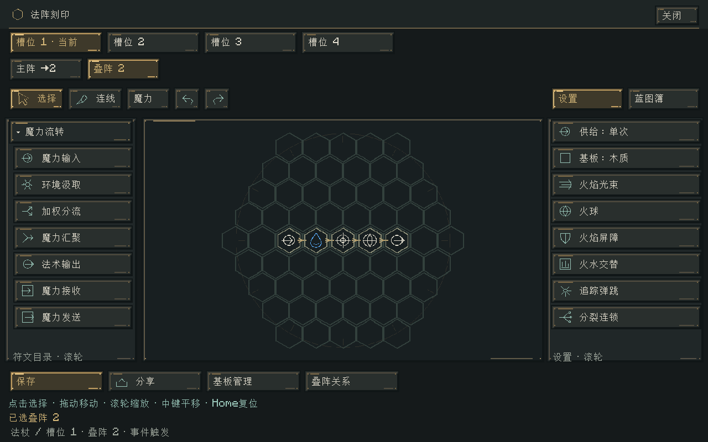
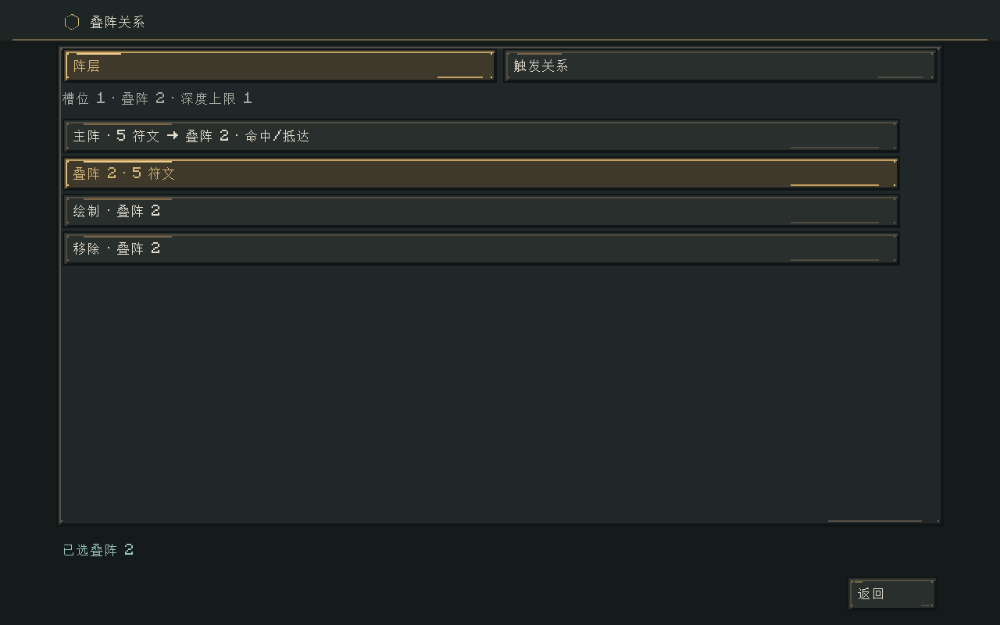
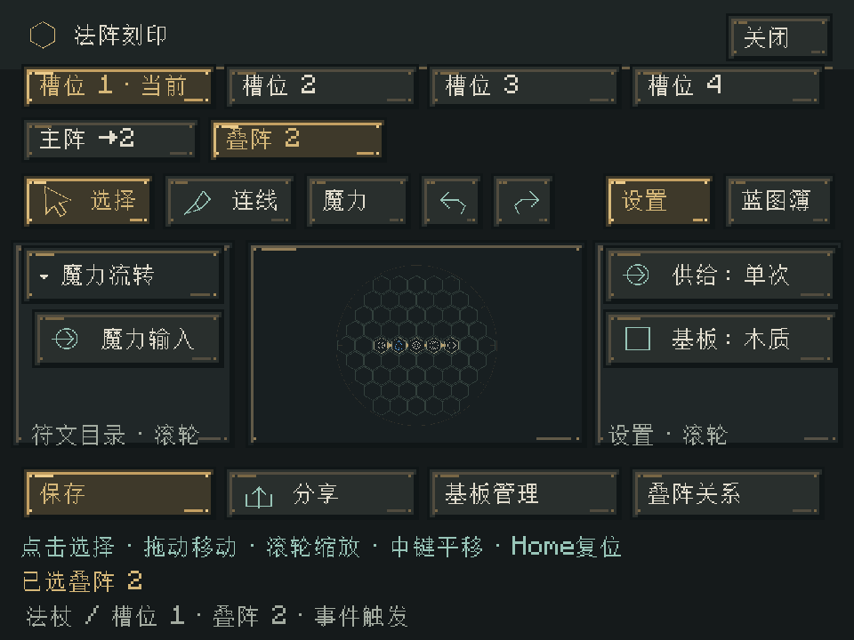
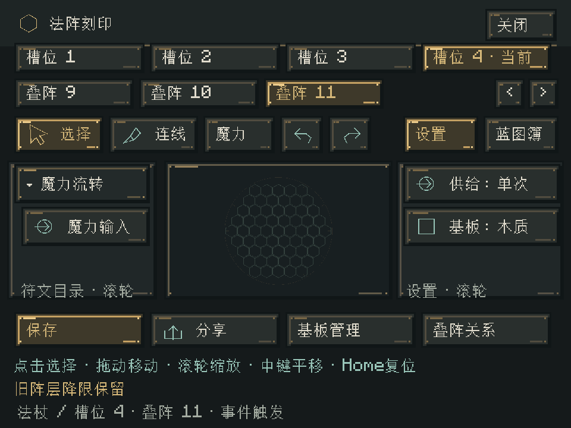

# 同基板叠阵与编辑导航

2026-11-01 · 0.31.0

## 当前结构

法杖、法术书和固定法阵使用相同的基板槽位结构。一个槽位对应一块实际基板；槽位内有主阵和可绘制的叠阵，坐标使用同一平面格盘，各阵层分别保存符文与线路，允许在相同坐标重叠。阵层共用基板材质、尺寸和规则，不新增供能池，不各自获得满魔力，也不消费另一张基板。

主阵拥有正常运行实例。叠阵保留创建定义，通过母投射物的事件触发时创建独立、有限供给的子实例；未触发时不额外推进VM。源阵可以指向本基板的另一阵层或自身，循环仍受材料深度、触发次数及服务器工作预算约束。一次输出仍只配置一个派生目标，不把重叠解释为隐式连接。

## 编辑与操作

- 刻印页移除起阵、停供按钮，基板管理页也不再提供这两个按钮。运行中的法阵须先在世界中使用法杖停止供给，再回工作台刻印。
- 顶部第一行显示物理槽位，当前槽位高亮，点击直接切换；不会起阵。第二行显示该槽位的主阵、叠阵及箭头目标，点击切换当前绘制阵层。阵层较多时可分页。
- 底部“叠阵关系”进入独立子界面，不属于法阵管理标签。“阵层”页显示各层符文数及触发关系，可新增、移除或返回绘制；被引用的阵层须先断开关系再移除。编号删除后不复用。
- “触发关系”页针对当前阵层选择目标及条件。新配置没有默认触发条件；明确选择命中/抵达或定时后才能保存。定时显示延时输入；预留比例继续使用既有有限魔力机制。
- 每个槽位和阵层保留独立的本地编辑草稿与撤销状态。切换不会自动保存；点击保存只修改当前明确地址。蓝图文本码和蓝图簿仍保存当前单张法阵，不包含整个叠阵关系图。
- 基板材料只能统一更换。服务器先验证所有阵层能否放入新格盘，成功后才消费新板并返还旧板；任意阵层放不下时整体拒绝。材质下降不会自动删阵或裁剪符文。

## 材料递归公式

设材料等级为木质0、黄铜1、水晶2：

```text
深度 = clamp(floor(initialDepth × depthGrowth ^ 材料等级), 1, 16)
```

服务端配置`layers.initialDepth`默认1，范围1–16；`layers.depthGrowth`默认2，范围1–4，支持小数。使用16.16定点计算，中间保留定点精度，最终取整。默认得到木质1、黄铜2、水晶4，不包含主阵。可新增的叠阵数量也受同一值约束；循环调用每跨越一次事件计一层，不能借自调用绕过。

```text
/ec config get layers.initialDepth
/ec config set layers.initialDepth 1
/ec config set layers.depthGrowth 2
```

配置同时出现在NeoForge服务端配置界面与`elementalcircuits-server.toml`。16是保存/数值格式保护。降低公式不删除已有阵层，已超出数量时不能继续新增；新发射的程序冻结当前材料深度，已经发射的投射物及在途任务保留原冻结深度。`recursion.maxDepth`只保留给旧跨槽位程序，不再覆盖新同基板公式；触发次数、任务窗口、保留率、活动容量与每步工作预算仍共用。

## 跨槽位与旧世界

跨槽位魔力/信号互联的领域模型、线路及在途保存保留，当前编辑页不再提供新建入口；既有线路不被清空。旧的跨槽位派生记录保留在原字段中，新的投射物不再使用它，旧配置入口拒绝新增。要继续设计派生，需要在对应基板内绘制叠阵并建立关系。旧数据不会自动复制为多个占用新材质的阵层。

升级前已经支付并发射的递归投射物，仍按冻结程序v1恢复和完成；不能因编辑结构变化而丢失其预付效果。新的同基板程序是v2，仅冻结一个物理基板的主阵、叠阵和关系；运行队列、命中位置、沿弹道方向释放、预算和权限保持原契约。

## 模块与保存

`PlateLayers`为不可变领域定义，主阵引用实际基板规则，子层状态只保存派生定义，避免重复保存主阵。`CircuitAssembly`仍只调度物理槽位的活动VM，新增阵层状态进入仓储变更检测、完整快照和原子校验。程序集v3保存各槽位叠阵；v1/v2明确恢复为空叠阵并保留原有跨槽数据。

编辑传输使用`槽位 + 阵层 + 请求令牌`，网络协议升为`1.21.1-15`，客户端与服务端同时更新。服务器验证实际载体、工作台授权、明确地址、材料限额与源/目标关系。子阵定义不可伪造另一材质；失效编号不会回退写入主阵。客户端按完整地址缓存草稿，迟到回复仍使用既有请求关联机制过滤。

`LayerScreen`负责只读观察的控件装配和明确意图，`AssemblyRenderer`负责页面外观；法阵求值、预算与冻结定义不依赖界面。世界法术外层版本仍为v9，原有程序v1和新程序v2均严格校验，未知类型/版本保留原数据并停用。

## 验证

- `build/layers-final-check.log`：115,883项核心检查、169项Minecraft GameTest通过；本次新增7项Minecraft契约，覆盖实际物品NBT、工作台授权、明确阵层地址、公式冻结、物理槽2的本地主阵编号、材料降级原子拒绝和旧v1冻结程序继续产生水元素效果。
- `build/layers-release-build.log`：最终界面修改后的完整构建与115,883项核心检查通过。纯领域覆盖不可变叠阵、严格规则一致、无悬空引用、同基板循环、删除后编号不复用、完整保存往返、材质更换、公式定点取整与格式边界。
- 原有探测异步磁盘集成测试改用仅限测试的10秒真实时间等待，避免GameTestServer高速逻辑步使外部I/O过早超时；生产扫描器保持非阻塞。
- 所有世界测试都在`build/gametest-runs/`和`build/recursion-smoke/`隔离目录中完成；未修改正式世界。不宣称长期多人压力或任意大型旧世界升级验收通过。


`build/layers-release-gpu.log`：真实OpenGL客户端通过直接物理槽位切换、主阵/水元素叠阵切换、独立关系页、显式命中/定时选择、服务器保存回执、真实水源显化、GUI2/GUI3布局及已有阵层超限时自动分页定位。完成标记包含`PLATE_LAYERS_GPU_PASS`与`LAYER_PAGINATION_GPU_PASS`。

安装包：[0.31.0](../../../releases/elemental-circuits-1.21.1-0.31.0.jar)，2,685,694字节，SHA-256：`3f655e338fb739d8e87d364a0ad1b43e0299e4eef030080630b1b4d1796e5152`。21个历史归档、74个OGG和两份授权文件保持原字节；正式包不含测试类。核验证据为`build/layers-release-verification.json`。








