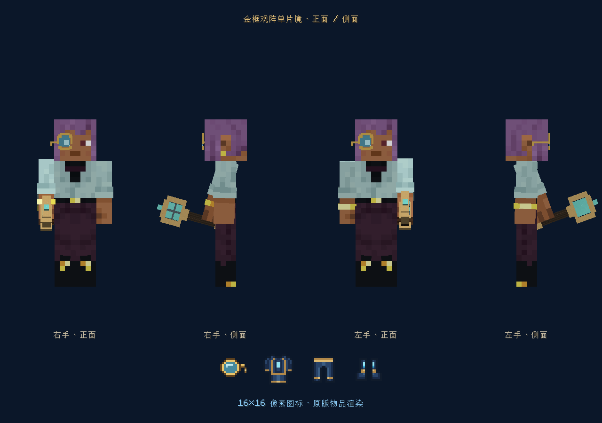
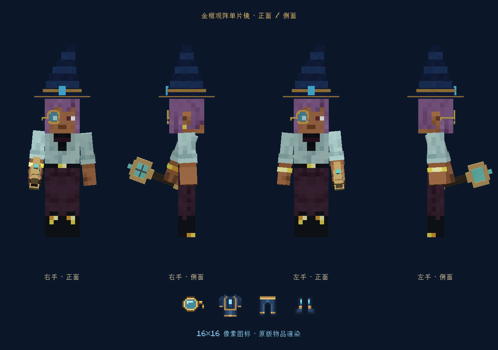
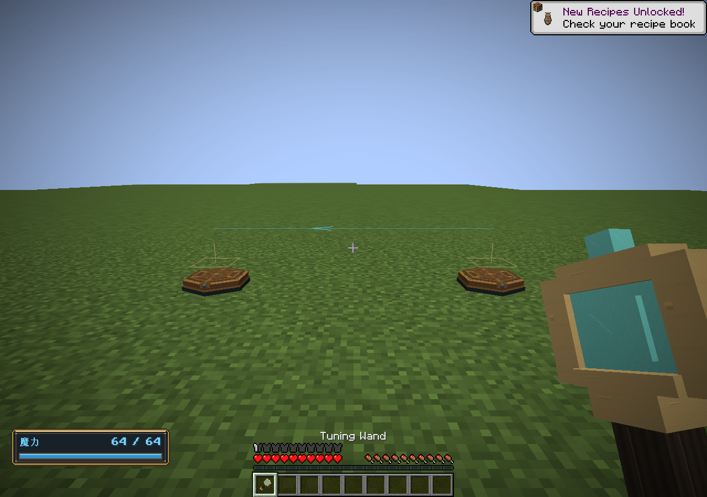

# 固定法阵调律与观阵

0.47.0，Minecraft 1.21.1 / NeoForge。2026-11-03。

## 使用

调律杖右键固定法阵起阵或停供；潜行右键循环切换槽位，不停止其他槽位。副手持魔力水晶时右键，从玩家魔力槽充能，水晶不消耗。操作沿用所有权与8格距离校验；基板损坏拒绝起阵。原有空手起停和潜行法杖选择刻印目标入口保留，统一修复无输入源时吞掉起阵失败的问题。

调律杖配方：` G /GCG/ S `，G为金锭，C为魔力水晶，S为木棍。

观阵单片镜配方：` G /GCG/  N`，N为金粒。可放入原版头盔槽或Curios头部饰品槽，后者允许与巫师帽或其他头盔共存。模型为右眼金框、浅蓝晶片，短镜腿从铰链向后折回头部侧面；移除垂链。16像素物品图标同步更新。饰品装饰槽只改变外观，不授予观测或附魔效果；饰品可见开关只控制渲染。

戴镜后显示64格内已加载固定法阵。蓝线表示魔力，金线表示信号，箭头表示流向；线路有魔力在途或信号有效为真时提亮。瞄准法阵显示选中槽位、运转状态、储量与连线槽位方向。摘镜、隐藏HUD、断线、换世界后不继续显示旧观察。

不强加载区块，不显示未加载锚点；每10 tick同步一次，最多64个最近锚点、128条线路，线路每帧合成一次线条绘制。超过预算的部分不展示。连接的建立与删除仍在现有法阵管理页进行，调律杖用于控制运行和充能，不另设隐式连线操作。

## 实现与验证

`FixedCircuitControl`统一服务器操作校验；`FixedRelationSight`从世界已加载法阵和互联图构建有界观察。`RelationNetwork`独立同步，客户端`FixedRelationRenderer`只读批量渲染；`MonocleRendering`处理单片镜头部模型。观测失效超过30 tick自动隐藏。

核心检查161868项、原生GameTest 258项通过，含双槽位佩戴、装饰槽隔离、元素防护附魔及数值回归。真实右键起阵、切槽保留运行、充能守恒和超距拒绝继续回归。独立GPU世界验证消息注册、装备同步、模型和线路渲染完成，日志标记`FIXED_RELATION_GPU_PASS`。离线环境中原版账号服务连接失败，不影响这次本地验证。

测试：`./tools/build.ps1 -Tasks coreTest,runGameTestServer,build -Mirror -Offline`。

GPU检查：`./tools/build.ps1 -Tasks runClient -RelationSmoke -Mirror -Offline`，使用`build/relation-smoke`独立目录。

