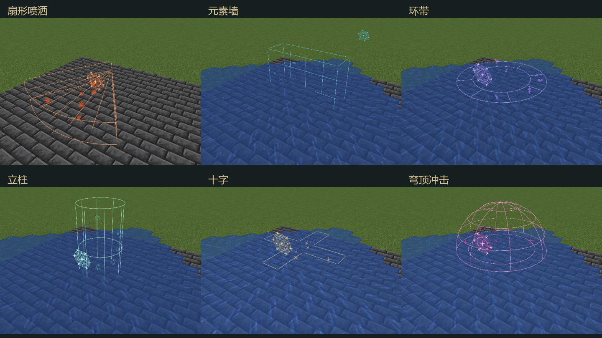
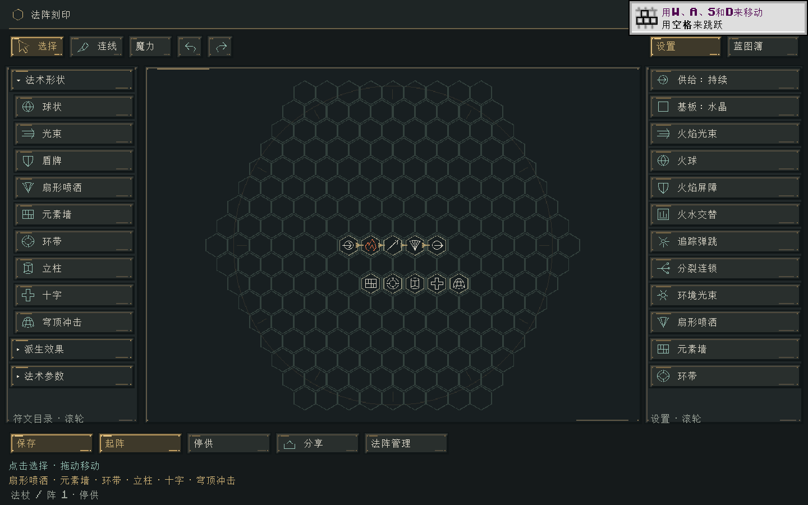

# 扩展形状符文 · 0.22.0

六种新符文位于刻印界面左侧“法术形状”。右侧设置栏也有对应示例，滚轮可继续向下查看。新形状沿用元素转化、实际世界作用、有限魔力和法杖释放冷却。

| 符文 | 作用区域 | 用法 |
|---|---|---|
| 扇形喷洒 | 前方70°扇面，最远为半径的两倍 | 必须接指向施法；持续供给可形成喷流，适合扫过前方目标、浇水或点火 |
| 元素墙 | 瞄准点处的竖直薄矩形，高宽均为半径两倍 | 必须接指向施法；射程决定位置，半径决定大小，可连续释放元素墙 |
| 环带 | 水平空心圆环，内径保留中心空位 | 范围施法环绕自身；指向施法在瞄准点展开 |
| 立柱 | 竖直圆柱，高度为半径两倍，直径等于半径 | 适合垂直覆盖和柱状照明，支持范围与指向施法 |
| 十字 | 水平四向通道，斜角留空 | 适合通道与路口，前后方向随视线转动 |
| 穹顶冲击 | 上半球壳，内部与下方留空 | 适合上方目标；这是元素作用域，防御仍使用盾牌符文 |

这些形状每次释放结算一个瞬时脉冲。持续法阵按原有供给间隔反复释放，每次都消费真实魔力；停止供给后不会留下一个自动攻击的区域。元素墙不生成新的实体阻挡方块，也不拦截投射物。火焰、水源等已产生的原版方块继续按原版规则存在和更新；临时光源仍由原有寿命机制清理。

## 绘制与组合

最短路线为：**魔力输入 → 元素转化 → 施法方式 → 形状 → 法术输出**。无需额外添加半径符文即可使用默认2格规格。需要更大覆盖时添加半径，作用量仍分配到接触目标，并沿用半径修饰的既有成本。放大范围不会复制伤害或水源预算。

扇形喷洒的距离由半径决定，不兼容额外射程修饰。元素墙及其余形状的指向施法可用射程控制中心位置；环带、立柱、十字、穹顶也可接范围施法，其示例默认围绕自身展开。喷洒随完整视线俯仰，墙始终直立，环带与十字保持水平。范围环带、十字和穹顶的中心比施法起点低0.75格。

一次输出只能选择一种形状。六种新形状暂不组合爆裂、弹跳、追踪、分裂、连锁或附加效果；冲突包保留在法阵中，不会静默丢掉已接入的修饰。球状、光束与盾牌的原组合规则继续有效。

火、水、雷、光、暗等使用既有实体和方块作用；纯奥术保留穿透方块的规则。普通元素要通过遮挡和权限检查。混合包先按既有规则分离纯奥术成分，其余成分不会跟随奥术穿墙，也不会被复制。生物以包围盒中心、方块以格子中心是否落在体积内判断；实体与地形共享同一份支付量。

## 实现与兼容

- `ShapeVolume` 为不依赖Minecraft的局部坐标判定；`ShapeRules`从独立 `shapes_v1.json` 注入并固定本版比例。`ShapeFrame`只负责Minecraft坐标转换，`ShapeSpells`只定位与派发，`ElementInteractions`继续独占有限接触分配及实际响应。
- 每次世界查询只考虑已加载区块；最多检查512个按距离、坐标稳定排序的体积内格子，再使用既有最多128个接触目标的分配上限。大形状、密集目标下优先处理近处，不能保证所有内部格子在同一次脉冲中都获得作用量。没有强制加载或新增持续区域状态机。
- 服务端只同步形状、中心、方向、半径和元素观察。客户端 `VolumeGeometry` 与权威判定共用规格，独立生成短时轮廓和元素碎屑；沿用单材质、单批绘制与8192四边形总预算。单个形状最多518个四边形，释放法环另计。视觉寿命不决定命中或魔力支出。
- 六个原创符印追加到静态图集，旧图标索引保留；图集由512×512扩为512×576。使用 `python tools/artwork/bake-glyphs.py` 可单独重烘焙，不触碰工作台、固定阵盘、法杖或HUD画稿。
- 含新符文或缓存新形状运输包的法阵现场使用v6；旧图继续使用v4/v5，旧现场不能伪装携带新形状。跨阵接收口没有形状符文时，也会按缓存内容保存v6。旧蓝图、旧程序集继续可读；外层格式和世界弹道保存版本不变。新形状禁止进入弹道持久化状态机。
- 网络协议升为 `1.21.1-8`，客户端与服务器都需要0.22.0；0.21.1及更早客户端不能连接。未来若改变这些几何比例，需要新的规则/现场协议，不能直接改变v1含义。

## 验证

- `build/expanded-shapes-build.log`：最终build成功，92,706项核心契约通过。新增覆盖几何孔洞、组合限制、六套实际示例输出、逐步账本、每个边界的恢复、跨阵已修饰包及恶意特效规格。
- `build/expanded-shapes-contracts.log`：125项Minecraft集成测试通过；新增覆盖六种实体命中区域、共享伤害预算、扇面真实水源、瞄准面及相邻面的元素墙、遮挡/奥术穿透、真实临时光源/熄灭、禁止区域进入弹道和远端区块不加载。
- `build/expanded-shapes-gpu.log`：六套真实VM经服务端结算、网络同步和实际GPU绘制通过，每次观察均为一个批次；停供过期及中文编辑器侧栏检查通过。截图位于 `art/expanded-shapes/`，水墙产生的水会在后续截图中继续流动。
- `build/expanded-shapes-godot.log`：统一隔离回归23套通过，`SUITES: 23, FAILED: 0`。
- `python tools/artwork/check-workstations.py`：工作台、固定阵盘和27种法杖的既有模型/UV/贴图检查通过。本次没有重绘或重新导出这些模型。

首次验证发现的薄墙相邻面可见性问题已修复。严格输出校验也发现旧光照测试夹具给光束同时设置了半径；夹具已移除非法半径，原有世界效果断言全部保留。未进行多人联机、长期GPU帧率或完整旧世界升级体验验收。

分支 `codex/expanded-spell-shapes`；未暂存、提交、合并、打tag或推送。

安装包：`../releases/elemental-circuits-1.21.1-0.22.0.jar`，1521254字节，SHA256：`ea34d87a073c6067b1e8fc102936d99bf30a5b9bf784ab32e2d2a49c2bb83771`。全部11个历史安装包大小与SHA256已核对保留。
