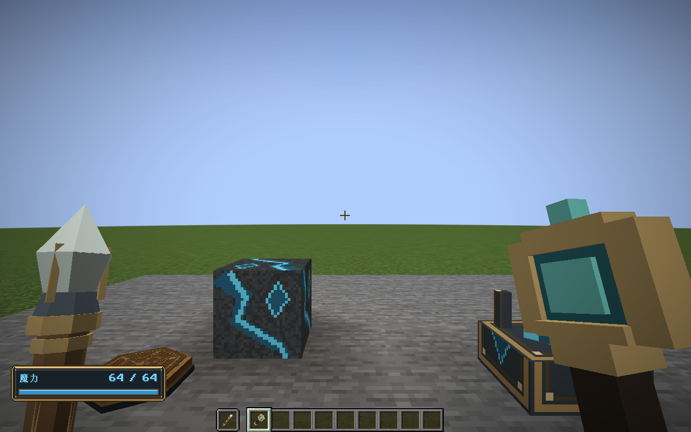
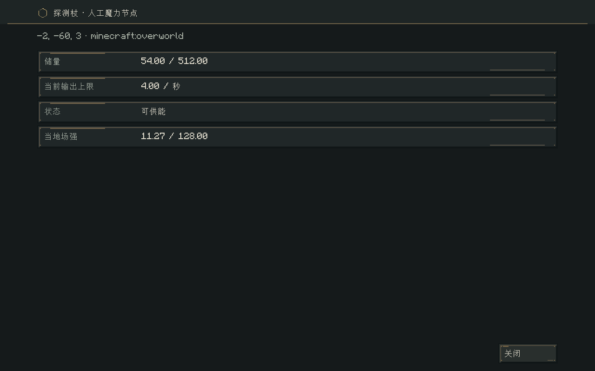
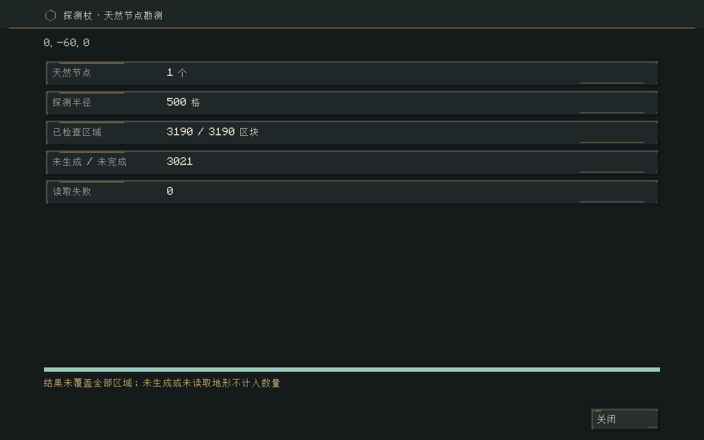
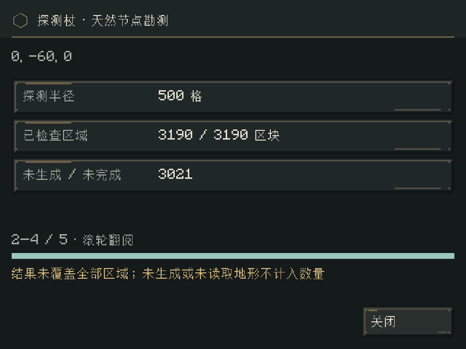

# 探测杖与天然节点勘测

2026-11-01 · 0.30.0 · 已实施

新增专用探测杖：右键方块读取法阵、能量节点或当地魔力场；蹲下右键读取副手法杖/法术书；右键空气勘测周围天然节点。半径默认500格，可由服务器配置。使用独立的只读报告页，沿用黄铜与蓝绿界面；不消耗魔力、不操作起停、充能、安装或刻印。

废弃魔力水晶对空气查看场强及空手右键节点显示信息的旧入口；水晶装填、法阵起停/充能和工作台刻印继续作为功能操作。读场强不调用discover，不生成初始环境余量，不激活场。

天然节点数量按以起点方块坐标为中心的三维球体统计，包含耗尽节点，只计天然方块、不计人工节点。同维度，包含已生成但未加载的区块；通过原生异步区块存档读取，无区块生成、强加载或离线模拟。已加载区块优先读取活体方块实体位置并确认真实方块；存档按真实方块调色板解码，不用生成概率预测、不只依赖节点缓存。

尚未生成或生成未完成的区块不计入确切数量，界面标明未覆盖；读取损坏、超时或取消不能显示为完整的零节点。勘测是有时间跨度的观察，各区块以读取时状态为准；不是整片世界原子快照。

`SurveyArea`处理整数距离与区块候选；`NodeSurvey`维护可测试的增量状态机和异步工作限额；Minecraft适配器只在服务器线程读取已加载世界，以纯NBT解码处理存档。每维度任务数、每步启动区块数、每任务读请求数（默认16）及超时有配置，轮转推进；不逐方块扫描500格球体，不调用getChunk或join等待未完成I/O。

报告使用单向服务端数据包和请求身份；初次使用才打开界面，进度回复只更新当前匹配报告。关闭报告不因迟到回复重开；登出、维度卸载终止任务。配置变更不改变已开始勘测的中心/半径。旧世界无新持久状态需要迁移。

验收：合成和资源注册、旧入口失效、探测无充能/起停/场量变化；球体边界/负坐标、真实节点种类与耗尽、已加载与存档解码、异步上限/轮转/损坏/取消/超时、配置半径、原有回归与实机报告页。实施范围与验收证据如下。


## 配方与实际操作

配方：1枚魔力水晶、2枚铜锭、1枚紫水晶碎片、1根木棍。得到水晶时解锁配方书条目；创造栏中位于刻阵法杖旁。

```text
空    魔力水晶    空
铜锭  紫水晶碎片  铜锭
空      木棍      空
```

- 右键固定法阵：查看本地储量、当前槽位、各槽位材质/运行状态/阵内魔力、符文与线路数量、内部互联数及派生目标。
- 右键天然或人工节点：查看种类、储量/容量、当前输出上限和当地场强；耗尽或损坏明确标记。右键工作台也只读取信息，双格桌子两半均不会进入组装会话。
- 蹲下对空气右键：读取另一只手所持法杖、法术书或固定法阵物品的槽位信息。
- 蹲下右键普通方块：只读取当地场强；尚未激活的单元显示“尚未激活”，不假装是零，也不创建环境余量。
- 普通右键空气或普通地面：以玩家所在格为中心勘测天然节点。再次使用会显示同一在途任务，不重头扫描。报告页可滚动，世界继续运行；法阵/节点信息是本次读取的快照，关闭后再次右键刷新。

读取不要求节点/法阵所有权，也不会给予刻印或组装授权。原版距离、世界交互限制和探测杖实际持有校验仍生效。工具不消耗耐久、燃料或玩家魔力；操作间隔10个服务器步以避免连续输入刷报告。

## 配置

进入“模组 → 元素法阵 → 配置 → 服务端 → 探测杖”，或使用权限2的现有`/ec config`命令。

| 键 | 默认值 | 范围与作用 |
|---|---:|---|
| `probe.radius` | 500 | 1–2048，三维球形半径，单位格 |
| `probe.chunksPerTick` | 16 | 1–1024，每维度共享的每步读取启动额度 |
| `probe.maxConcurrent` | 2 | 1–8，每维度并行任务；同一玩家最多一个 |
| `probe.readAhead` | 16 | 1–16，每个任务最多挂起的异步读取 |
| `probe.timeoutTicks` | 2400 | 20–72000，最长服务器逻辑步；默认约120秒 |

```text
/ec config get probe.radius
/ec config set probe.radius 500
/ec config set probe.chunksPerTick 32
```

数值同时写入现有`elementalcircuits-server.toml`；实际位置由NeoForge该运行实例的配置策略决定。已保存的配置保留用户值，不会因升级强行改成默认值。半径在任务开始时冻结，其余调度限额按当前配置读取。暂停/离线不补算，关闭报告不会强迫扫描重启；登出、死亡、换维度或世界卸载丢弃任务观察引用。

## 扫描的真实性与负载

500格球体在坐标0附近筛出3190个水平候选区块，避免扫描超过5亿个球内方块。已加载区块遍历方块实体位置并复核天然节点方块；未加载区块只解码可能包含天然节点的方块调色板，正确处理单一调色板、4/5/9位等不跨64位字的填充存储。耗尽的地脉仍计数，人工节点不计数，拆掉或新放置的节点会在下一次真实读取中反映，不依赖永久缓存。

原版`ChunkStorage.read`可能为不存在的区域建立空.mca文件，因此适配器先检查区域文件；每次任务缓存区域文件是否存在，缺失时直接标为未生成。读取失败与缺失分开统计。已有原生写入队列与读取由Minecraft存储层协调；NBT解码不访问世界可变数据，活体查询与任务推进只在服务器线程进行。未完成future不join，不强加载或生成区块。

多个任务共享启动额度并轮转，挂起读请求总数默认最多32个；任务状态、区块列表和少量future都属临时观察，不写进世界存档。超时的部分结果会注明未覆盖，不重新消费或再生成资源。世界持续变化、区块刚好卸载/保存或新生成，均可能使不同时间的两次勘测数量不同；缺失区域不保证其中没有节点。

## 资源与验收

探测杖是独立注册物品，采用12个原生静态模型部件，复用既有黄铜、皮革和蓝绿玻璃调色板。模型路径为`assets/elementalcircuits/models/item/probe_wand.json`；没有运行时生成贴图或几何，也没有引入新的外部美术授权。

- `build/probe-release-check.log`：115,822项核心检查、162项Minecraft GameTest通过；本次新增9项集成测试。
- 核心覆盖三维球体、负坐标/世界边界、异步工作限额、完成/失败/缺失分类、取消、报告深拷贝与严格UTF-8编解码。
- 原生集成覆盖调色板位宽与存储边界、真实`ChunkSerializer`输出、已加载/真实异步存档计数、缺失区域不创建文件、不加载区块、耗尽天然节点、人工节点排除、旧入口失效、读场强不增加资源、探测不触发法阵/工作台、双格桌子无实体半边、配置半径冻结、退出清理及配方注册。
- `build/probe-gpu-final.log`：真实OpenGL客户端，主手三维探测杖、节点/固定法阵的原生右键、另一只手法杖多槽信息、500格真实勘测进度/结果、1280×800 GUI2与960×720 GUI3滚动、关闭后迟到回复以及跨维度消息处理。

默认配置的本机实测：500格球体、3190个候选区块，11,205毫秒完成；结果为1个天然节点、3021个未生成/未完成区块、0个读取失败。此样例是平坦隔离世界，不能代表已完整生成的大型世界扫描速度。完成页与小窗口滚动截图均检查通过。

安装包：[elemental-circuits-1.21.1-0.30.0.jar](../../../releases/elemental-circuits-1.21.1-0.30.0.jar)，2,658,090字节；SHA-256：`d5b0b81cc1addd37b3aa0e84e9ffc48c46c661cd5c0c868f45d74e742d9f20b8`。ZIP完整性、正式包排除测试类、19个历史归档哈希、74个OGG及两份授权文件字节一致性已核验；本地证据为`build/probe-release-verification.json`。

测试只使用`build/gametest-runs/`与`build/probe-smoke/`的隔离世界。尚未做真实多人长期压力或大型旧世界完整升级验收；扫描时长取决于已有地形量和磁盘读取能力，不承诺即时完成。网络协议更新为`1.21.1-14`，客户端与服务端同时安装0.30.0；法阵、节点和魔力场保存格式不变。








