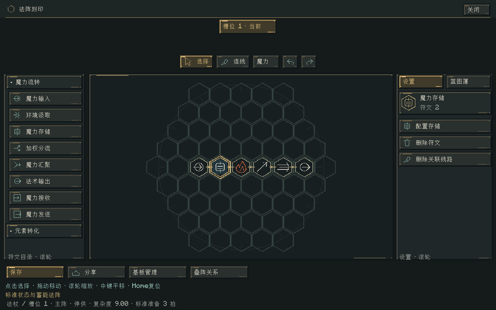
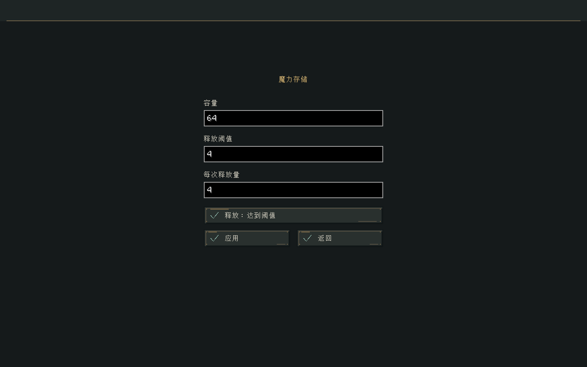
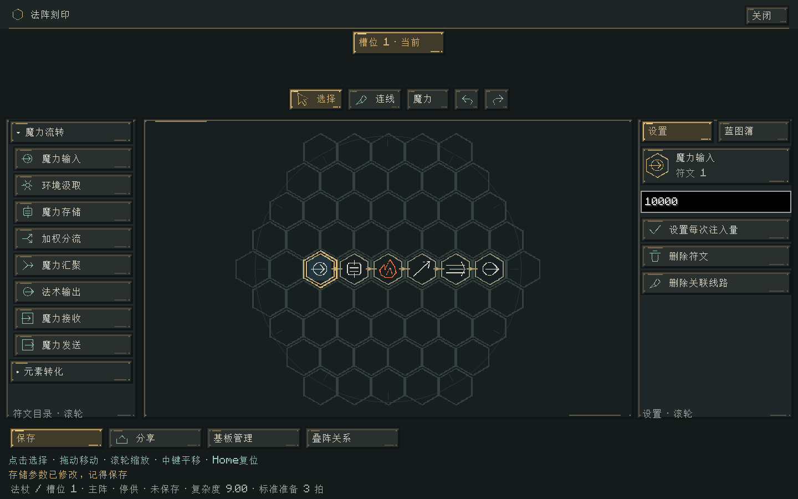

# 标准状态与专用储魔 · 0.37.0

这版降低传输与转化损耗，以一套可复现的参考法阵定义默认值；施法准备时间同时取决于有效法阵复杂度与法杖速度。普通符文不再提供通用蓄能，新增独立的魔力存储符文。

## 1. 标准状态

标准阵为“魔力输入 → 火元素转化 → 指向 → 光束 → 输出”，5 个符文、4 条相邻连线、总线长 4 格、依赖深度 4。木质基板，玩家法强 1，石英杖端强度/速度均为 1，无装备属性、反应或派生。固定装置取中性法强与速度。

| 项目 | 标准值 | 资源或配置 |
|---|---:|---|
| 每次输入 I | 4 | circuit.defaultInjection；可由入口单独设置 |
| 目标作用量 E | 1 | casting.defaultEffect；作用量符文可覆盖 |
| 射程 R | 12 格 | standard.range |
| 半径 r | 2 格 | standard.radius；光束不使用半径 |
| 散射幅度 a | 0.125 | standard.aim；0 最精准 |
| 参数历史损失倍率 | 0.01 | casting.parameterLossScale，沿用上版的 1/100 |
| 每个形状逻辑方块成本 c | 0.002 | casting.shapeCostPerBlock |
| 传输/符文历史损失倍率 s | 0.1 | standard.transmissionLossScale |
| 准备时间 T₀ | 2 拍，约 0.1 秒 | standard.delayTicks |
| 法杖释放 CD | 12 拍，约 0.6 秒 | wand_cooldown.json；按杖端速度缩短 |
| 阵内传输轮数 | 8 / 世界步 | circuit.manaSteps |
| 持续注入间隔 | 1 世界步 | circuit.injectionInterval |
| 基础玩家槽 | 64 | player.initialCapacity，仅新玩家 |
| 固定回复 g | 4 / 秒 | player.regeneration |
| 容量回复比例 p | 0.002 / 秒 | player.percentRegeneration |
| 消费后恢复等待 | 40 拍，约 2 秒 | player.recoveryDelayTicks |

标准光束的逻辑覆盖数 N=12。作用量 1、强度 1、法强 1 的单目标火伤仍约为 2 点生命，随后还受原版抗性、护甲、相克反应和受击间隔影响。玩家自然恢复为 g+pMmax，64 上限时约 4.128/秒；回复药水只放大固定分支。

示例已迁移为 `examples/blueprints/` 下的蓝图文件，测试脚本将它们注入蓝图簿。底栏显示当前有效复杂度，以及速度 1 时的准备拍数，方便比较不同法杖之前的法阵本身。

## 2. 成本与损耗

记 F=65536，数量仍为 16.16 定点。最终成本继续采用高精度中间值，在最终除法后截断至 1/F：

```
D = max(1,R) × [1+4(1−a)]             指向法术
D = 1                                范围法术
η参数 = 1 − 参数损失倍率 × (1−1/D)
μ = P^k × 玩家基础魔耗 × (1−魔耗减免百分数/100)
C = max(1/F, trunc[(E+cN) × μ / η参数])
```

P 为玩家法强，k 为魔耗指数，默认 1。玩家基础魔耗默认1，减免百分数范围0–80。0.47起区分实际消耗的运输量和接触效果量，见[数值审查与输出效率](数值审查与输出效率.md)。N 按实际逻辑形状统一计格。射程、半径、精度、作用量均在报价前解析；未显式放置参数符文时使用标准默认值，显式设置同值收费相同。

线路、端点、转化、反相、分流/汇聚的原保留率为 η旧，现在统一使用：

```
η新 = 1 − s × (1−η旧)，s 默认 0.1
```

因此木质单位线长损失约 5% → 0.5%，黄铜约 1% → 0.1%，水晶约 0.2% → 0.02%；转化约 2% → 0.2%，反相约 5% → 0.5%，分汇流约 1% → 0.1%。端点耦合同样缩减。线路仍按真实格数逐段结算，不论符文是否相邻；预览和运行共用同一传输函数。

实际线路保留关系仍为：端点保留率两次 × 材料单位长度保留率的 L 次方，逐段定点截断。材料差异保留。

自然耗散每世界步执行一次，不随 8 次传输轮数重复收费：

```
δ在途 = casting.movingLossPerTick × standard.movingLossScale
δ等待 = casting.cacheLossPerTick × standard.waitingLossScale
δ存储 = standard.storageLossPerTick
Q下一步 = floor[Q × (1−δ)]
```

| 类型 | 基础值 × 新倍率 | 名义有效损失/拍 |
|---|---|---:|
| 在途 | 0.002 × 0.05 | 约 0.0001 |
| 普通等待/控流 | 0.05 × 0.1 | 约 0.005 |
| 专用存储 | 独立配置 | 约 0.00005 |

配置在进入定点边界时量化，当前实际原始损失分别为 6/F、327/F、3/F。因此三者不是无限精确的小数。旧世界已有的在途/缓存基础配置继续参与新倍率，不必清空配置文件；显式配置 0 可以关闭对应自然损耗。

成功时消费 C、产生名义作用量 E。实际交付运输量为 B=min(E,C,max(1/F,trunc[E×min(1,μ)]))，接触时用 E/B 折算效果；成本耗散为 C−B。折算不产生可回收或递归供能的魔力。成功后未用完的可追溯魔力退回原来源，不再放入所有符文共享的隐藏储备；无法追溯的旧魔力不能凭空返给当前持有者。失败返还继续使用上一版的分元素比例和全局失败损失系数，线路及自然耗散不返还。

输入量是“要求从来源取多少”，不是“最终造成多少伤害”。只提高输入、不提高作用量或形状需求，不会自动放大伤害。来源先付完整输入，之后可能收到未用量/失败量返还；玩家最终净支出与原始注入量可能不同。

下表由当前核心实际运行参考阵得到，使用默认损耗和 2 拍准备、可追溯玩家来源，第三个逻辑边界完成一次释放；返还按原来源收到后的净支出计算：

| 材料 | 原始注入 | 交付作用量 | 总耗散 | 未用量返还 | 最终净支出 |
|---|---:|---:|---:|---:|---:|
| 木质 | 4.0000 | 1.0000 | 0.1631 | 2.8369 | 1.1631 |
| 黄铜 | 4.0000 | 1.0000 | 0.1004 | 2.8996 | 1.1004 |
| 水晶 | 4.0000 | 1.0000 | 0.0879 | 2.9121 | 1.0879 |

更复杂的形状、更高法强、更长准备时间和线路都会改变这张表。数据记录为 `build/standard-reference.json`。

## 3. 法阵复杂度与准备时间

先从输入/汲取/接收/信号源做正向可达，再从法术/接口输出做反向可达，仅计二者交集。没有接入有效输出路径的孤立符文、装饰线和死端不计复杂度。

```
K = wn×Nr + wl×L + wd×D + wf×B
K₀ = 5wn + 4wl + 4wd
T准备 = min(Tmax, ceil[T₀ × K/K₀ ÷ v])
```

- Nr：有效符文数；L：有效线路总格长，包含信号线。
- D：可拓扑求值部分的最长依赖深度，以边数计。
- B：拓扑消去后剩余、受反馈依赖影响的节点数，包含其尚未消去的下游。这是保守的反馈开销项，不冒充精确环数。
- 默认 wn=1、wl=0.1、wd=0.5、wf=2，分别为 standard.nodeWeight / lengthWeight / depthWeight / feedbackWeight。
- K₀ 按同一权重自动计算，默认约 7.4。v 来自当前法杖杖端，固定装置/装备法阵默认 1。
- T₀ 默认 2，Tmax 默认 1200，分别由 standard.delayTicks / maximumDelayTicks 配置。T₀=0 或 K=0 时准备为 0。

例如速度 1 时，标准阵 K=7.4 → 2 拍；加一个串联存储符文的蓄能示例 K=9 → 3 拍；10 个串联节点、9 格连线、深度 9 时 K=15.4 → 5 拍。世界按 20Hz 推进，实际时间还有整数拍量化。

准备从该批魔力抵达输出时开始，叠加在线路输送和信号自身时序之后；不会加速计数器或时钟。准备结束后仍须取得载体共享的释放 CD。普通输出不能借等待 CD 持久蓄能；预算被拒绝时退回可追溯未用量，需要新注入或存储符文之后再发射。

复杂度在冻结定义创建时以 O(V+E) 迭代计算并复用，不在每次传输/渲染中重新遍历图。准备开始后冻结本批释放时刻，临时换杖端不会重置这一批。完整时序保存在现场 v11，重载不重新扣输入、不重置准备、不重复释放。

## 4. 哪些地方可以存魔力

| 符文/队列 | 是否跨步保留 | 目的 |
|---|---|---|
| 转化、反相、参数、形状、或门、分汇流等普通符文 | 不提供持久蓄能 | 当步处理；无法处理的可追溯未用量退回来源 |
| 与门 | 是，等待另一侧 | 保留原有双路门契约 |
| 通路开关、魔力感应 | 是，受控等待 | 按普通等待速率衰减 |
| 魔力收发口 | 是，有界 | 跨法阵交接，避免复制或丢包 |
| 法术输出准备队列 | 仅在已排定的准备期间 | 一批排定输出；不把之后批次合并成储魔池 |
| 在途/待传输包 | 有界传输队列 | 运输所有权，不是普通符文的蓄能功能 |
| 魔力存储符文 | 是，独立容量 | 玩家主动配置的低衰减储魔 |

所有保留量、来源、到达顺序及衰减均纳入收支账本；公共剩余储备已取消。旧现场曾有的储备在采用新策略后退回可追溯来源，不转换成免费新存储。

存储符文位于“魔力流转”，选中后点“配置存储”进入独立页：

| 参数 | 初值 | 约束 |
|---|---:|---|
| 容量 | 64 | 0＜释放量≤阈值≤容量≤65536 |
| 释放阈值 | 4 | 达到该总量才能放行 |
| 每次释放量 | 4 | 可以与阈值不同；支持定点小数 |
| 释放方式 | 达到阈值 | 可切换为信号控制，信号也需要满足阈值 |

允许多次手动起阵或持续小额注入，存量不随停供/重新起阵清零。只在主动运行时放行，每世界步最多释放一次，避免 8 轮内部传输导致每拍释放 8 次。信号读上步状态，遵守既有因果；有多个出线时沿用分配契约。

存储按实际到达顺序支取，元素和来源顺序跨存储/保存保持；不在储存时提前结算元素相克。存量仍有低速自然损耗。满容量不能复制或挤出已有魔力，多余可追溯量返还来源。显式重画法阵继续遵守停供、回收规格和原有编辑事务边界。

“蓄能光束”示例每拍输入 1，阈值/释放量均 4；由于线路与自然损耗，实际积满会略晚于数学上的第四次输入。若要配合物理 CD 精确放行，可接节拍器等信号控制。

## 5. 输入 10000 与其他参数审查

原入口执行存在 `min(设定输入,节点容量)`；历史基板冻结容量可以只有 64，新默认缓冲为 1024。新版取消这种静默降档：

1. 新执行策略以完整 I 报价并原子扣款，不再用历史 nodeCapacity 截断每次输入。
2. 玩家仅有 56、请求 10000：整次失败，不能偷取 56/64；来源有足额时实际原始扣款和累计注入均为 10000。
3. 全局 circuit.defaultInjection 也可设为 10000，不再要求它小于历史节点容量。
4. 子法阵保留设置的固定输入；预付不足失败。新存储协议的子阵同样可保存和运行存储符文。
5. 旧 v1 蓝图中曾被忽略的入口参数，在加入存储或派生执行升级时仍使用其旧默认输入，不把历史无效字节突然激活。
6. 输入、汲取、作用量、感应阈值均检查了数量路径，不存在 56/64 的文本或定点转换上限；供给接口还检查报价量必须等于请求量。
7. 射程/半径原先可收到小数后转成整数，现在 UI 解析及领域构造明确拒绝小数。需要连续的数量按 1/F 一次量化，不报 rounding necessary。

环境汲取是“速率上限”，实际仍受场强、补能和可用供给限制；这与固定玩家输入不同。射程、半径、派生数、持续时间仍受已公开的服务器性能预算约束，超预算明确拒绝。单包数量技术边界仍为 65536，计数/节拍保持原来的大整数边界。没有把这些工程预算伪装成不限量。

## 6. 调整入口

配置文件仍为各世界的 `serverconfig/elementalcircuits-server.toml`。既有管理员指令自动包含新键：

```text
/ec config set standard.transmissionLossScale 0.05
/ec config set standard.delayTicks 1
/ec config set standard.depthWeight 0.75
/ec config set standard.storageLossPerTick 0.00002
/ec config set standard.range 16
/ec config set circuit.defaultInjection 10000
/ec mana capacity @s 20000
/ec mana refill @s
```

最后两条是明确的测试/管理操作，正常输入 10000 必须有足额供给，不会因为玩家余额少而自动缩成低配法术。调低损耗不会凭空补满玩家、节点或存储。

## 7. 验证与边界

完整构建、核心契约和原生集成使用 `tools/build.ps1 -Tasks build,runGameTestServer -Mirror -Offline`。覆盖足额/不足的 10000 输入、全局默认输入、旧 64 缓冲、实际 ServerPlayer 供给适配、来源返还、逐步守恒、手动/持续蓄能、信号因果、每拍一次释放、FIFO 元素、真实物品 NBT、完整时序恢复、旧协议迁移，以及既有系统回归。

界面使用 `tools/build.ps1 -Tasks runClient -StandardSmoke -Mirror -Offline`，自动操作独立存储页，输入并保存 20000 / 120 / 12.5，切换信号模式，核对输入 10000、静态图集符形和复杂度显示。截图为隔离的编辑器页面核对，不冒充生存世界实战或全套 GPU 性能验收。

现场 v11、带存储蓝图 v3；纯读取旧现场/蓝图保留旧语义，进入服务器运行或工作台打开编辑时显式采用新施法策略。未改 Godot 工程或正式世界；不声称全面长期联机、任意崩溃下跨文件事务或所有超大反馈图均已完成压力验收。返还沿用既有来源账本、去重收据和可配置预算，耗尽时背压。






