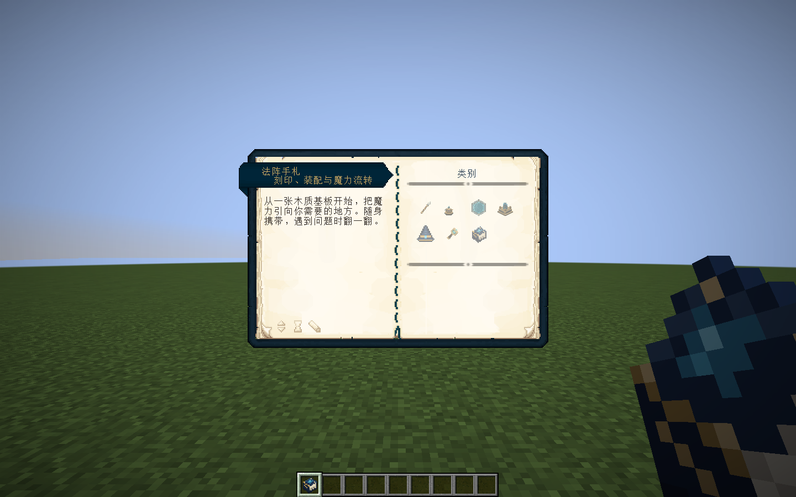
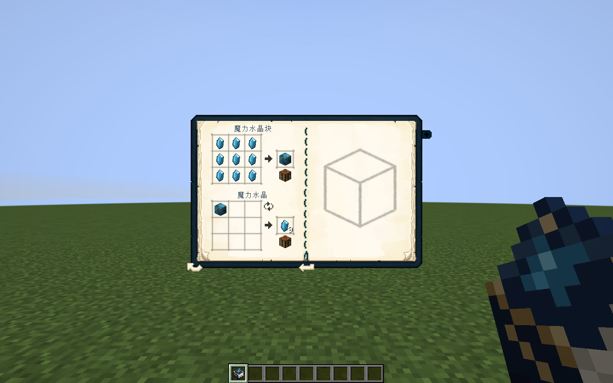
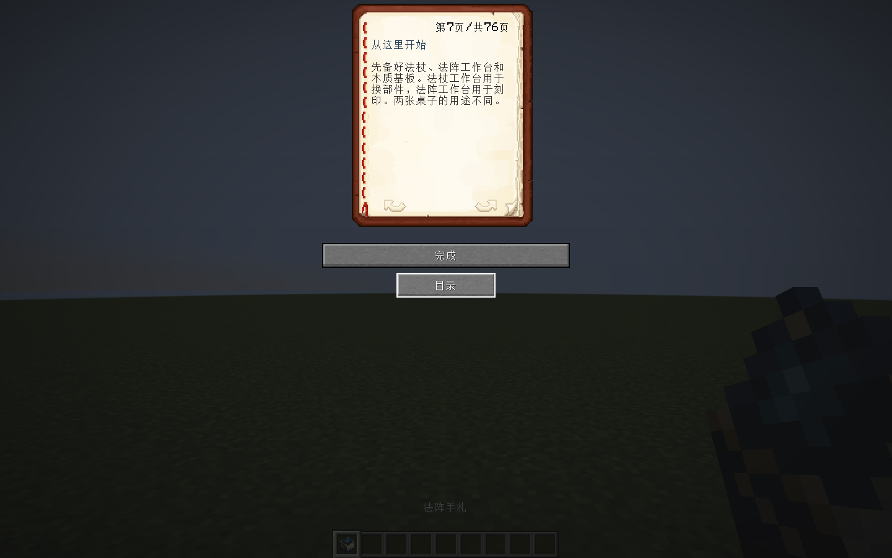

# 法阵手札与 Patchouli

版本：0.40.0；Minecraft 1.21.1 / NeoForge 21.1.265 / Java 21。

用一本书、一份蓝色染料和一粒金粒无序合成“法阵手札”。创造物品栏也能找到它。主手或副手右键阅读；不消耗材料、不写入法阵，也不占用法术书或蓝图簿的功能。

封面采用16×16原创像素贴图：斜置的原版书形、深蓝书皮、黄铜包角、蓝水晶封印和浅色书页。界面使用原版风格纸页，不替换已有法术书和蓝图簿的三维模型。

## 两种阅读方式

安装 Patchouli 时，同一物品打开 Patchouli 宝典：提供分类目录、搜索、书签、条目和原生配方页。书本界面使用其内置蓝色书皮，搭配黄铜色书名和深蓝链接。

Patchouli 是可选兼容，不是新的硬性前置。未安装时使用 Minecraft 原版阅读界面，提供可点击目录、翻页、返回目录和全部说明；合成条目列出材料，完整配方格由 Patchouli 提供。原版阅读器根据当前字体重新分页，避免直接把两页宝典文字塞入一页原版书。

已固定测试 [Patchouli 1.21.1-93 NeoForge](https://modrinth.com/mod/patchouli/version/BIogJv2D)。需在所使用的游戏实例内单独安装对应版本；不将 Patchouli 类或资源打进本模组 JAR。Curios 仍是装备戒指的必需前置。

## 内容

| 分类 | 条目 |
|---|---|
| 第一张法阵 | 从这里开始、一次施法、输入与魔力槽 |
| 刻印与装配 | 在工作台刻印、基板与固定法阵、装配法杖、蓝图簿与分享 |
| 符文与叠阵 | 元素转化、形状、控制与时序、存储与蓄能、命中后的法术 |
| 水晶与魔力场 | 水晶矿、节点与汲取、水晶基座、果实与药水 |
| 随身装备 | 法术书、法袍、铭刻戒指 |
| 查阅与排错 | 探测、反应顺序、魔力成本、施法排错、设置 |

共6类、24条，提供完整中文和英文版本。数值和按键明确写作默认值，以游戏控制设置及服务器配置为准。管理员命令只作说明，阅读器不执行命令。

## 资源与维护

`tools/artwork/bake-guidebook.py` 是双语内容及像素原稿来源，生成两种阅读器所需的静态 JSON。修改条目时只改这一处，再运行生成器。书本定义位于 `data/elementalcircuits/patchouli_books/field_guide/book.json`；分类、条目和配方页位于 `assets/elementalcircuits/patchouli_books/field_guide/{语言}/`，按照 [Patchouli 官方资源约定](https://vazkiimods.github.io/Patchouli/docs/patchouli-basics/getting-started/)组织。

Patchouli 书本使用 `dont_generate_book` 与 `custom_book_item` 绑定本模组物品，避免出现两本入口。兼容调用单独放在 `client/guide/PatchouliGuideClient`，由可选模组存在性检查后加载；服务端和无 Patchouli 客户端不需要解析其 API。

Aseprite源文件位于 `art/aseprite/guidebook/circuit_guide.aseprite`。重建贴图：

```powershell
python tools/artwork/bake-guidebook.py
& 'E:/Aseprite-v1.3.15.5/build/bin/aseprite.exe' -b art/aseprite/guidebook/circuit_guide.png --save-as art/aseprite/guidebook/circuit_guide.aseprite
& 'E:/Aseprite-v1.3.15.5/build/bin/aseprite.exe' -b art/aseprite/guidebook/circuit_guide.aseprite --save-as src/main/resources/assets/elementalcircuits/textures/item/circuit_guide.png
```

资源包可覆盖分类、文字和贴图。未提供语言时使用英文基础版本。

## 验证入口

```powershell
./tools/build.ps1 -Tasks build,runGameTestServer -Mirror -Offline
./tools/build.ps1 -Tasks runClient -GuideSmoke -Mirror -Offline
./tools/build.ps1 -Tasks runClient -GuideSmoke -NoPatchouli -Mirror -Offline
```

两种图形测试均创建 `build/` 下的隔离世界，不读取正式存档。测试用真实物品使用动作打开指南，核查模型、内容、配方或字体分页，再保存截图。无 Patchouli 测试从运行时类路径中完全移除该依赖。

## 实机截图







## 发布核对

161415项核心检查与231项原生测试通过。装有Patchouli、完全移除Patchouli的两种真实客户端图形验证通过；中文原版阅读器76页全部进行默认字体高度检查。检查并查看了目录、正文、配方和封面截图。没有进行长期性能或完整新玩家体验验收。

安装包：`elemental-circuits-1.21.1-0.40.0.jar`；3099891字节。

SHA-256：`9852e2a717a73de4963b1815657e727c2c2203092e40ac014805e1bf9708a581`。

生产包不含测试类、测试蓝图、Curios或Patchouli实现。31个历史安装包的大小及哈希均已复核；74个既有OGG保持逐字节一致。没有修改正式存档，法阵和世界存档格式不变。


## 0.41 手持外观

手册平摊展开，深蓝封皮、黄铜包角、蓝色书签与法阵笔记共用像素图集。三维模型仅在第一、第三人称手持时显示，物品栏、掉落物和展示框沿用原有平面封面。模型不改变两种阅读器的打开方式。源码、原稿和重建命令见 [工程结构与排版](../maintenance/工程结构与排版.md)。
