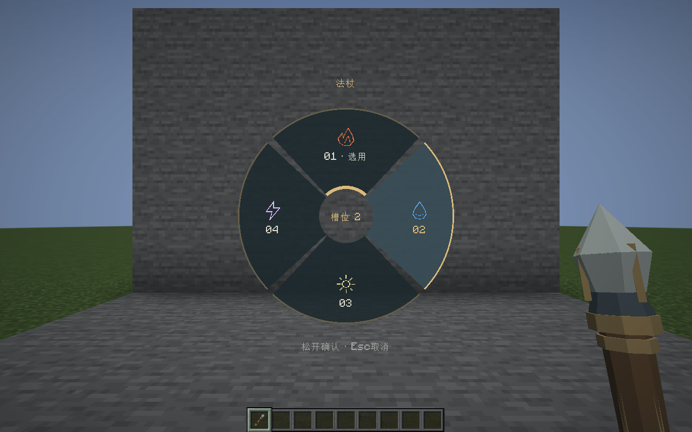
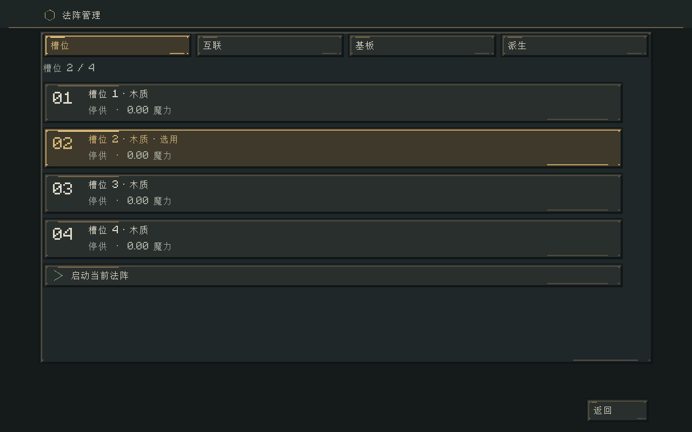
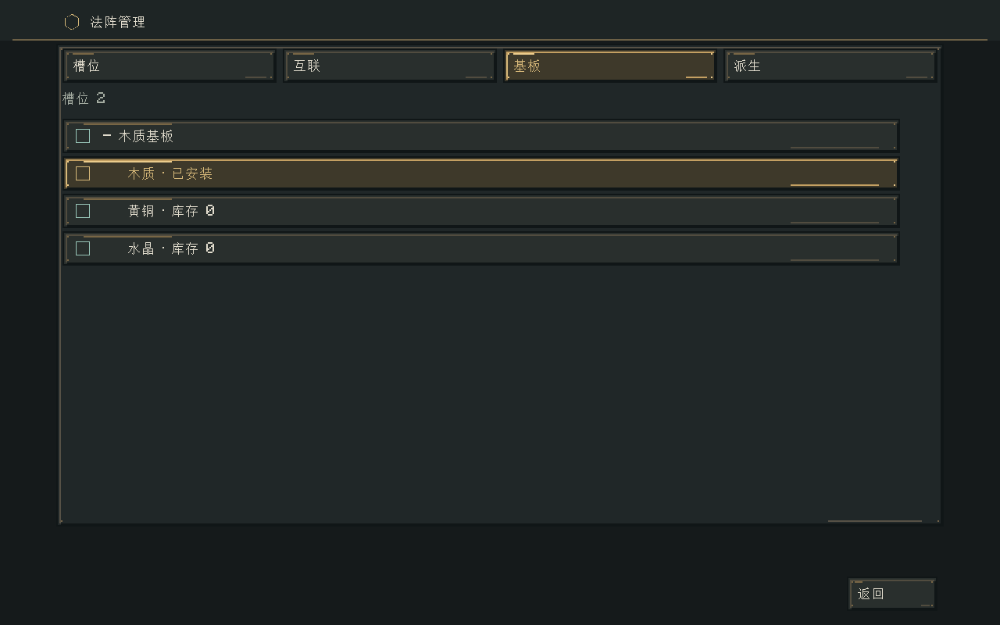
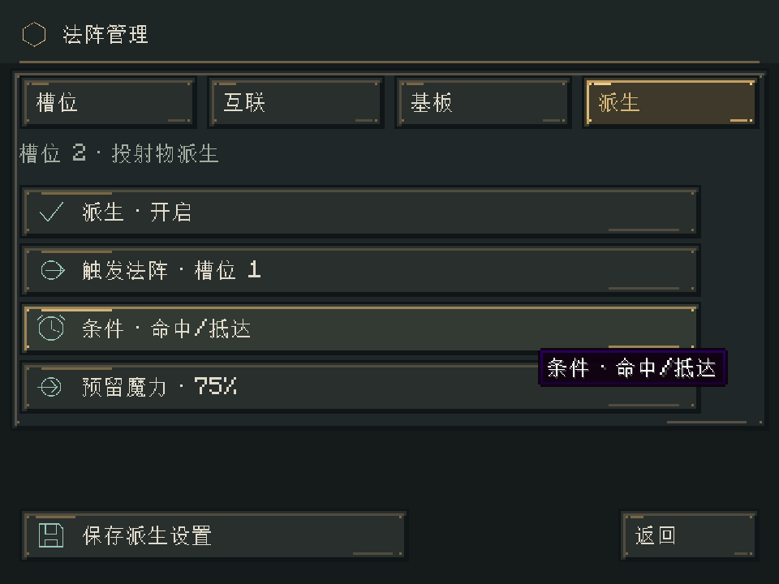
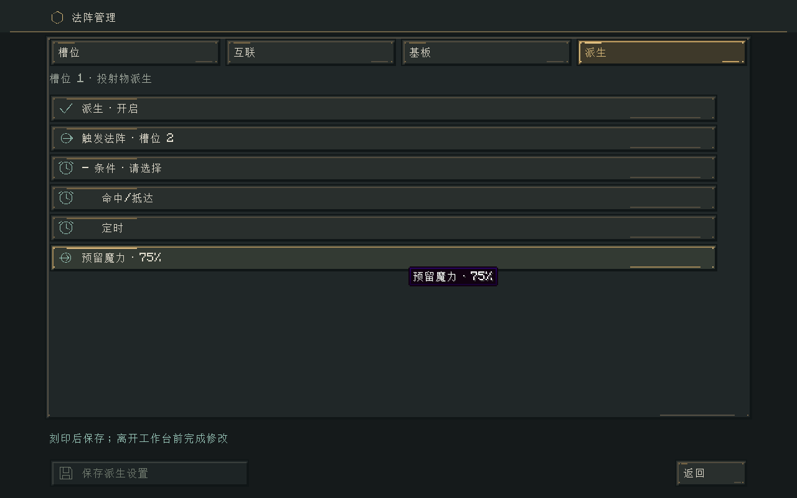
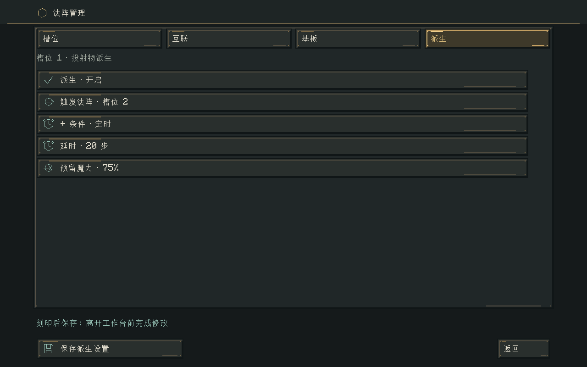

# 法阵管理、快捷选择与递归施法

> 本文记录0.29–0.30的跨槽位派生设计。0.31起改为同基板叠阵，现行操作与兼容规则见 [同基板叠阵与编辑导航](同基板叠阵与编辑导航.md)。旧冻结程序仍可恢复。

2026-11-01 · 0.29.0基线；0.30.1明确选择与触发策略更新

## 目标与交互

管理页先显示明确的槽位卡片：编号、选用标记、材质、运行状态和阵内魔力。选用和起停分开；说明收进悬浮提示，底部只保留最近操作结果。新增基板采用“新增法阵”展开子选项；更换基板在当前槽位下展开，避免三种材质始终并列占位。

Z/X在主手法杖时切换施法载体的槽位；副手持法术书时优先选择书中法阵，否则选择法杖自身。新增可重绑的轮盘键R：按住打开、移动指针选择、松开确认；中心取消，Esc取消，滚轮/数字也可选择。打开界面仅选用，不自动起停，不允许借此修改蓝图。服务端重验手持载体、身份、槽位及频率。HUD简短显示载体和当前槽位。

## 为什么用独立触发实例

“命中后调用另一个槽位”的直接实现会遇到五个问题：重复扣玩家魔力、修改正在运行的子阵、投射物在飞行期间换蓝图导致效果变化、递归无限扩张、退出/卸载丢失已经支付的效果。子法阵不能只是复制伤害配置，也不能让视觉弹道决定触发。

首期在管理页新增“派生”设置。每个源槽位可指定本载体内的目标槽位（包含自身）、命中/定时、定时逻辑步和预留比例。配置保存在程序集；单张蓝图不包含跨槽位引用。关闭派生时保持原有行为。仅有飞行过程的指向球状投射物携带触发；光束、屏障与瞬时体积仍按原方式结算，不在本期伪装为飞行体。

## 供能与因果

1. 根法术照常经过输入、路线损耗和法杖CD。发射时冻结当前载体的各槽定义、派生关系和递归规则，不冻结或复制槽位运行状态。
2. 按实际元素分包后，将每个投射包中配置比例的魔力预留为触发预算（默认75%，可设置5%–95%）；其余用于原投射物碰撞、反弹和伤害。两份资源不重复使用。
3. 触发预算在调用子阵前执行显式中和损耗（默认保留95%），作为子实例的纯净供能。这样火元素载体能在触发后运行水元素子阵；转换不会免费保留原攻击能量。
4. 子阵创建全新TickCircuit，单次启动，使用有限预付供给，不读取玩家槽或世界魔力场。汲取符文无可用环境源，跨载体收发不进入这个孤立实例。
5. 为避免子阵默认请求4魔力却只剩3魔力而完全无法起动，事件实例的各INPUT按原请求上限、预算和稳定编号比例分配一次入口额度，并预留整个运行窗口的信号成本。预算不足不透支；不会更改原蓝图。多个入口不复制预算。
6. 子阵后续节点、控制、输出和真实世界作用使用同一VM与效果适配器。实例运行跨固定步，不将反馈、计数器或节拍在一次Java调用中计算到底。法杖部件强度保持根施法时的值，不逐代相乘；子代不再次收取装备CD和耐久。
7. 命中或定时以先到者的配置条件判断，触发只消费一次；命中触发遇到射程耗尽也执行一次终止触发。定时型若提前碰撞，在碰撞点结算触发，避免已经支付的预算无提示消失。击中屏障而完全被阻挡则终止触发；未被屏障吸收的部分按剩余比例保留预算。
8. 子实例输出若也配置了派生，按相同过程预留下一代预算。新增实例进入下一世界边界队列，不调用递归Java栈，也不当场遍历至无穷。

## 确定上限与调度

允许A→B→A、自调用和多输出，但每条根施法链共享触发额度，默认最大深度4、最多64次子实例，单个实例最多120个逻辑步。服务器另设活跃实例/链和每世界步的VM工作预算；每步计算预算不足的已接纳任务轮转等待，不把等待变成额外伤害。格式硬边界独立于当前配置，降低配置不损坏已有合法保存。

实例到窗口末尾或资源完全排空后终止，未使用预算/阵内残余计为未显化消耗，不能回填玩家或母法术。每个实例维持“预付 = 未支取 + 阵内持有 + 损耗 + 已交付”的精确等式。根链不再被投射物或任务引用时回收。不可对敌意数据创建无限链、负延时或无上限等待。

## 世界作用与生命周期

触发位置取服务器权威命中点或定时位置，方向沿弹道；出生点沿入射方向后退0.06格，保留在碰撞面外侧，避免子弹出生在墙体内部。区域/盾牌子阵也可以从这里释放。根所有者UUID与权限持续传递；登出不会改成匿名授权。飞行或任务所在区块未加载则冻结，不强加载、不离线补算。

世界法术保存增加同一根记录中的冻结程序表、链额度、触发胶囊、定时剩余和任务完整VM/供给现场。程序按引用共享，避免每个飞行体重复保存四个大法阵。旧世界显式初始化为空递归表。缺程序、悬空引用、错误账本或未知版本保留原记录并停用，不能悄悄重新起阵。坏载体配置不覆盖已有活动现场。

管理设置在工作台授权范围内修改，切换工具在野外只允许选用。配置变化不追溯更改已发射投射物的冻结程序。

## 验收

- 精简管理页、展开子项与明确槽位；不同分辨率不遮挡。
- 无书法杖与配书两种Z/X、轮盘确认/取消、迟到消息与换手校验。
- 火球触发水/光/区域子阵，定时释放，A→B→A和自调用有界。
- 输入、预留、中和、损耗、控制和输出预算守恒；不足/阻塞不重复扣款。
- 子阵与原槽位现场互不修改；飞行中改配置不影响已发射效果。
- 队列、在途、任务运行中保存恢复和卸载冻结，权限继承及旧记录迁移。
- 核心契约、Minecraft集成、实际客户端页面/轮盘截图、构建与归档校验。

本文先编写设计，再按以下边界实现；不将未覆盖的长期性能或完整旧世界升级写为通过。

## 实施后的操作

1. 持法杖或法术书与法阵工作台交互，进入“法阵管理”。“槽位”显示独立编号和选用状态；“新增法阵”展开后选择并消费基板。更换当前基板在“基板”页展开后完成。
2. 在两个槽位分别保存可运行法阵。例如槽位1使用“火球”，槽位2也使用“火球”并把元素转换符文改成水；也可以把子阵改为范围、水域或光照效果。被引用的子阵须保留INPUT；要清空它，应先关闭引用它的派生设置。
3. 停止所有槽位供给。选用母阵槽位，在“派生”页开启派生、选择目标槽位，明确选择“命中/抵达”或“定时”，再设置延时和预留比例；新配置未选条件时不能保存，点击底部固定的“保存派生设置”。说明行保持简短；延时与比例使用独立数值输入弹窗。
4. 关闭界面，Z/X切换当前槽位；也可按住R，把指针移到目标扇面后松开。中心、Esc或右键取消；滚轮切换候选、数字直接确认。按键可在原版控制设置重绑。副手法术书优先，移除书后回到法杖自身槽位。
5. 选用母阵并起阵。子阵由权威投射物事件创建，不需要启动目标槽位。母阵仍保留直接伤害份额；目标槽位已有的独立运行不会被重启或改写。

单张蓝图文本码只分享一张图，不含载体的跨槽位派生关系。派生设置随完整法杖、法术书或固定法阵保存；首期只选择同一载体的目标，跨载体依赖需要独立的权限、寻址和卸载设计，尚未开放。

## 数量、时间与失败边界

设发射包为P，预留比例r，中和保留率q：母攻击只得到P−floor(P×r)，子阵供给最多为floor(floor(P×r)×q)。例如实际出阵4点、预留75%、保留95%，母体约1点、子阵供给约2.85点；之后还要支付子阵自己的转换、线路及信号损耗。原请求超过事件预算会按稳定比例缩小INPUT；原请求低于预算时不强行消耗余量。运行中的供给账本与VM账本分别守恒，终止时余量耗散，不回填玩家，也不转成新的世界资源。数值实际使用16.16定点取整。

本次选择“预留后执行真实子阵”，没有采用命中时从玩家重新扣款：后者会让同一个投射物随玩家余额、登出、换装备而改变效果，也容易在多人服务器产生授权歧义。另一种把子阵直接压平成伤害标签的实现不能保留计数、逻辑、形状与世界交互，因此未采用。目标是有界的事件调用，不是无限可重入的装备运行栈。

默认边界如下。深度、次数、窗口与保留率在根发射时冻结；调度容量按当前服务器配置执行。

| 配置键 | 默认值 | 含义 |
|---|---:|---|
| `recursion.maxDepth` | 4 | 根阵深度0，允许创建深度1–4的子阵 |
| `recursion.activations` | 64 | 同一根施法链共享的成功子阵数量 |
| `recursion.jobTicks` | 120 | 单个子阵最多推进的逻辑步，且不超过原窗口 |
| `recursion.retention` | 0.95 | 预留魔力中和保留率 |
| `recursion.maxChains` | 128 | 每维度并存根链数量 |
| `recursion.maxJobs` | 128 | 每维度已接纳的子阵任务数量 |
| `recursion.activeUnits` | 16384 | 子阵符文数＋两倍连线数的合计容量 |
| `recursion.workPerTick` | 32 | 每世界步最多推进的任务数量，轮转等待 |

这些设置进入现有中文配置页、服务端TOML与权限2的管理命令。例如 `/ec config set recursion.maxDepth 6`。降低容量不会删除已经保存的任务；它限制新的接纳。降低每步预算只延长等待，不跳过VM逻辑步。

- 达到深度/次数上限时，后续投射物照常释放其现有魔力，但不再预留下一代。
- 根链或程序存储容量不足时，本次根法术按普通投射物释放，不拆走预留份额。
- 命中时若任务数/工作容量不足，或预算不足以创建合法子阵，这一次预留事件耗散并消费，不重新扣款、不重复尝试，也不挤掉旧任务。
- 已接纳任务仅受每步工作额度而等待。等待不增加逻辑年龄；因此过载时子阵实际时间会变长，不能声称严格维持20Hz吞吐。
- 冻结程序单份最多16MiB、活跃程序总量32MiB；保存另有链1024、任务1024、触发胶囊4096、工作容量65536的格式硬边界。现有投射物、目标数、方块扫描和特效预算继续生效。
- 工作容量是工程近似，不是CPU毫秒配额。极长线路、大范围世界作用和其他模组负载仍可能影响TPS；本次不宣称任意图规模都能实时运行。

正常时序为：世界步T中命中→队列保存年龄0子阵；T＋1推进子阵VM，若输出投射物则加入待生列表；T＋2新投射物才移动。控制符文仍按逻辑步采样，魔力按冻结的传输轮数流转，避免把递归调用压进同一次Java调用。命中反弹母体时先消费派生事件，之后的反弹不重复携带它；现有命中分裂不会复制这份已消费预算。

## 模块与保存协议

| 边界 | 实现职责 |
|---|---|
| `TriggerBinding` / `InvocationProgram` | 纯定义、同载体引用、冻结规则，允许有界循环 |
| `TriggeredCircuit` | 纯领域单次VM、有限供给、入口比例、恢复契约 |
| `RecursiveSpells` | 每维度队列、共享冻结程序、链额度、胶囊与区块冻结 |
| `WorldSpells` / `SpellEffects` | 权威碰撞、屏障共同吸收、世界作用及统一保存 |
| `CircuitSelection` / `BookService` | 轻量只读槽位观察、物理手持校验与服务端选用 |
| `SpellWheelModel` / Screen / Renderer | 几何选择、输入适配、纯绘制分离 |
| `AssemblyPageModel` / Screen / Renderer | 折叠状态、编辑命令与展示分离 |

程序集含派生时使用v2；无派生仍可保存v1。世界法术v9记录`Recursion`，旧v1–v8显式初始化为空；新现场丢失递归表视为损坏。任务保存供给、完整VM、时钟、位置和方向，但不重复保存整张蓝图；恢复时由冻结程序和预算重新构建同一入口计划再严格校验。触发编号计数也保存，恢复后继续产生相同编号。网络协议升为`1.21.1-13`，两端需要同时更新。

选择轮盘收到迟到回复只更新当前匹配页面，不自动重新开窗。改变实际手持载体会取消选择，服务端再次检查UUID和当前持物。修改派生还须验证原有工作台会话、距离和所有槽位停止供给；靠近但未交互并不获得权限。

## 验证证据与当前限制

- `build/recursion-release-check.log`：构建通过；115,456项核心检查、153项Minecraft GameTest通过，其中本次新增10项服务端集成测试。
- 新增契约覆盖入口缩放、隔离、控制节拍、子阵现场恢复、元数据及轻量选择、循环终止、定时边界、冻结程序共享、轮转、公平等待、区块冻结、全额/部分屏障吸收、容量拒绝、损坏原记录保留、v8迁移、真实持物切换和工作台授权。
- `build/recursion-gpu-final.log`：Intel Iris Xe实际OpenGL客户端通过，1280×800/GUI2及960×720/GUI3，真实Z/X网络确认、四槽法杖轮盘、配书优先、滚轮/松开、中心/Esc取消、展开基板、派生设置、真实投射物触发水源。截图为隔离测试世界，未替代长期生存试玩。
- `build/recursion-godot.log`：原Godot工程23套回归通过。测试数据均位于隔离目录。客户端日志中的Yggdrasil联网失败和Godot根证书日志不属于玩法测试失败。
- 尚未验收：真实多人长时间压力、全部元素×形状×派生组合、大型历史世界升级、任意图规模TPS。控制和预算契约通过不等于所有复杂法阵都有足够预算起动。

## 交付

安装包：`../../releases/elemental-circuits-1.21.1-0.29.0.jar`，2,619,199字节。SHA-256：`a8c7037c68e9c3974646d919998b25a697861f2729cf77ea9309c2edcaeaceab`。归档共19件；本次追加前逐件确认18个旧安装包的大小与SHA-256均未改变。74个OGG及既有授权文件与0.28.0逐字节一致，正式JAR不包含GameTest或客户端测试类。

## 0.30.1：不预选触发条件

新建派生配置的条件为空，界面显示“请选择”，展开列出“命中/抵达”和“定时”；选择前保存按钮不可用。选择定时才显示延时输入。关闭派生仍可以保存，已有载体记录的条件按原值恢复。切换目标、调整预留或开启派生不会替玩家选择条件。未完成草稿只存在于客户端，关闭后不写入载体。

`TriggerDraft`专门表达未完成状态，只有显式选择后才能生成非空、合法的`TriggerBinding`；缺失、空值或未知条件的服务端JSON请求均拒绝，不回退到命中。旧的`IMPACT`和`TIMER`序列化名称保持不变，不修改已有冻结程序及飞行体时序。

`TriggerCondition`是纯领域策略接口：接收权威飞行步/终止事件和剩余步数，返回等待、计时或触发决定。`TriggerBinding.When`的各类型实现该策略；`RecursiveSpells`只解释结果、更新运行现场和提交一次子阵任务，不再写死命中/定时的二选一逻辑。类型选择列表枚举现有类型，名称由独立文本键提供。后续增加类型时，应提供显式策略、文本、参数校验和契约测试；新增运行状态或保存字段时须升级冻结/现场协议并明确迁移，不可用未知类型回退。

本次提供内部策略扩展点，尚未开放第三方运行时注册。命中/抵达与原定时的提前碰撞结算保持兼容；定时投射物在倒计时之前碰撞时仍于碰撞点触发。新增条件不能绕过一次性预算、队列边界、权限和递归上限。

### 0.30.1验证与安装包

`build/explicit-trigger-check.log`：115,849项核心契约（增加27项）、162项Minecraft集成测试通过。包含新配置空条件、参数调整不隐式选择、已有选择恢复、未知/缺失条件拒绝、策略计时边界和原生服务端拒绝未选条件请求。

`build/explicit-trigger-gpu.log`：真实客户端验证未选条件时保存禁用、明确选择定时并显示延时、切换命中后服务端保存确认；递归投射物仍触发真实水元素效果。1280×800 GUI2与960×720 GUI3页面检查通过。仅使用隔离测试世界。

安装包：[0.30.1](../../../releases/elemental-circuits-1.21.1-0.30.1.jar)，2,664,754字节，SHA-256：`929127f2f2b737e71f5f699d3c7285bb4b1e71ea81c24d0e09cb0d4c22d25a0e`。20个历史归档、74个OGG和两份授权文件保持一致，正式包不含测试类。核验记录：`build/explicit-trigger-release-verification.json`。

