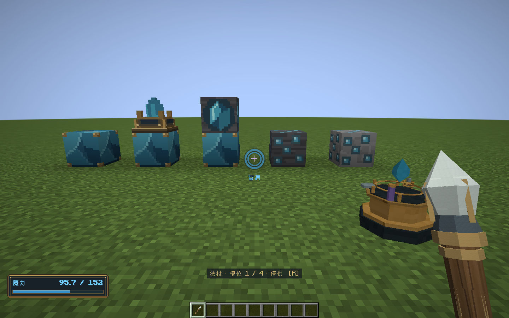
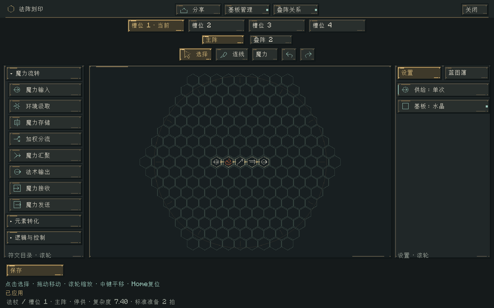
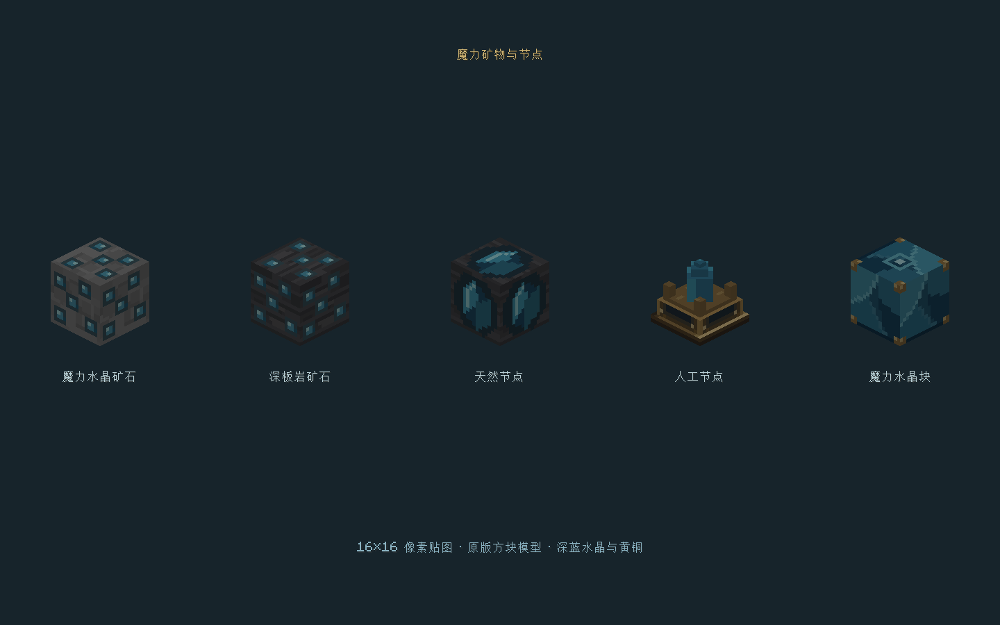
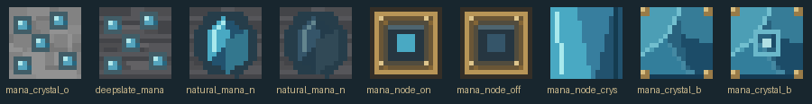

# 蓄力、水晶增幅与魔耗属性 · 0.39.0

日期：2026-11-02。Minecraft 1.21.1、NeoForge 21.1.265、Java 21，继续使用 Curios API 9.5.1+1.21.1。网络策略载荷升级为 `1.21.1-19`，客户端与服务端应同时更新。

## 单击与蓄力

短按右键并松开时，以倍率1释放；达到6个世界步后进入蓄力，40步蓄满，松手释放。20步为一秒，默认蓄满约2秒。按住时不向本次法阵注入、不扣本次输入，准星内环显示蓄力进度，外环仍显示原有释放冷却。取消使用、切换手持物或槽位、改变副手施法载体、离开维度和退出会取消尚未释放的蓄力。

设按住时间为 `t`、开始阈值为 `t₀`、蓄满时间为 `t₁`、最大倍率为 `Qmax`：

`Q(t) = 1 + (Qmax − 1) × clamp((t − t₀)/(t₁ − t₀), 0, 1)`

默认 `t₀=6`、`t₁=40`、`Qmax=2`。所有魔力数量按16.16定点截断。该倍率同时增加本次伤害系数和实际施法成本，不增加射程、半径，也不改变符文中指定的固定输入量。短按无需等待蓄力阈值，但仍遵守法阵自身的准备时间和法杖冷却。输入不足以支付更高的蓄力成本时按原有失败返还规则处理。

每次右键释放都只发起一次输入，即使该蓝图勾选持续供给，也不会因此反复注入；蓝图的持续偏好保留，固定法阵和其他起阵方式仍可使用。存储符文可以通过多次右键释放继续积攒魔力。单次供给后的逻辑运行窗口和阵内残余流转遵守原规则。

新运行现场v12保存本次供给方式和蓄力倍率，保存、重载、调整传输速度与规则迁移均保留；v1–v11显式按原供给规则和倍率1恢复。蓝图版本不变，不保存按键状态或额外魔力。派生链保存实际释放时的完整成本系数，不重新从法强推测，也不因换装而重算已发射法术的减免。子法阵保留原有中性准备速度，不把主手法杖的速度带入派生链。



## 玩家魔耗与法袍

新增两个原生、可同步的玩家属性：

| 属性 | 默认值与范围 | 作用 |
|---|---|---|
| `elementalcircuits:mana_cost` | 默认1，范围1/65536–16 | 基础魔力消耗倍率 |
| `elementalcircuits:mana_cost_reduction` | 默认0，范围0–80 | 消耗减免百分数，80表示减免80% |

法袍四件额外提供：巫师帽4%、法袍8%、绑腿6%、靴子4%，相加22%；原有法强、容量和固定回复加成保留。减免在原版属性提示中以百分数数值显示，卸下后立即移除。

设玩家法强为 `P`，魔耗指数为 `e`，基础魔耗属性为 `B`，减免百分数为 `R`，未加玩家系数的形状／参数成本为 `C₀`：

`伤害系数 = P × Q`

`实际施法成本 = C₀ × P^e × B × (1 − R/100) × Q`

仍按统一报价公式进行高精度计算并截断，最小成本为一个定点单位。法强最终上限16，魔耗倍率上限65536；蓄力会同时受这两个上限约束，不会因成本封顶而白送额外伤害。最终强度仍乘原有杖端等系数。

例：全套法袍 `P=1.55`、`B=1`、`R=22`、`e=1`，未蓄力成本系数约1.209，蓄满约2.418。减免减少成功施法的预算消耗；输入符文仍请求完整输入，剩余量按原收据退回来源。线路损耗、控制供能及失败损失遵守各自规则。

管理员可直接使用原版属性命令，例如：

```text
/attribute @s elementalcircuits:mana_cost base set 0.8
/attribute @s elementalcircuits:mana_cost_reduction base set 10
```

## 魔力水晶块

九枚魔力水晶合成一块，可分解回九枚；加入创造分类、原生配方解锁、镐采掘和掉落。物品说明提示其增幅用途。

只检查目标正下方紧邻的一块，隔层、侧邻或继续向下堆叠不额外叠加，不扫描塔体，也不强制加载区块。

| 正上方目标 | 默认效果 | 资源规则 |
|---|---|---|
| 人工节点 | 每个场步的释放上限×1.5 | 仍完整扣除节点储量，不产生自然恢复 |
| 天然节点 | 释放上限×1.5，自然恢复×1.5 | 保留容量、恢复余数与来源账本，不能超容量 |
| 固定法阵 | 伤害与成本系数×1.25，准备速度系数×1.25 | 不增加免费输入，不改变范围；提高的伤害仍付出成本 |

移除基座后下一次查询／报价恢复原值；已经释放的法术保留此前系数。速度系数参与原有复杂度准备公式并向上取整，默认2拍的简单法阵可能仍为2拍，更复杂法阵的缩短更明显。

## 编辑器与美术

分享、基板管理、叠阵关系位于页头中央，槽位、阵层、工具紧凑排列；没有叠阵时自动收起该行的预留空间。保存仍在左下角。参数展开时 Enter 先保存该参数，收起后 Enter 或小键盘 Enter 保存整张法阵；非法参数不会跳过校验直接提交整阵。



矿石、天然节点、人工节点及水晶块采用16×16贴图，原生方块模型静态烘焙。天然节点保留完整岩块形态，人工节点采用黄铜底座与竖直分面水晶，并关闭完整遮挡，避免邻接方块出现错误剔面。Aseprite源文件位于 `art/aseprite/mana-blocks/`，可运行 `tools/artwork/export-mana-blocks.ps1` 重建与导出。





## 可配置项与验证

新增服务器配置：`input.holdTicks`、`input.fullChargeTicks`、`input.maximumCharge`，以及 `crystal.nodeEmissionMultiplier`、`crystal.naturalRecoveryMultiplier`、`crystal.circuitPowerMultiplier`、`crystal.circuitSpeedMultiplier`。默认值分别为6、40、2、1.5、1.5、1.25、1.25。现有配置界面与 `/ec` 配置机制自动包含这些设置。

验证命令：

```powershell
./tools/build.ps1 -Tasks build,runGameTestServer -Mirror -Offline
./tools/build.ps1 -Tasks runClient -CrystalSmoke -Mirror -Offline
./tools/build.ps1 -Tasks build,runClient -StandardSmoke -Mirror -Offline
```

新增纯领域检查覆盖蓄力阈值、饱和、取消、单次注入、完整现场恢复、折扣、成本封顶与旧格式拒绝。6个新增原生测试覆盖实际物品使用／松手、按住不消费、切换取消、真实装备属性、节点能量守恒、天然恢复和基座即时移除。

图形验证在隔离世界通过实际客户端按键状态与使用物品网络包进行，确认真实右键长按和松开、22%属性同步、工作台授权下的Enter保存、四槽位与叠阵布局，以及矿石／节点／水晶块原生渲染。0.38的参数展开、左右侧栏、单线删除与320×240逻辑窗口回归也通过。没有修改正式存档或重新生成原有世界矿物，也没有重新进行完整玩法和长期GPU性能验收。

最终验证：161415项核心检查、230项Minecraft原生测试全部通过；蓄力、编辑器及紧凑布局图形验证通过。

发布包：`elemental-circuits-1.21.1-0.39.0.jar`，3038651字节。

SHA-256：`39947f713bf64671a31c8880cc4884595285b3da4762a5bb58ecb7014a6f773b`。生产包不含测试类、蓝图测试夹具或Curios实现；74个既有OGG逐字节保持不变，30个旧安装包的大小与哈希均已复核。网络协议已更新，客户端与服务端需要同时安装0.39.0，仍需Curios 9.5.1+1.21.1与Java 21。
