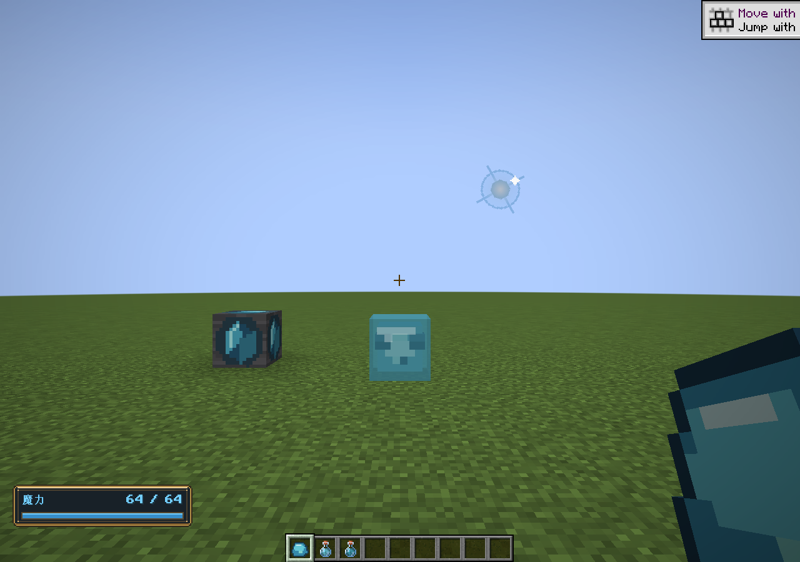
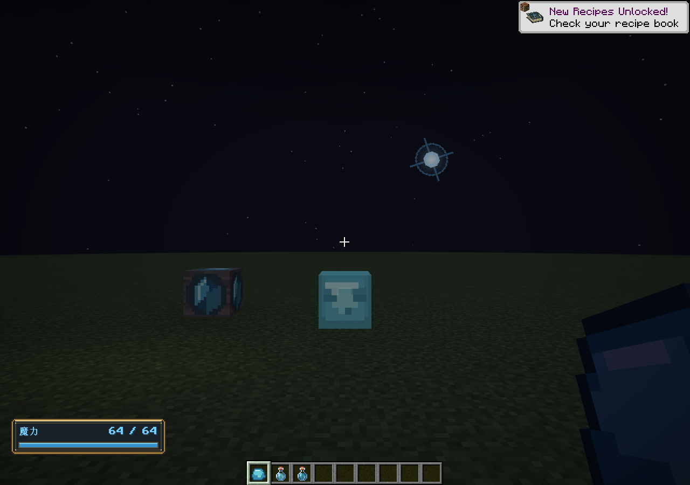

# 魔力史莱姆与浮光节点

版本0.45.0 · Minecraft 1.21.1 / NeoForge 21.1.265。2026-11-03。

## 获取循环

在天然节点周围寻找魔力史莱姆，击败后收集魔力凝胶；也可以将普通史莱姆留在高浓度魔力场中转化。凝胶直接食用或酿造，用于补足瞬时施法储量；节点与汲取口用于长期供给。

魔力史莱姆沿用原版史莱姆跳跃、体型、攻击与分裂规则，为蓝色像素生物。自然生成受主世界群系生成表、有效地面、碰撞、和平难度和原版怪物上限控制；权重4，每组1—2只。只有已加载天然节点24格范围内通过环境检查，人工节点不提供此资格，不绕过原版生成距离或生物数量上限。

普通史莱姆每20tick采样一次所在8格场单元。场量至少24，持续累计600tick后转化；不足则清空进度，采样带来的时间误差小于1秒。进度写入原生实体持久数据，保存读取保留。仅转换原版史莱姆，不转换岩浆怪或其他模组生物。转换保留体型、当前血量、名称和原生convertTo支持的属性，不治疗、不触发死亡分裂。已转换生物不再转换；死亡分裂的后代仍为魔力史莱姆。

最小体型死亡掉落0—2份凝胶，受原版抢夺附魔影响；大体型先按原版分裂，不另行掉凝胶。创造栏提供刷怪蛋。

## 凝胶与两种药水

| 物品 | 默认作用 | 获取 |
| --- | --- | --- |
| 魔力凝胶 | 食用立即恢复16魔力 | 小型魔力史莱姆掉落 |
| 魔力复原药水I | 立即恢复32魔力 | 粗制药水＋魔力凝胶 |
| 魔力复原药水II | 立即恢复64魔力 | 复原药水I＋萤石粉 |
| 已有魔力回复药水 | 提高持续恢复速度 | 粗制药水＋魔力水晶 |

复原药水支持原版火药喷溅、龙息滞留及对应原生效果路径。喷溅恢复受距离强度缩放，滞留由原版范围云控制命中间隔。没有红石延时配方：它是瞬间效果。恢复截断于当前容量，不改变永久上限、不修改待返还账本、不清除尚未结束的自然回复等待。恢复不是旧施法返还，独立通过ManaPool.restore注入。凝胶满饥饿值也能食用，满魔力时仍会消耗。

## 两种天然节点

| 初值 | 地脉节点 | 浮光节点 |
| --- | --- | --- |
| 位置 | 原有地下分布 | 地表最高块上方8—16格 |
| 储量 | 4096 | 1024 |
| 自然恢复 | 1/秒 | 2/秒 |
| 场步最大输出 | 0.5 | 1 |
| 默认每秒最大输出 | 2 | 4 |

场步默认5tick；两者实际输出受剩余量、单元空余、活动预算和水晶块增幅约束，已耗尽仍自然恢复。浮光更容易从地表定位，输出快、储量小；地脉提供更长缓冲。浮光每区块1/24概率尝试一次，要求目标及六邻居均为空气，不覆盖地形；实际密度取决于地形和群系。新增世界生成只出现在新生成区块，已有节点与魔力场保留。

浮光使用原有有限节点领域对象，冻结容量与每步输出写入节点存档。魔力场调度、抽取、自然恢复、节点破坏掉落与探测都复用现有边界。光团无实体碰撞，含悬浮、旋转光晕与粒子；本身不是能自由搬动的生物。探测杖报告单列“浮光节点”，范围扫描包含两种天然节点，包括原有离线区块调色板路径。

## 配置与工程

服务器配置新增ecology.enabled、nodeRadius、conversionField、conversionTicks、gelRestore、potionRestore，以及field.aerialCapacity、aerialPerStep、aerialRegeneration。既有设置命令与配置界面通过统一设置表接入。容量与场步输出只影响新初始化浮光节点，已有数据冻结；恢复速率与生态阈值按当前服务器设置读取。生成高度、频率、群系和生成权重可使用数据包覆盖对应JSON。

ManaEcology适配原生实体和事件，转化按实体自己的固定tick采样，不扫描区块或创建魔力场单元；自然生成只查询已注册节点。ManaSlime保留原版运行行为。InstantMana是物品/效果到玩家槽的单向适配，客户端只负责模型与光团渲染，不决定转化和恢复。

验证：161569项核心检查，247项原生GameTest通过；包括实际死亡掉落、分裂类型、转化进度保存、离场重置、体型和血量保留、原生酿造与实际饮用、距离缩放、封顶和存档、节点恢复与世界生成配置实际放置。客户端使用独立世界做昼夜截图并确认魔力史莱姆实际存在，标记MANA_ECOLOGY_GPU_PASS。尚未做大范围探索的生成密度统计和大量生物压力测试。

命令：`./tools/build.ps1 -Tasks coreTest,runGameTestServer,build -Mirror -Offline`；GPU：`./tools/build.ps1 -Tasks runClient -EcologySmoke -Mirror -Offline`。所有验证世界位于build下，不修改正式存档。

