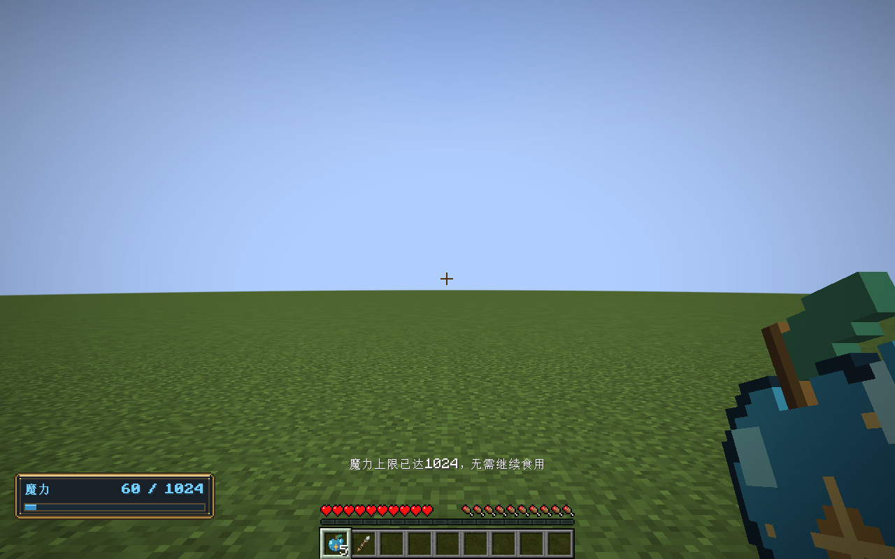

# 魔力输入与永久成长 · 0.25.0

2026-11-01 · Minecraft 1.21.1 / NeoForge 21.1.265 / Java 21。

## 调节法阵的魔力输入

在法阵工作台打开刻印界面，选中**魔力输入**符文，在右侧输入数量，点击“设置每次注入量”，然后保存。默认规则下可设置 **0.25–64点**，支持可用16.16定点数精确表示的小数，例如0.5、1、2、8。上限由当前载体冻结的单节点容量决定，不由玩家总容量决定。

每个输入符文分别保存自己的数量。单次供给注入一次；持续供给沿用法阵已有的注入周期，当前默认每10个逻辑步一次。多个入口的当次总需求一起扣款，魔力不足时原子拒绝并停止供给，缓存满时本轮整体等待，不扣无法接收的魔力。信号维持成本、线路损耗和实际元素输出继续计入原账本。

**环境汲取**也增加“设置汲取上限/步”。它限制每个世界逻辑步的最大汲取量，真实数量仍受当地魔力场、节点供给和缓存空余限制。它不会把环境魔力变成无限资源。

“作用量”仍控制法术修饰，不替代外部注入。改变输入数量须先停供、保存，再手动起阵；重配先回收和复用原有残余，不重复扣玩家魔力。


## 魔力果实

**1个苹果＋4块魔力水晶**无序合成1颗魔力果实。获得魔力水晶后，原版配方书解锁该配方；创造物品栏也可直接找到。贴图由Aseprite制作，采用晶蓝果肉、黄铜星纹和晶簇。

- 长按使用键食用，采用原版约1.6秒的食用动作；满饥饿值也能使用。
- 每颗永久增加**16点魔力容量**，硬上限**1024点**。从初始64点升满共需60颗。
- 提升容量不填满当前魔力，不清除恢复等待或消费账本；新增空余由原有自然恢复补足。
- 容量随玩家保存，退出重进和死亡重生均保留。
- 已达1024时拒绝食用并提示，不消耗果实；食用中途取消不增加容量。




## 创造模式耐久

施法和近战共用玩家耐久策略。创造模式的法杖不再磨损，包括由副手法术书提供法阵的施法；生存模式仍在真实释放法术后磨损一次，近战也正常磨损。已有损伤不会因为切模式被修复。魔力和释放冷却维持原规则。

## 代码、保存和兼容

- `Blueprint.inputAmount`统一读取入口数量，`withInputAmount`负责显式升级与校验；`TickCircuit`在报价、容量检查、扣款、回收复用和环境汲取中读取相同定义。
- 旧蓝图v1继续读取冻结规则中的默认注入量，历史上没有作用的入口参数不会突然改变需求。第一次设置入口数量时升为蓝图v2，其他入口保留原行为。编辑、移动、布线、材料更换、蓝图码、书籍保存及服务端载体规则绑定均保留版本。
- 使用蓝图v2的VM现场保存为v7；旧VM现场v1–v6仍按原语义读取，新语义不能伪装为旧现场。程序集外层、文本码外层和玩家槽字段没有变化；玩家槽原本已经保存容量，本次沿用该完整记录。
- `ManaGrowthRules`是纯领域成长规则，`ManaPool.increaseCapacity`只增容。`ManaGrowthResources`从独立`rules/mana_growth_v1.json`读取版本化数值。`ManaFruitItem`使用原版食品组件，成长在服务端确认食用完成时提交；`PlayerMana`立即保存并同步HUD。
- `WandEquipment.wear(stack,user)`统一处理创造豁免；法杖近战与`MinecraftCircuitHost.emit`都通过该入口，固定设备不承担物品耐久。
- 本版网络协议为 **1.21.1-9**，客户端与服务端一起更新。旧模组不能读取新的可调入口蓝图/现场，不应回退打开已经更新的世界。

可编辑美术源为`art/aseprite/mana-fruit.aseprite`，制作脚本为`tools/artwork/paint-mana-fruit.lua`，正式贴图为32×32的`textures/item/mana_fruit.png`。新增运行代码没有依赖客户端测试或美术制作工具。

## 验证

- **95,227项**核心契约通过，比上版新增838项检查，覆盖分数/大小输入、逐步保存恢复、守恒、多个入口总报价、背压、残余复用、编辑历史/导入协议、环境上限、60次成长及硬上限。独立`test-core.ps1`得到相同结果。
- **131项**Minecraft集成测试通过，其中4项新增测试使用真实配方匹配/合成、食品消费、持久化和重生适配器、创造/生存法杖、真实VM与副手法术书。
- 真实图形客户端使用原生参数框和按钮设置8、拒绝0，检查新贴图烘焙，实际长按食用，并观察服务端同步的64→80→1024容量、满级拒食及重新加载玩家槽。完成标记为`MANA_PROGRESSION_GPU_PASS`。截图存于`art/mana-progression/2026-11-01/`。
- 工作区原有Godot隔离回归**23套、零失败**。未修改Godot玩法代码或正式存档。

```powershell
./tools/build.ps1 -Tasks build,runGameTestServer -Mirror -Offline
./tools/test-core.ps1 -JavaHome 'C:/Program Files/Java/jdk-21.0.10'
./tools/build.ps1 -Tasks runClient -ProgressionSmoke -Mirror -Offline
```

日志位于`build/mana-progression-contracts.log`、`mana-progression-standalone-core.log`、`mana-progression-gpu.log`和`mana-progression-godot.log`。图形测试使用独立`build/progression-smoke/`世界，服务端使用每次新建的`build/gametest-runs/`子目录。首次编译修正了测试中ItemStack存档Tag的类型转换；完整测试随后通过。环境存在原版在线认证服务访问失败和Godot证书库告警，坏存档用例也会打印预期拒绝日志，不代表正式世界被读写。尚未进行多人主观试玩或长期性能采样。

## 安装包

`../releases/elemental-circuits-1.21.1-0.25.0.jar`，2,260,658字节，SHA-256：`eaf3567f38c1eb5fab3dd1c1be5917d7fa77d4017f5250fdf717f725fca6240e`。已校验既有14个归档包未变；本版保留74个音效、三维书籍/工作台及素材署名和授权全文，未打包测试验证器或美术工具。
