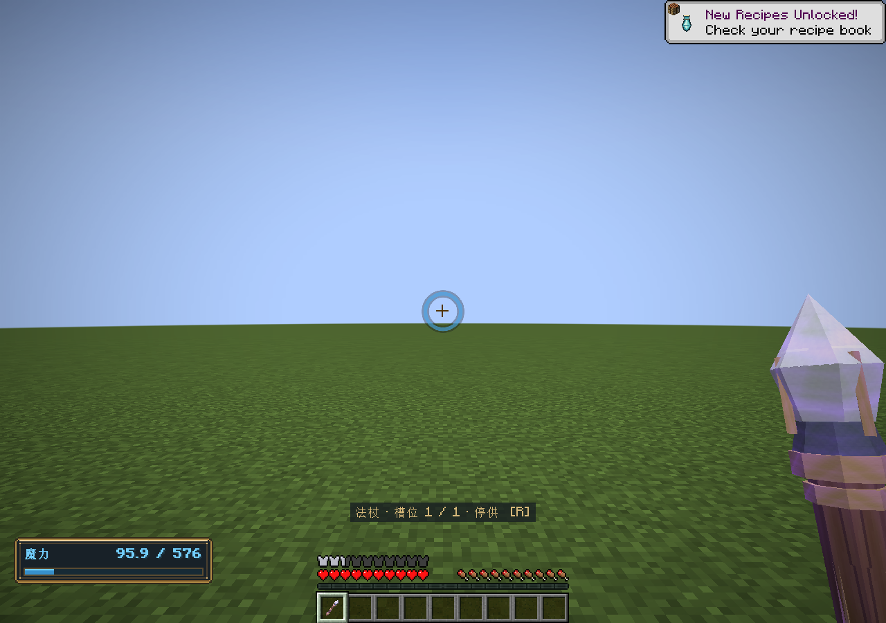

# 魔法附魔

2026-11-03 · 0.47.0 · Minecraft 1.21.1 / NeoForge 21.1.265 / Java 21

新增15种原版数据驱动附魔。定义位于`data/elementalcircuits/enchantment/`，支持附魔台、铁砧、附魔书、原版交易与随机附魔池；魔力维修为宝藏附魔，不进入附魔台。创造分类提供最高级附魔书，原版随机池的具体获取机会仍由交易和战利品规则决定。自带手札及Patchouli宝典同步加入“魔法附魔”章节。

| 附魔 | 等级 | 默认效果 | 适用范围 |
|---|---|---|---|
| 扩容 | III | 每级增加32魔力容量 | 手持或佩戴的法杖、法术书、法袍、戒指、观阵镜 |
| 源流 | III | 每级增加0.5魔力/秒固定回复 | 同上 |
| 增幅 | III | 每级增加0.1法强 | 同上 |
| 迅咒 | III | 每级提高10%施法速度 | 当前实际施法的法杖、法袍部件、戒指 |
| 护板 | III | 每级减少15%基板正常及过载磨损 | 当前承载法阵的法杖、法术书、法袍、戒指 |
| 魔力维修 | II | 每秒每级最多修复1耐久，消耗4魔力/点 | 手持或穿戴的原版耐久物品及本模组法阵载体 |
| 土、水、火、风、雷、光、暗、奥术、霜之庇护 | 各IV | 每级降低对应元素魔法伤害4% | 实际穿戴的护甲、Curios戒指及头部观阵镜，手持无效 |

不同元素庇护在同件物品上互斥，各部位可搭配不同庇护；与原版保护可共存。魔力维修与原版经验修补互斥。迅咒作用于当前释放法术的物品，穿着迅咒法袍不会加速手中的法杖；副手法术书作为蓝图来源时使用法杖的速度和释放冷却，书自己的护板影响书中法阵的基板。

## 数值关系

扩容、源流、增幅使用原版`minecraft:attributes`附魔效果；物品定义和附魔的加成相加，不改永久成长，也不补满魔力。戒指和观阵镜的修饰符按饰品槽区分身份。卸下时移除加成；容量缩小时按既有玩家槽规则截断多余储量。源流进入固定回复分支，仍受现有恢复等待与药水倍率影响。增幅进入既有法强公式：伤害乘法强，魔力成本乘法强的配置指数次方，指数默认1。

迅咒有效速度为`clamp(部件基础速度 × (1 + 等级 × 0.10), 0.25, 2)`，同时用于法杖释放间隔和法阵复杂度引起的施法延迟。沿用已有速度安全域，已达到2倍速度的法杖不会继续提速；魔力输入与阵内推进时序不变。

护板磨损倍率为`max(0.10, 1 - 等级 × 0.15)`，III级保留55%磨损。该倍率同时乘正常供给损耗和过载损耗，熔毁阈值、爆炸和熔毁后的报废状态不受影响。

每种庇护减伤率为`min(0.80, 装备上该庇护等级之和 × 0.04)`。混合法术的结算伤害为`原伤害 × Σ(该元素伤害占比 × (1 - 该元素减伤率))`，只按反应后实际剩余伤害成分计算。不同防护不会交叉抵御，纯净魔力没有元素庇护。保护作用于本模组元素伤害类型，不把环境火焰或普通雷击自动算成元素魔法。维持已有反应、状态效果、原版护甲/保护和受击间隔处理，不撤销先前命中的伤害。

魔力维修在服务端每20tick检查手持、护甲和非装饰戒指/头部观阵镜，按物品独立分配维修预算，背包物品不参与。顺序为原版装备槽、戒指槽、头部饰品槽；每件先修物品耐久，再按基板槽序修复。基板保留16.16小数精度，支付量为`ceil(实际修复量 × 每点成本)`，不超过可支付量，不透支、不凭空恢复。成功扣魔沿用正常消耗后的恢复等待。耗尽但未熔毁的基板可修复；保留蓝图、供给账本和空的魔力现场，不自动启动。熔毁必须在工作台消耗新基板更换。

## 配置与扩展

以下服务端配置可在原生配置界面及`/ec config`中修改，当前值即时用于后续结算：

| 配置键 | 默认值 |
|---|---|
| `enchant.guardPerLevel` | 0.04 |
| `enchant.guardMaximum` | 0.80 |
| `enchant.boardReductionPerLevel` | 0.15 |
| `enchant.speedPerLevel` | 0.10 |
| `enchant.repairPerLevel` | 1 |
| `enchant.repairManaPerPoint` | 4 |

例如`/ec config set enchant.repairManaPerPoint 2`将维修成本调整为每耐久2魔力。扩容、源流、增幅的属性系数、最高等级、附魔权重、适用物品和互斥标签使用数据包覆盖JSON；既有附魔书和物品继续使用原版保存与同步，无新增法阵存档格式。

专用附魔适配器位于`server/enchantment/`；基板领域只接收磨损倍率与实际修复量，不依赖附魔注册表。伤害适配只消费已有元素伤害成分。原版和Curios分别负责属性装卸与同步，避免再维护一份玩家装备加成账本。

## 验证

0.46首次验收为核心161569项、原生GameTest253项，其中新增6项集成测试覆盖附魔台候选、真实铁砧、互斥、Curios修饰符身份、原生物品保存、冷却、熔毁阈值、混合防护与受击间隔、维修扣魔和小数耐久、无魔力/背包/饰品/熔毁边界。客户端额外验证原生法袍和Curios戒指装上附魔后的实际同步属性。

自动验证命令：`./tools/build.ps1 -Tasks coreTest,runGameTestServer,build -Mirror -Offline`。图形验证：`./tools/build.ps1 -Tasks runClient -EnchantmentSmoke -Mirror -Offline`，仅使用`build/enchantment-smoke`中的隔离世界，不接触正式存档。尚未做长期多人运行或其他附魔模组组合验收。

0.47修复法袍防护附魔标签，新增观阵镜头部饰品支持；当前回归和边界见[观阵镜与数值审查验收](../verification/观阵镜与数值审查验收.md)。
