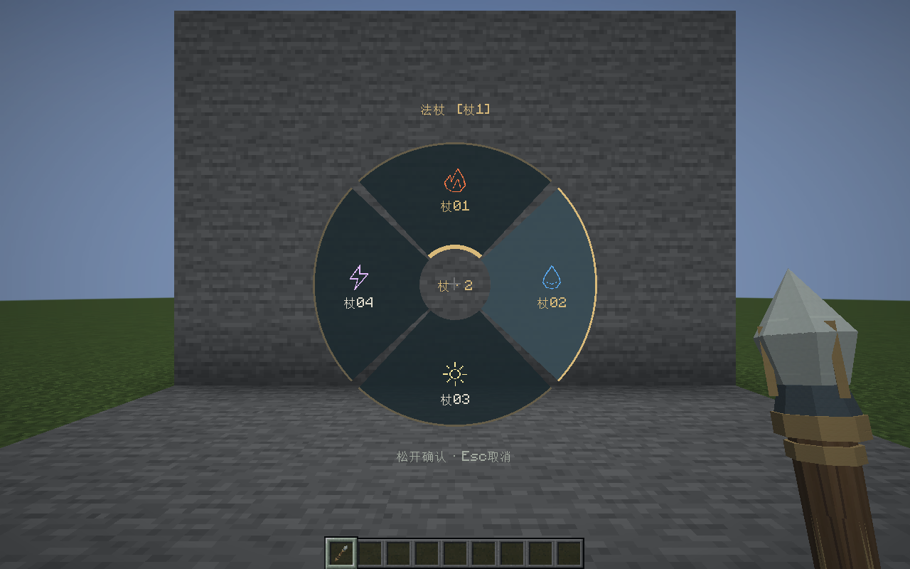
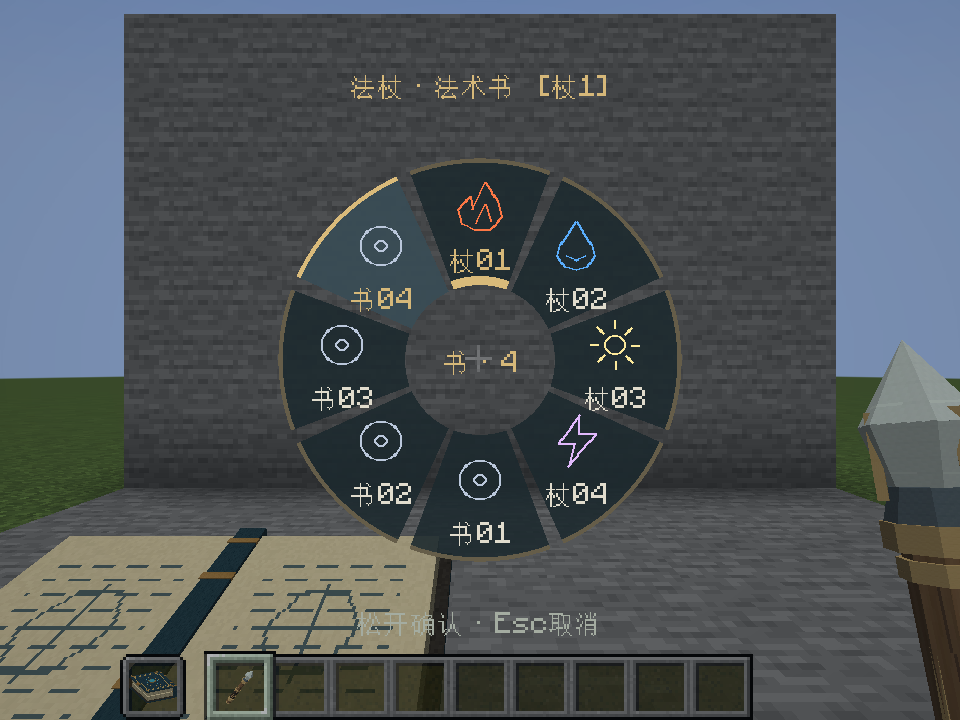
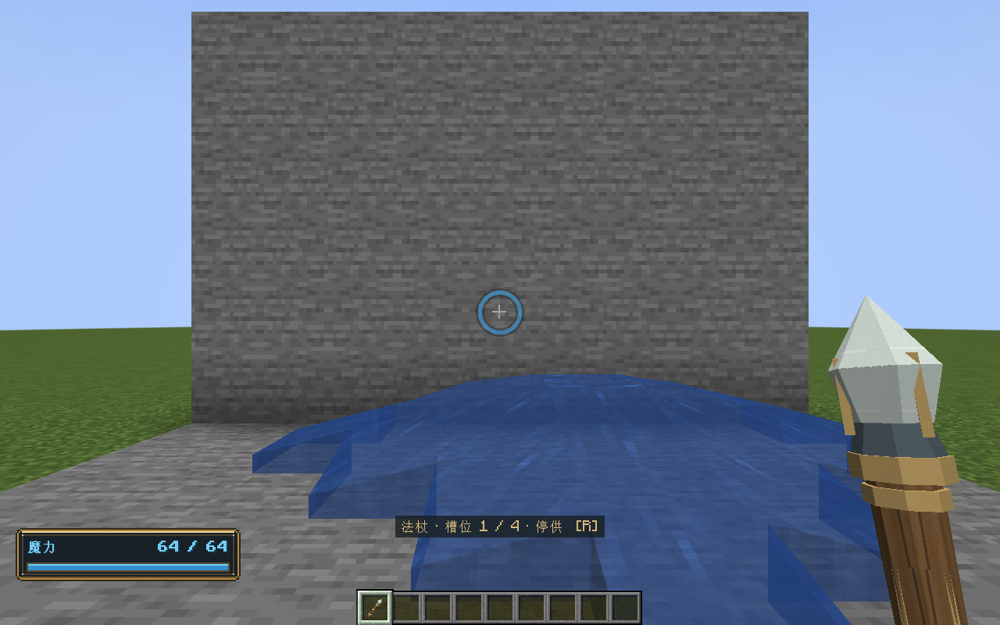

# 0.42 反相奥术与联合选阵验证

日期：2026-11-02。环境：Windows、Java 21.0.10、NeoForge 21.1.265、Curios 9.5.1+1.21.1、Patchouli 1.21.1-93。

## 结果

| 检查 | 结果 |
| --- | --- |
| 领域回归 | 161503 项检查通过 |
| 原生 Minecraft GameTest | 235 项全部通过 |
| 实际客户端轮盘/编辑/递归回归 | 四个 GPU 完成标记齐备，正常退出 |
| Java 格式 | 374 个文件 AOSP 四空格检查通过 |
| 安装包 | 0.42.0；不含 Contracts 或 VisualSmoke 测试类 |

最终构建命令：`./tools/build.ps1 -Tasks build,runGameTestServer -Mirror -Offline`。日志：`build/antimagic-final.log`。领域与原生检查均来自本次最终构建。

客户端命令：`./tools/build.ps1 -Tasks runClient -RecursionSmoke -Mirror -Offline`。日志：`build/antimagic-client.log`，使用 `build/recursion-smoke/` 下独立的新建世界，没有读写正式游戏存档。

## 抵消与运行现场

领域检查覆盖反相奥术对其余 15 种成分的双向抵消、1:1 余量、最早相克片段优先、纯净不变、同相不自消、无余量伤害及历史 v1 不变；含反相奥术的混合包不提前拆出穿透分量或光照预算。

原生检查逐一命中实体，确认已抵消元素不写入伤害、点燃、潮湿、冻结或受击间隔，不撤销此前燃烧。新增真实光束检查确认火、水、光被抵消后不创建火焰、水源、命中光源及尾迹光源；同一场景未混合火仍能造火，排除权限或未加载场景导致的假通过。

选阵检查覆盖双方同号槽位、默认杖阵、明确书阵、跨来源循环、物品 NBT 往返、换书回退、原书恢复、迟到请求拒绝和蓄力中换来源不扣魔力。没有复制法阵或魔力现场。

## 实机证据

四槽杖阵，1280×800 / GUI 2：

副手配书后保留四槽杖阵并加入四槽书阵，960×720 / GUI 3。标题标明当前选用“杖1”，悬停“书4”，来源与同号槽位可区分：

客户端以数字 8 选中书槽 4，服务器回执确认；打开轮盘后收起书，轮盘自动关闭并回退到杖槽 1。随后同一杖阵继续完成递归世界作用：

测试夹具原本采用火母弹、水子阵。编辑器将模板升级到当前默认 1 点输出后，水会先消费在熄火上，旧检查因此等不到水源。夹具已改用风母弹，仍使用 16 点预付预算和真实工作台保存的子阵，没有改变生产消耗或绕过世界作用。

## 边界

此次验证涵盖单机真实网络路径、实体与方块作用、选择持久化和 GUI 2/3 布局；不代表公网多人延迟或长期性能验收。反相奥术抵消限于同次接触载荷，不提供独立投射物之间的拦截。开发离线运行中的 Mojang 公钥请求失败及既有 WMI/refmap 提示没有影响完成标记。
