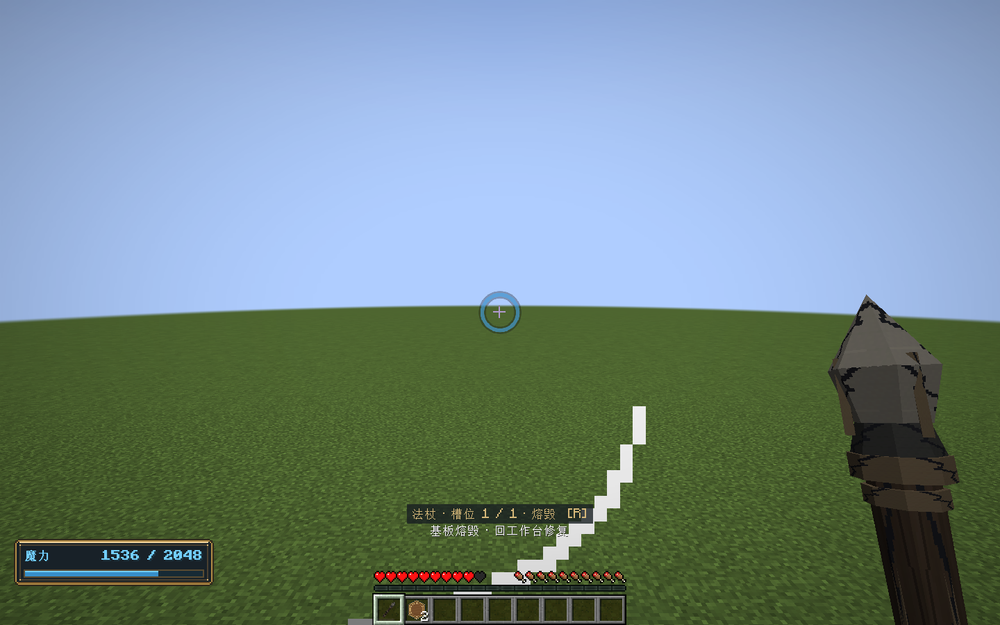
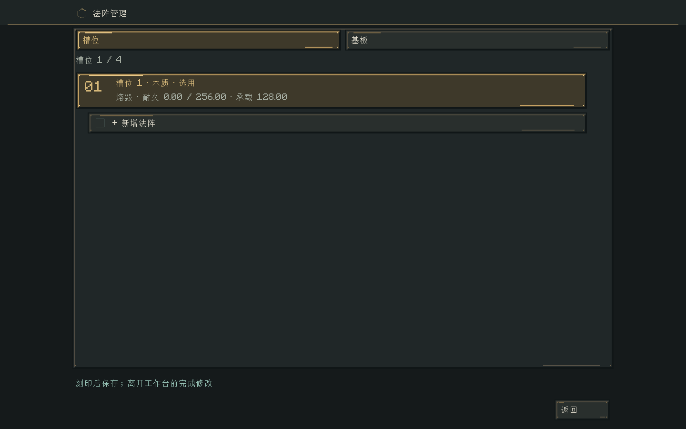
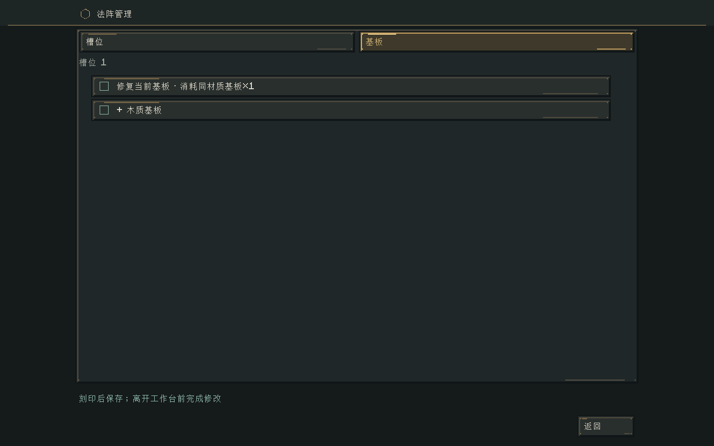
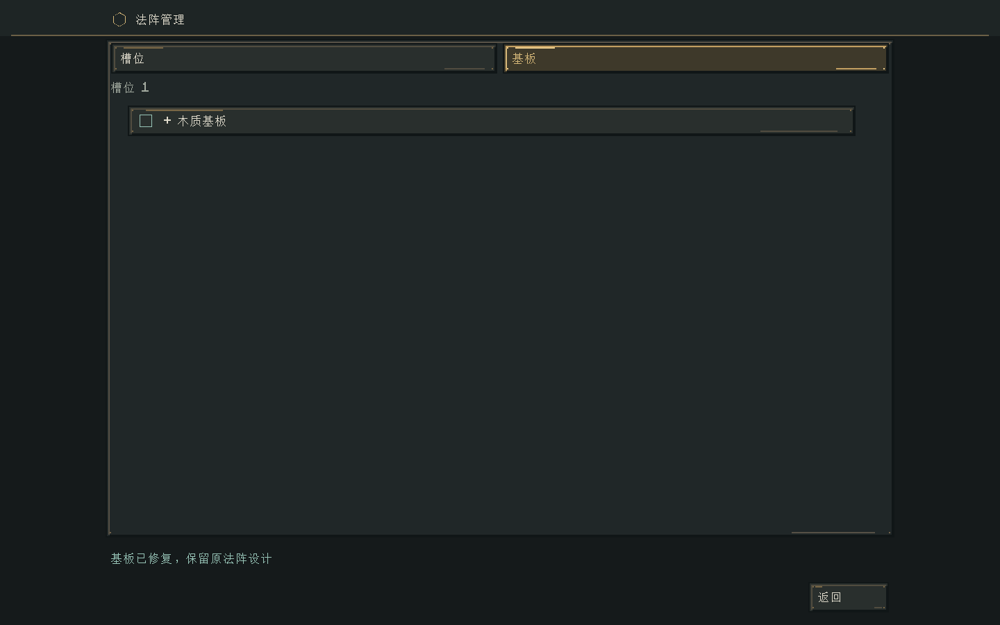
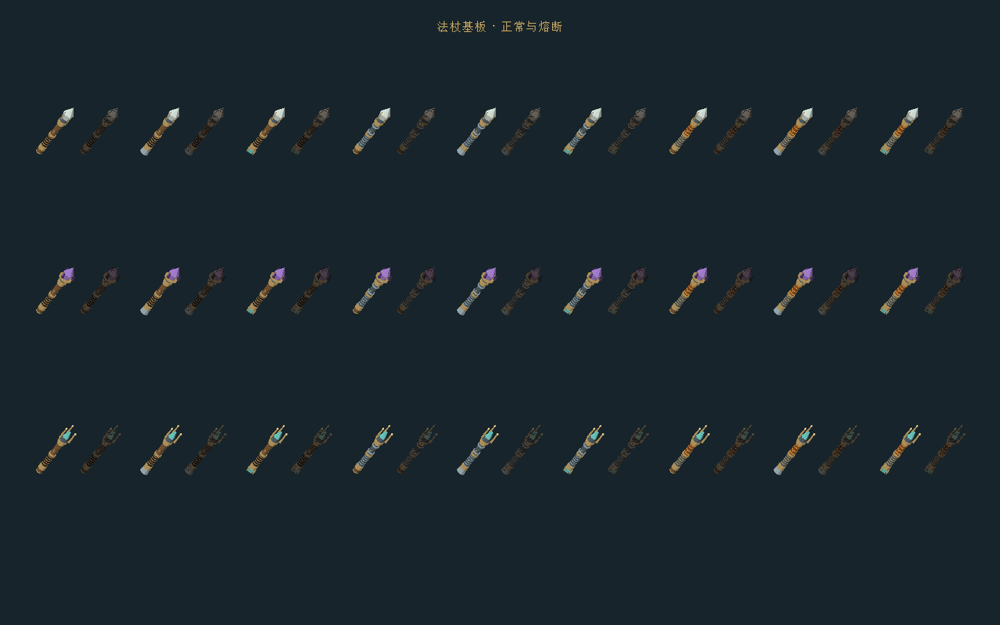

# 0.43 基板承载与熔断验证

日期：2026-11-02。Windows / Java 21.0.10 / Minecraft 1.21.1 / NeoForge 21.1.265 / Curios 9.5.1+1.21.1 / Patchouli 1.21.1-93。

## 验证结果

| 检查 | 结果 |
| --- | --- |
| 领域回归 | 161569 项检查通过，含新增66项 |
| 原生 Minecraft GameTest | 240 项全部通过，含新增5项 |
| 实际客户端 | `BOARD_FUSE_GPU_PASS`，正常退出，5张截图 |
| 静态模型 | 27种部件组合，每种正常/失效两态，共54个烘焙模型全部加载 |
| Java 格式 | 382个文件，AOSP四空格检查通过 |
| 交付版本 | 0.43.0，网络`1.21.1-21`，客户端与服务器同时更新 |

最终构建：`./tools/build.ps1 -Tasks build,runGameTestServer -Mirror -Offline`，日志`build/board-final.log`。

客户端：`./tools/build.ps1 -Tasks runClient -BoardSmoke -Mirror -Offline`，日志`build/board-client.log`。使用`build/board-smoke/`下的隔离新建世界，没有读取或修改正式世界。客户端按原版60刻出生保护结束后触发熔毁，并验证施法者实际失血；不绕过出生保护或受击间隔。

## 覆盖范围

领域层检查安全承载边界、熔毁阈值前一固定点与阈值本身、平方超载磨损、小数累计、创造豁免、元素烈度及爆炸预算。实际VM检查完整512输入在任何输出前熔毁、魔力不足原子失败而不虚构负载、两次300魔力存储累积、汲取口实际输入、跨阵接收、破板拒绝接收，以及损耗账本守恒。

持久化检查v4基板记录、损坏恢复后不能起阵、重复套用蓝图不能修复、槽位独立与叠阵共享状态、修复保留设计和阵层、旧版本补齐健康记录而不追溯补扣，以及无效耐久拒绝。恢复后尚未绑定安装策略时禁止增加不完整的基板记录，拒绝操作不改变现场。

原生检查实际调度熔毁、NBT往返、杖体保留、熔断后仍可近战、近战只磨损杖体、施法主要磨损实际来源基板并保留杖体小数、创造豁免、空地修复请求拒绝、工作台修复真实扣一张同材质板、爆炸距离衰减与原版受击间隔。书阵沿用原有实际光束命中测试，并确认不磨损杖内未用基板。

修复了法杖`inventoryTick`遗留的“副手有法术书就停止杖阵”分支，新增真实调度回归，保留0.42联合轮盘的行为。旧字节相等迁移断言改为逐VM现场相等，并明确检查新增v4健康记录；没有以重置VM替代迁移。

## 实机截图

熔毁后的手持法杖、实际魔力扣款与失血。槽位HUD上移，避开原版动作栏通知：

槽位的失效状态、独立耐久和承载量：

同材质基板修复入口：

修复后按钮消失，基板实物由2张减为1张，服务器同时检查原512输入与叠阵保留：

27种组合的正常/失效模型比对。失效模型复用几何、UV和握持变换，16张共享静态贴图由`tools/artwork/bake-broken-wands.py`生成：

## 验收边界

以上是自动化回归与客户端冒烟，不代表长期多人服、极限符文数量或人工平衡试玩完成。自然魔力的元素烈度预测按可达转化刻印计算，不执行开关分支预测；它只影响爆炸公式，实际VM转换与命中反应顺序不变。已经发射的递归投射物使用原有冻结预算，不向之后更换的物理基板追扣耐久。

公式与设置见[基板承载与熔断](../systems/基板承载与熔断.md)。
