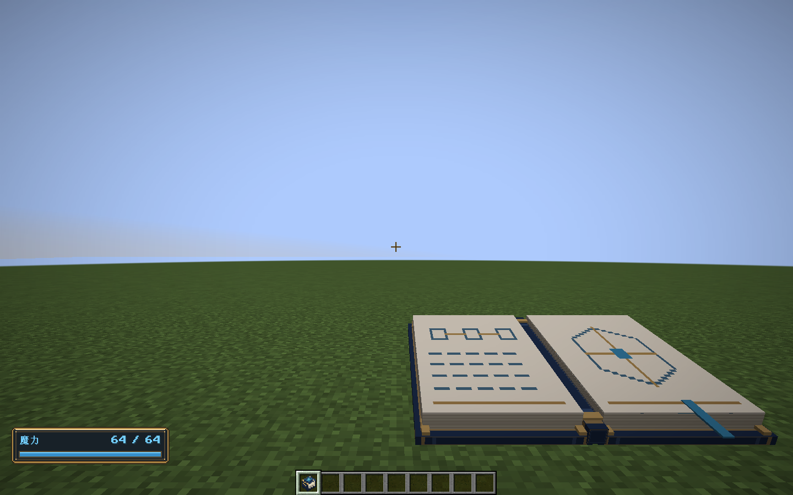
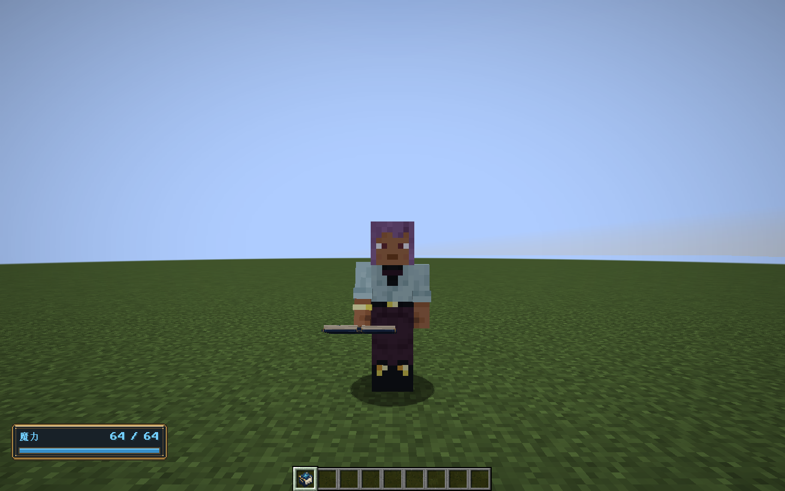
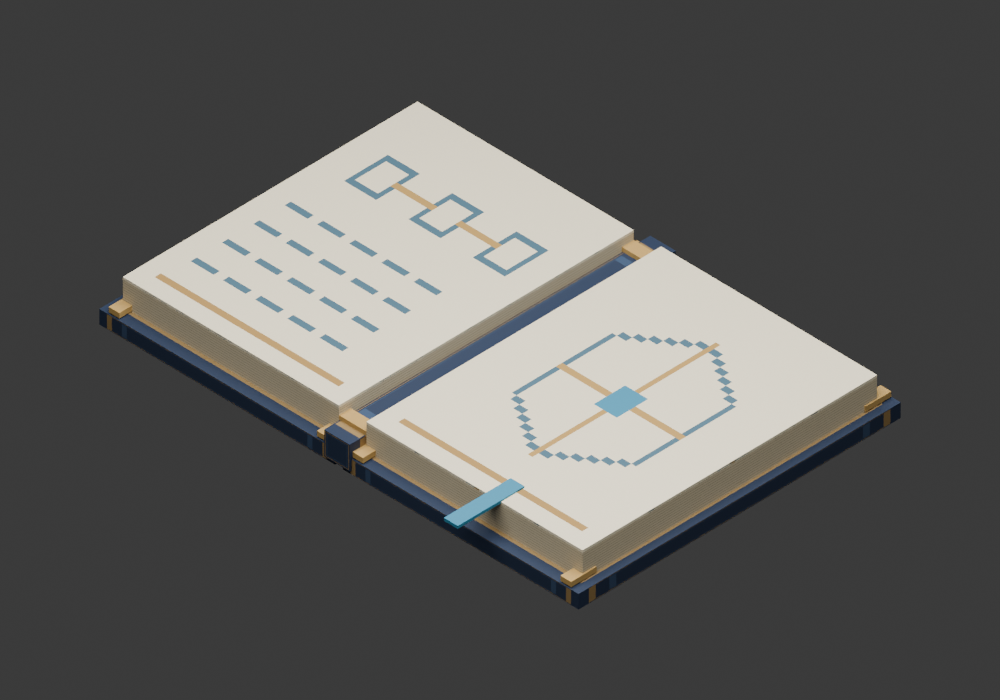

# 手册模型与目录整理验收

版本：0.41.0；Minecraft 1.21.1 / NeoForge 21.1.265 / Java 21。

## 交付内容

法阵手札使用 Blender 制作静态展开模型：深蓝封皮、黄铜包角、蓝色书签、纸页与法阵笔记。第一、第三人称的左右手选择三维模型；物品栏、掉落物和展示框使用原有像素封面。OBJ 为208个顶点、156个四边形，使用一张256×128图集。Blender和Aseprite原稿保留在 `art/`。

178项类型迁移按领域、应用、客户端、服务器及适配职责分类；373个Java文件采用AOSP四空格排版，补齐空格、方法间空行并展开长表达式。37份原有文档分类到 `systems`、`art`、`verification`、`maintenance`；美术工具集中于 `tools/artwork/`，旧Forge审计夹具归档到 `tools/archive/audit-1.20.1/`。现行文档和脚本引用同步更新。

## 验证

| 检查 | 结果 |
| --- | --- |
| `build,runGameTestServer` | 161,415项核心断言与231项原生集成测试通过 |
| `tools/test-core.ps1` | 独立JDK21核心测试入口通过 |
| `format-java.ps1 -Check` | 373个Java文件排版检查通过 |
| `runClient -GuideSmoke` | Patchouli路径通过，真实物品使用动作打开指南，检查分类、条目及配方页 |
| `runClient -GuideSmoke -NoPatchouli` | 完全移除Patchouli时的原生阅读器通过；第一、第三人称与像素封面截图已检查 |
| 生产JAR | 不含旧包名残留类、测试类和蓝图夹具 |
| 历史包 | 32个既有发布包的大小和SHA-256均匹配原清单 |

另对整理前282个主源码文件进行词法比较：归一包名、import、类型全限定名和格式化器拆分的常量字符串后，仅 `EquipmentClient` 与 `EquipmentWheelScreen` 存在执行代码差异，内容为按键匹配访问方法及其调用。目录迁移没有改变数值或算法。

回归发现旧装备测试仍期待容量加成88，整理前源码实际为 `160 × 部件权重`，合计880。本次保留源码数值，仅修正测试预期。没有改写正式存档。外部开发代码若直接引用旧Java包名，需要更新import；本次未验收第三方扩展源码。

测试世界与日志均在 `build/`。离线环境中的Mojang认证网络失败日志不影响本地测试，损坏数据测试会主动产生拒绝加载日志。没有进行长期帧率或完整新玩家体验验收。

## 截图

## 安装包

`elemental-circuits-1.21.1-0.41.0.jar`，3,159,284字节。

SHA-256：`c446c1c9d4181f01f25e598e0be109d53bedcadd0dbd4e2894b94e4ef2a8f444`。

Curios为既有前置，Patchouli仍是可选依赖。源码结构、原稿位置和重建命令见 [工程结构与排版](../maintenance/工程结构与排版.md)。
