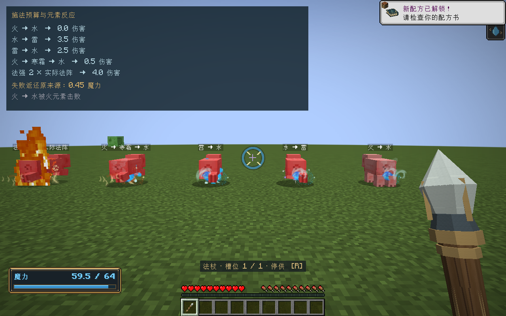
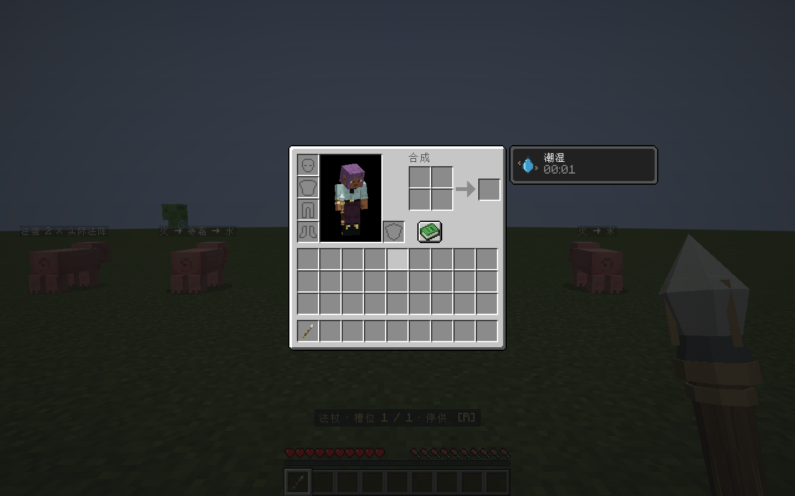

# 施法经济改革验收

版本0.35.0，2026-11-02。分支`codex/casting-economy-reform`；未暂存、提交、合并或推送。工程：Minecraft 1.21.1 / NeoForge 21.1.265 / Java 21。

## 本轮实现

采用用户确认的损失比例1/100、分元素原来源返还、法强魔耗指数初值1。实际公式和所有新增配置详见[施法成本与魔力动力学](../systems/施法成本与魔力动力学.md)。这份报告记录实现与验证，不以旧版公式为当前规则。

- 先解析实际参数，统一报价；精度连续输入；高精度除法后截断，修复大除数提前归零。
- 固定输入，预算不足失败，不追加支取；成功零头进衰减储备，避免同轮重复失败。玩家槽不足也有明确失败计数和短提示。
- 来源随魔力片段贯穿分流、合流、反相、转化、运输和派生预算；失败按元素比例返还原玩家、固定阵或场格点。
- 持久化VM返还出箱、世界凭据与接收侧累计收据，离线/满槽/卸载继续等待；防止重复入账。混合派生预算按精确前缀连续支取，避免累计比例舍入改变返还归属。
- 缓存和在途魔力按世界步自然损耗；内部多轮传输不多收衰减。所有形状按统一逻辑占格公式收费。
- 按杖端安全强度/频率的平方超载耐久；创造和固定装置保持免耐久。
- 固定＋容量百分比回复，药水只影响固定分支；天然节点恢复入账，多口和浓度限制实际汲取。
- 玩家原生法强属性，伤害与成本系数冻结随飞行和派生保存；相克反应、附加效果和原版受击边界统一。
- 新格式有独立版本与旧数据兼容路径；旧载体在服务器边界保留资源和现场后采用新版成本策略。

## 验证结果

| 验证 | 结果 |
|---|---|
| `build,runGameTestServer -Mirror -Offline` | 161,077项核心契约、205项原生GameTests全部通过 |
| `runClient -CombatSmoke -Mirror -Offline` | `ELEMENTAL_COMBAT_GPU_PASS`与`ECONOMY_GPU_PASS` |
| 原生客户端血量 | FIFO火→水0、水→雷3.5、雷→水2.5、火→霜→水0.5；另一个实际VM法强2火束4伤害 |
| 失败预算 | 实际玩家固定输入1不足报价，未发射；存活火魔力按比例退回原在线玩家 |
| 原来源回填 | 固定装置和场格点真实入账，NBT恢复后重复收据不重复注入；玩家重新绑定与死亡克隆保留收据 |
| 原版受击 | 取消hurt不附带灼烧/迟缓/击退；更弱连击服从原版间隔；相克抵消不再为附加效果付费 |
| 生命周期与数值 | 默认参数同价、精度小数、高精度大除数、失败计数耗尽、返还账本守恒、衰减恢复、固定子阵预算 |
| 待机提交 | 既有待机性能样本确认无逐步NBT替换，边界采用策略的首次迁移除外 |
| 归档和许可 | 26个归档核对；此前25个SHA不变；74个OGG和已有许可逐字节保留；测试类未打包 |

记录：`build/economy-release-tests.log`、`build/economy-gpu.log`、`build/economy-release-verification.json`。核心和原生测试使用隔离目录，客户端生成临时平坦世界，没有使用正式存档。日志中的坏数据停用信息来自对应负例；Mojang公钥/皮肤联网失败属于环境限制，未影响上述通过标记。编译保留既有10条NeoForge弃用警告。

## 安装产物

`../releases/elemental-circuits-1.21.1-0.35.0.jar`，**2,923,008字节**。

SHA-256：`2794e75b08a12a8aa84bb8bfcfbeea28919aafabb62819ee983e905c3010056e`。

客户端与服务器都需使用对应1.21.1版本，网络协议为`1.21.1-17`。

## 已知边界

- 旧存量没有来源记录，无法追溯的部分不会猜成玩家退款。
- 凭据和接收收据保留去重，默认预算65536，单步工作128；长期服务器需按实际存档和内存预算配置，达到预算时背压。
- 玩家、区块和SavedData分别落盘，不承诺突然断电下跨文件的数据库级强事务。普通保存恢复与重复发送已验证。
- 自动化图形冒烟没有覆盖长期多人服负载或完整人工平衡试玩；不宣称全部GPU帧率或长期性能验收通过。

