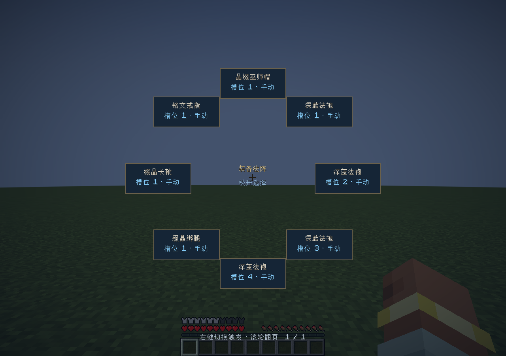
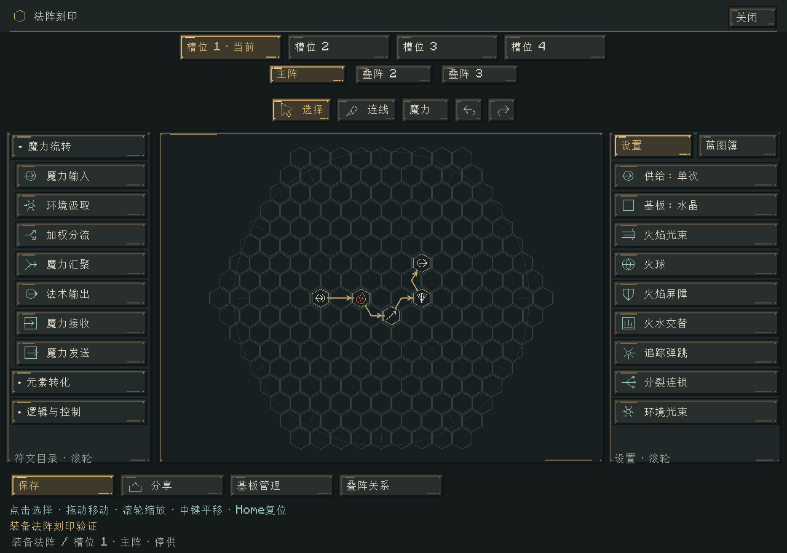
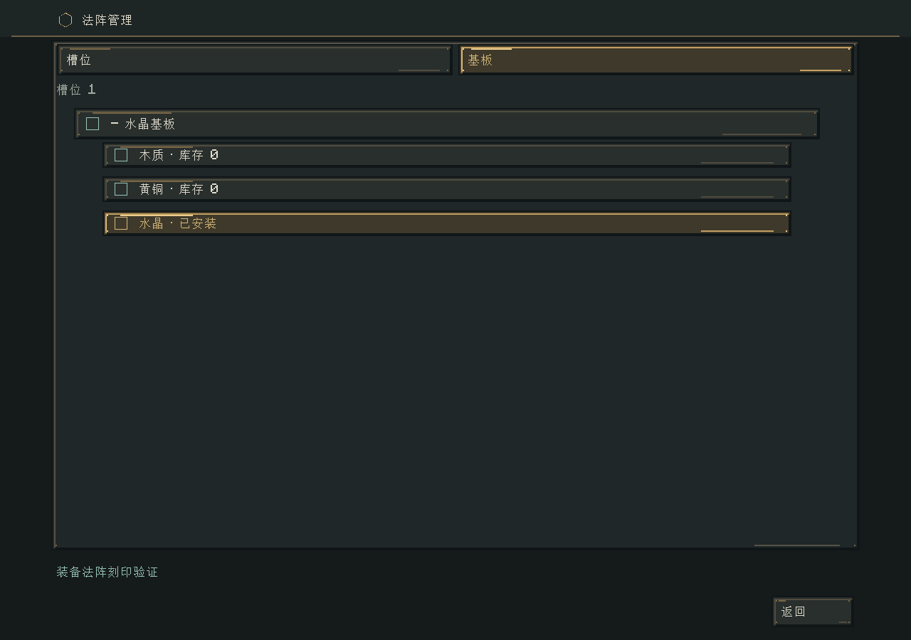

# 法袍与装备施法验收

日期：2026-11-02。版本：0.36.0。分支：`codex/wizard-equipment-circuits`，未暂存、提交、合并或推送。

## 已交付

- 编辑器槽位、阵层和工具的居中导航；小尺寸阵层按钮；管理页父子按钮分级与缩进。
- Blender 制作的四件深蓝水晶法袍，46 个骨骼方盒，原版盔甲渲染；128×128 分层贴图及 32×32 物品图标。
- 五个皮革/魔力水晶配方及配方书解锁；原生护甲、法强、装备容量和固定回复属性。
- 真实 Curios 戒指槽、可刻印戒指，工作台授权继续有效。
- 装备法阵按键、八项分页轮盘、逐槽位手动/受击触发；统一玩家供给与现有法阵调度。
- 脱装后的停供、禁释与缓存衰减；损坏装备独立停用；反击来源穿过投射物、分裂和递归并阻止反击环。

玩法、公式与安装说明见 [法袍戒指与装备施法](../systems/法袍戒指与装备施法.md)。切换轮盘中的触发方式会停止该槽位的本次供给；仍在阵内的魔力继续按规则衰减。

## 验证

`tools/build.ps1 -Tasks build,runGameTestServer -Mirror -Offline`：161,126 项核心契约与 217 项 Minecraft GameTest 全部通过。新增 49 项核心断言与 12 项原生集成用例，覆盖容量/成长分离、穿脱/重登、真实 Curios 槽、供给和独立冷却、有效受击/取消伤害、反击闭环、坏装备隔离与背包缓存衰减。

`tools/build.ps1 -Tasks runClient -EquipmentSmoke -Mirror -Offline`：`WIZARD_EQUIPMENT_GPU_PASS`。真实玩家原版伤害事件启动法袍法阵；客户端同步整套属性 1.55 / 88 / 2.75，四个护甲模型、Curios 戒指、轮盘（V/J/H；避开 Curios 默认 G 键）、居中四槽导航和子项尺寸检查通过。轮盘按客户端语言翻译物品名。修复了绑腿水晶/外袍以及靴口/袍摆、靴面/靴身的静态重叠面。

测试使用独立 `build/gametest-runs/` 和 `build/equipment-smoke/`，不读写正式世界。GameTest 中出现的损坏存档错误为已有故障注入断言；GPU 日志的 Yggdrasil 公钥请求失败为离线认证服务请求，不影响本地渲染及玩法标记。未把该项扩大为联网联机验证。

日志：`build/equipment-release-tests.log`、`build/equipment-release-gpu.log`。校验记录：`build/equipment-release-verification.json`。不宣称长时间多人压力、所有皮肤/动作/其他玩家模型插件均已验收。

## 归档

安装包：`../releases/elemental-circuits-1.21.1-0.36.0.jar`，2,999,668 字节。SHA-256：`f2fbafe40049bbbba80ef74612d1d85cb85b84ec7eb5847f61bc26318f3b0725`。

需同时安装 `../releases/dependencies/curios-neoforge-9.5.1+1.21.1.jar`。Curios 的未修改源码、许可和哈希一并提供。模组 jar 未包含 Curios 类或测试代码。原有 26 个历史安装包及 74 个 OGG 文件的哈希均保持不变。

## 实机截图

