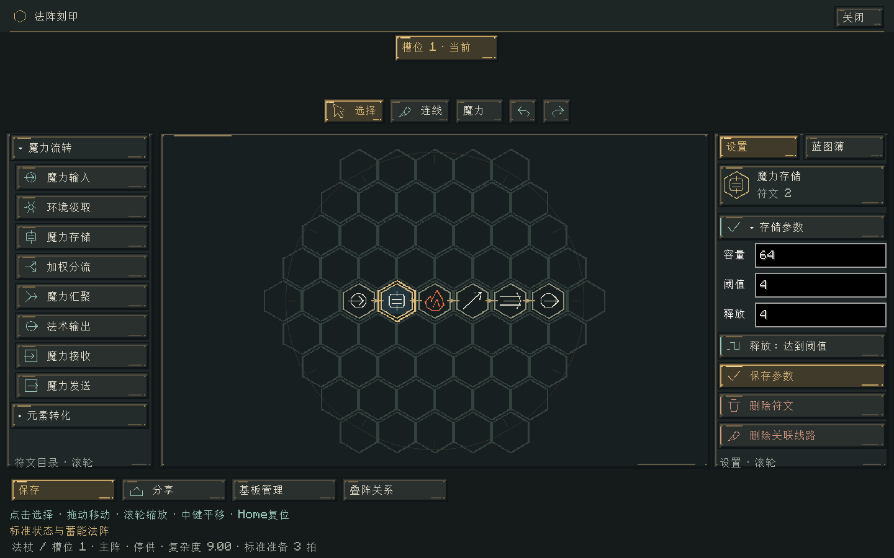
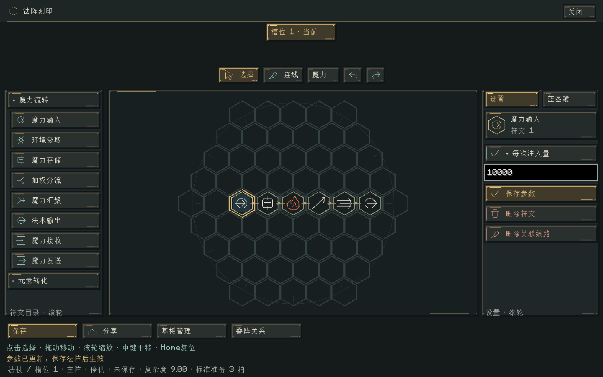
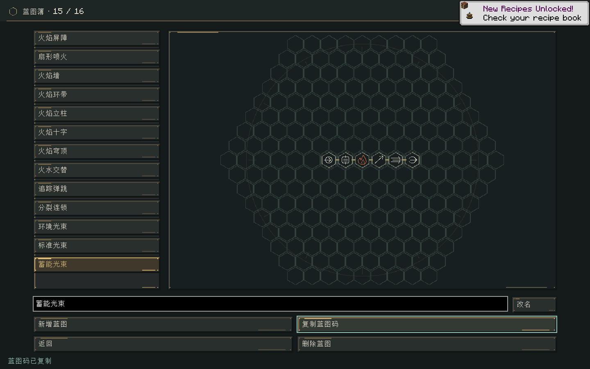

# 编辑器交互与蓝图测试 · 0.38.0

日期：2026-11-02。适用于 Minecraft 1.21.1 / NeoForge 21.1.265 / Java 21，继续使用 Curios API 9.5.1+1.21.1。

## 刻印界面

右侧不再放置示例模板，未选中符文时只显示供给方式与基板入口。保存使用黄铜强调，删除操作采用暖红色，参数按钮带展开箭头和侧边标识，基板入口保留导航标识。图标继续使用已有静态符印图集，没有新增逐帧生成资源。

点击符文参数按钮后，输入框与「保存参数」出现在该按钮下方。存储符文也改为原位编辑：容量、阈值、每次释放量与释放方式集中在同一个展开区。输入框中按主键盘 Enter 或小键盘 Enter 均可保存。非法输入保留文本并显示原因，不会部分更新草稿；切换释放方式、滚动或调整窗口大小不会丢弃已输入的文字。换选其他符文会收起原来的参数。

参数保存只更新刻印草稿，仍须使用底部「保存」或「完成刻印」将整张法阵应用到物品。短窗口可在右侧滚动查看输入框和保存按钮；保存参数后回到设置顶部。

连线模式下，将鼠标放在线段上，整条线路会高亮；按 Delete 仅删除这一条。当前「魔力／信号」工具决定可选的线路类型。交叉处选择距离最近的线，完全重合时选择最后绘制的线；符文中心不作为删线命中区。正在绘制新线路时先右键取消，再删除现有线。Ctrl+Z 可完整恢复线的路径和顺序。选择模式的 Delete 继续删除选中符文，放置模式不会响应删线快捷键；文本框获得焦点时 Delete 保留文本编辑行为。

左侧展开、折叠分类不再清空浏览偏移。允许列表末尾留白，使被点击的父项保持原来的高度；不再为了填满侧栏而强行改变滚动位置。





## 蓝图文件与脚本

示例保存为 `src/test/resources/blueprints/` 中的 15 个 `.ecblueprint` 文件，`index.tsv` 指定簿页顺序和中文名称。每个文件都是普通导入页可接受的 EC1 文本码；可直接复制文件全文使用。内容涵盖九种火焰形状、火水交替、追踪弹跳、分裂连锁、环境汲取、标准光束与蓄能光束。

```powershell
./tools/test-blueprints.ps1 -Mirror -Offline
./tools/test-blueprints.ps1 -Mirror -Offline -Interactive
```

脚本使用独立目录 `build/blueprint-smoke/`，每次创建新的平坦测试世界。快捷栏第1格放法杖，第2格放已收录15张示例的实体蓝图簿，第3格放法阵工作台，附近另放一台法阵工作台。脚本自动打开簿页并核验服务端选页、物品数据同步、预览与复制文本码；默认完成后退出。加 `-Interactive` 会保留游戏供手动试验。

示例保留完整配置和正常成本，载入目标草稿时仍使用目标基板的规则与尺寸。不会绕过材料限制、汲取条件或施法预算。蓝图文件、加载器和注入逻辑均属于测试源集，不会进入正式模组，也不会在正常游戏中自动赠送蓝图簿。



## 实现边界与验证

`RuneParameterEdit` 独立保管尚未保存的输入并原子更新 `EditorDraft`，Minecraft 输入框只负责收集文字。`RouteHitTest` 只计算屏幕线段距离，`EditorModel` 再校验工具模式、载荷类型和当前草稿，执行一次可撤销删除。渲染层只消费命中结果；鼠标、格盘或草稿未变化时复用命中缓存。左栏滚动由编辑状态持有。

验证结果：

- `build,runGameTestServer`：161,311 项核心断言、224 项 Minecraft 原生测试通过。新增39项核心检查及2个原生用例，覆盖文件文本码、簿页顺序、真实物品 NBT、参数原子更新、撤销、模式保护与单线命中。
- `runClient -StandardSmoke`：`STANDARD_MANA_GPU_PASS`、`COMPACT_PARAMETER_GPU_PASS`。验证默认折叠、三个储魔字段、重建／缩放后保留文字、两种回车保存、侧栏位置不跳、模板按钮移除、单线删除及撤销；320×240 逻辑尺寸下的滚动与回车也通过。
- `tools/test-blueprints.ps1`：`BLUEPRINT_NOTEBOOK_GPU_PASS`。真实服务器玩家获得15页实体簿，末页选择同步到服务端，复制结果与原文件一致。已核对实际渲染截图。

日志位于 `build/editor-release-tests.log`、`build/editor-final-ui.log`、`build/blueprint-injection-gpu.log`。离线客户端启动记录了原版账户服务网络请求失败，不影响本地世界与本次验证。截图用于说明界面与预览，本次没有重新进行完整玩法或长期性能验收。

安装包：`elemental-circuits-1.21.1-0.38.0.jar`（3,025,533 字节），SHA-256：`efe1047f74d3a9aaba694d0e087c9f61240f9bc19dcf9e122ae9d2acf02a5c1c`。此前29个安装包与74个音频文件内容校验通过；新包未包含测试类、蓝图夹具或 Curios 实现。
