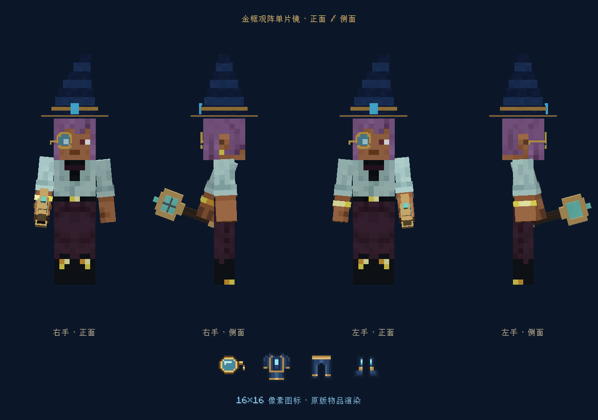
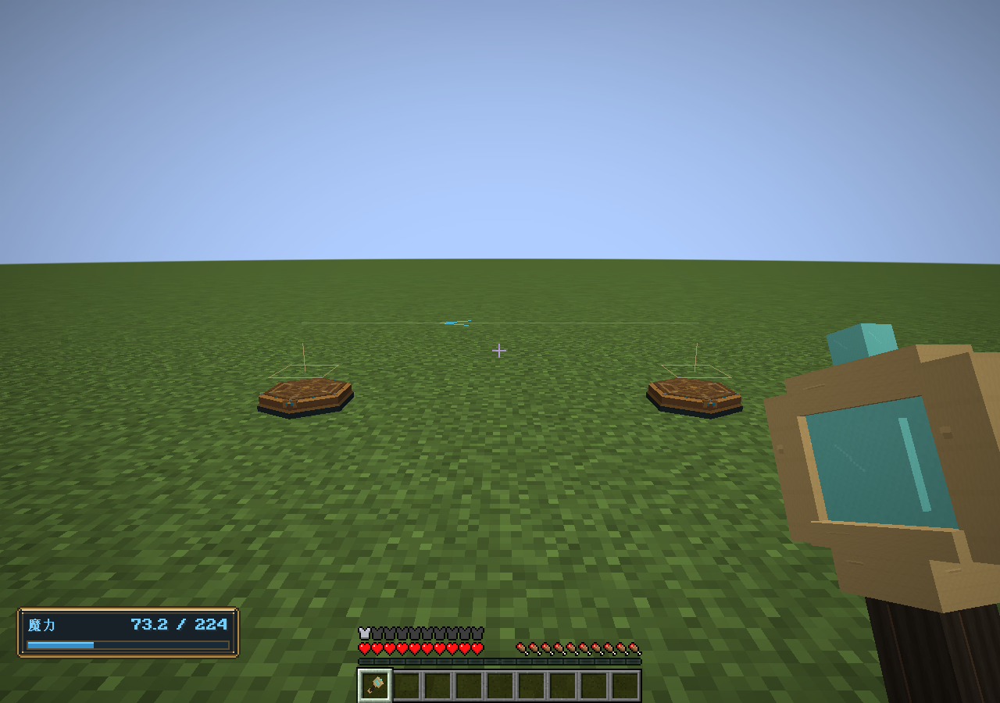

# 观阵镜与数值审查验收

2026-11-03 · 0.47.0 · 分支 `codex/monocle-numeric-audit`

## 修改与复现

1. 观阵单片镜保留头盔身份，增加 Curios 头部槽、标签及原生饰品渲染器。镜框保持金色八角边与蓝色晶片，移除垂链，镜腿缩短并向后绕到头侧；物品图标同步更新。头部饰品可与巫师帽同时佩戴，装饰槽不授予功能。
2. 高魔耗减免时成本低于名义作用量，旧输出从已支付量中继续支取完整作用量会越界。新增冻结的输出效率，明确分开成本、运输魔力与接触效果，完整保留元素次序与来源。伤害、状态、方块交互、盾牌、施法反馈及光弹预付照明使用正确的名义效果；命中分裂、连锁保留该效率。递归仅用真实支付魔力预留预算。
3. 玩家五项属性的原生清洗覆盖 NaN/无穷值；异常基础魔耗不再被原版变成最小成本。瞬间回魔补满时清除恢复等待，修复随即保存的玩家槽不能载入的问题；未补满时保留等待。
4. 修复法袍缺少元素防护适用标签；观阵镜加入魔法装备和防护附魔。Curios 修饰符按槽位区分，防护与维修只检查真实装备。损坏的玩家魔力记录不会被维修计时器覆盖或误判为装备损坏。
5. 杖体磨损按实际释放间隔计算频率，而不是用基础冷却作为下限；强度按名义作用量计算，魔耗折扣不隐式降低磨损。首次释放使用含迅咒附魔的速度估计。

公式和兼容边界见[数值审查与输出效率](../systems/数值审查与输出效率.md)。世界法术格式为 v12，历史 v1–v11 采用1:1输出效率；未知或伪造格式保留原始数据并停止运行。玩家槽和法阵蓝图格式不变。

## 验证

- `./tools/build.ps1 -Tasks coreTest,runGameTestServer,build -Mirror -Offline`：核心161868项检查、原生GameTest258项全部通过，完整构建成功。日志：`build/monocle-release.log`。
- 新核心测试跨最小/最大作用量及极低/普通/放大魔耗，检查报价、每步账本、真实释放、效果折算、来源顺序和包往返；瞬间补满后保存恢复；光弹按折扣预付照明且不复制魔力。
- 新增5项原生测试覆盖头盔/头部饰品/装饰槽、与巫师帽共存、真实防护附魔；非有限属性、补满后重载、坏玩家槽隔离；实际快速释放磨损；高减免施法及真实实体伤害；水源创造、命中分裂和折扣投射物存档推进/旧格式拒绝。
- `./tools/build.ps1 -Tasks runClient -RelationSmoke -Mirror -Offline`：独立世界生成4张截图，完成头盔和饰品模型、巫师帽共存、同步佩戴能力及固定法阵互联显示检查。日志标记 `FIXED_RELATION_GPU_PASS`，截图存于 `docs/images/fixed-control/`。
- Java 排版使用 AOSP 四空格风格；发布包核对原生版本、头部槽资源、15份附魔和JSON资源，不包含测试类；构建包与发布副本SHA-256一致。

本次验证覆盖已列出的计算与渲染路径，未作长期多人运行、第三方头盔模型组合或所有可配置数值组合的穷举验收。图形测试与GameTest使用各自隔离目录，未读取或改写正式玩家存档。未暂存、提交、合并或推送。

