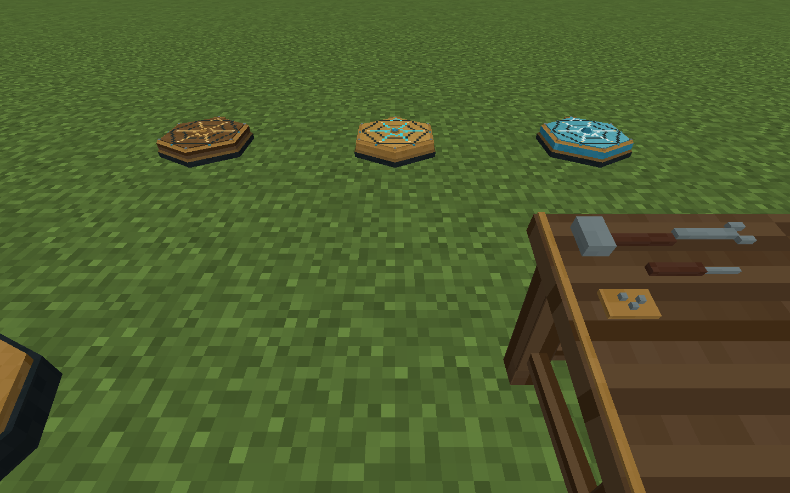
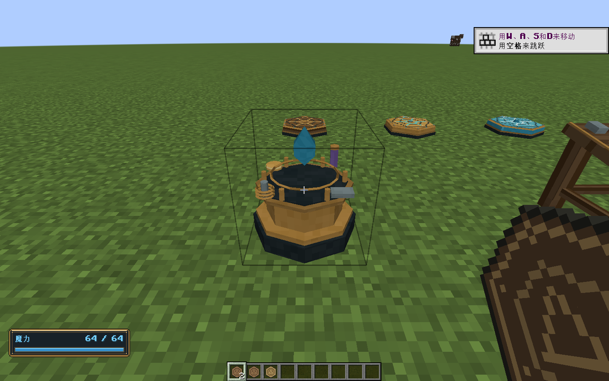
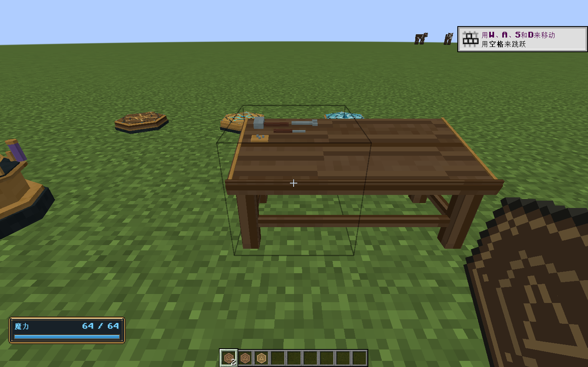
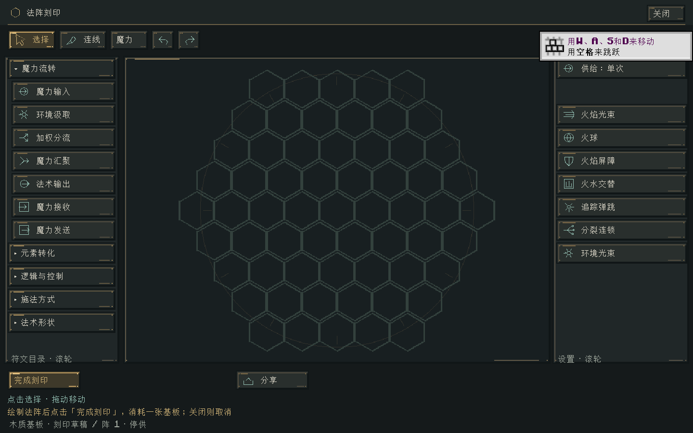
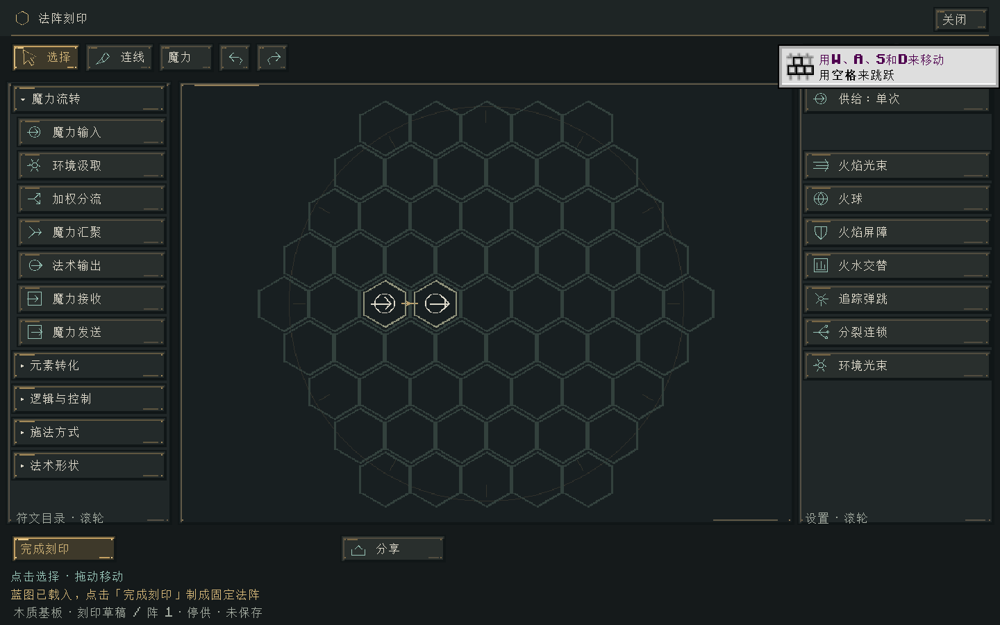

# 固定法阵刻印与外观

2026-10-31 · 0.21.0 · Minecraft 1.21.1 / NeoForge 21.1.265 / Java 21

工作台选中时只画占用方块的边界，双格法杖桌的每半边各一格。真实碰撞仍保留桌面斜坡、桌脚和悬晶，简化选框不会使玩家穿过模型。

## 三种六角阵盘

固定法阵从整立方体改为低矮六角阵盘，沿用黄铜包边、蓝色水晶、深色底座和像素刻线。木质盘面有暖色纹理与黄铜镶线；黄铜盘面有青蓝导流线和金属锁扣；水晶盘面采用蓝色分层边缘和中央小晶体。北侧的小型导流口标明法阵朝向，随方块旋转。最高0.22格，碰撞也改为低矮形状，保留原注册ID和材料状态。







## 完成刻印才得到固定法阵

1. 手持木质、黄铜或水晶基板右键法阵工作台，打开对应材质的空白草稿。此时基板仍在手中，数量不变。
2. 放置符文并连线，或载入已有蓝图。材质由这张物理基板决定，本次草稿不能换板或添加槽位。
3. 点击“完成刻印”。服务器校验蓝图后，消费一张基板，交付保存所绘法阵的固定阵盘，并关闭草稿界面。
4. 放置阵盘后，右键起停；蹲下且不持法杖右键可充能。环境汲取和固定阵互联规则沿用现有系统。





单张基板在原手持槽变成成品；堆叠基板只消耗一张，成品进入背包，背包满则掉落。关闭、走远、切换实际持物、失去工作台、死亡或登出都取消草稿，不消耗基板。草稿不保存到世界，取消后重新进入为空白；可先分享文本码或收录进蓝图簿以保留设计。

空白和无效蓝图不交付成品。“完成”要求至少一个有效符文，不强制伤害输出或某一组输入输出，以保留纯逻辑模块和互联阵的设计自由。成品没有额外魔力、不自动起阵。已有固定阵物品和世界实例仍可通过工作台修改。

## 实现与美术源

- [Blender源文件](../art/blender/fixed-circuits.blend)、[Blender场景预览](../art/blender/fixed-circuits-studio.png)、[Aseprite源文件](../art/aseprite/fixed-circuits.aseprite)。使用本机 Blender 5.2.3 LTS 和指定的 Aseprite 1.3.15.5 实际生成。
- 原生OBJ三个模型：木质304顶点/348面、黄铜316顶点/362面、水晶311顶点/358面。独立256×256图集，16块32×32画稿，四边各16像素外延；只导出三角形和四边形。
- 静态模型在资源加载时烘焙进原生区块，不新增逐帧方块渲染器。`tools/blender_mesh_atlas.py` 复用工作台的UV和封口导出。
- `InscriptionAccess` 独占草稿与原持物；服务器先提交编码，再消费材料。背包交付使用副本，避免原版插入接口清空用于确认回复的对象。每个请求重验工作台、距离和会话，完成或取消后旧请求不能再次交付。

重建资源：

```powershell
& 'E:/Aseprite-v1.3.15.5/build/bin/aseprite.exe' --batch --script-param "root=$((Get-Location).Path.Replace('\','/'))" --script-param fixed=true --script tools/paint-workstations.lua
& 'D:/blender/blender-5.2.3-windows-x64/blender.exe' --factory-startup --background --threads 4 --python tools/model-fixed-circuits-blender.py
python tools/check-workstations.py
```

## 验证

- `build/fixed-circuits-contracts.log`：最终build成功，89,428项核心契约、114项Minecraft集成测试通过。覆盖三种材料交付与保存、空白/非法拒绝、取消不扣板、真实持物约束、工作台消失、离开失效、满背包掉落、其他玩家隔离、旧保存/关闭请求不能影响新会话、传输往返、简化选框和斜面/水晶真实碰撞。
- `build/fixed-circuits-gpu.log`：真实客户端成功，12种材质/朝向的阵盘实际烘焙几何、两种工作台选框、草稿界面和实际“完成刻印”按钮通过；确认服务器只消费一张堆叠基板、背包交付一件成品、清理会话并关闭界面。原27种法杖的桌面两点支撑和全部变换后顶点检查通过。
- `build/fixed-circuits-godot.log`：工作区统一23套隔离回归通过，`SUITES: 23, FAILED: 0`。Godot源码和1.20.1工程未修改。
- `python tools/check-workstations.py`：7个工作台、3个阵盘和27个法杖网格的格式、边界、UV和资源引用检查通过。Blender与Aseprite源文件保留，历史9个安装包大小和SHA256均未变化。

真实客户端截图保存在 `art/fixed-circuits/`；最新Java构建另补了迟到关闭请求的身份校验，该项通过服务端集成测试。

客户端与服务端都需安装0.21.0，网络协议为`1.21.1-7`；蓝图、程序集和运行现场保存格式不变。未将本次验证当作长期性能、多玩家并发或整张旧世界升级验收。

安装包：`../releases/elemental-circuits-1.21.1-0.21.0.jar`，1312094字节。SHA256：`377f3b1fd99ea7161de2ec503fe621f8f2620371589a29fd7681ec035a97b131`。正式JAR已检查不包含测试类、测试结构和制作工具源文件。分支`codex/inscribed-fixed-circuits`，未暂存、提交、合并或推送。

0.21.1在本版模型上重绘了高密度贴图；本报告保留0.21.0基线数值与截图。当前Aseprite/Blender源文件已更新，最新画稿规格与实机图见 [法阵贴图细化](法阵贴图细化.md)。
