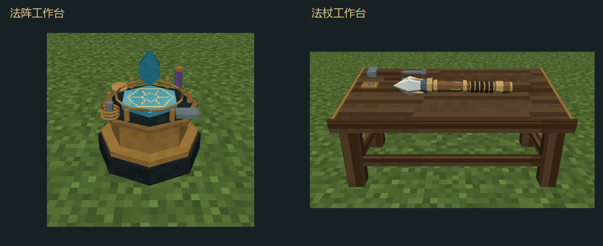

# 工作台贴图与穿模修复

2026-10-31，0.20.1；Minecraft 1.21.1 / NeoForge 21.1.265 / Java 21。分支`codex/workstation-surface-fix`，未暂存或提交。

## 问题与处理

| 问题 | 修复 |
|---|---|
| 不同长宽的面都铺满同一个材质块，纹理比例不一致 | 按模型空间尺寸投影UV，木纹跟随长轴；端面使用独立断面材质 |
| 图集仅留1像素边距，四级mipmap采样可能混入旁边材质 | Aseprite重绘为256×256图集，每块32像素画稿向四边外延16像素；UV限制在画稿像素中心内 |
| 基板侧面和背面也出现完整符纹 | 符纹只用于正面，侧面和背面使用对应木、黄铜或水晶材质 |
| 法杖4×4调色板限制方块图集mipmap级数，部分封口仍使用多边形 | 调色板升至16×16；Blender重新导出27种组合，将所有封口拆为三角形 |
| 分块桌面有缝，各块高度不完全处在同一平面 | 改成连续闭合桌面，以贴图表现木板接缝；桌腿在斜面下接合 |
| 工具高度和金属边条单独手填，出现浮空或被桌面吞掉 | 工具、金属条和前挡边共用12°桌面平面，沿该平面摆放 |
| 桌上法杖按固定偏移摆放，换部件可能嵌入或悬空 | 从真实烘焙顶点的下凸包求跨过中部的两处支撑，再限制桌面足迹和预留高度；使用独立NONE渲染上下文 |
| 水晶超出单格，但碰撞只到基座；桌子使用旧整块碰撞 | 水晶保持悬浮并收在单格内；模型同时导出碰撞数据，桌面按32段跟随斜坡，覆盖工具与支架 |
| 双格桌子的几何全部放在主格，另一半模型为空 | 按占位裁切为两个有真实几何的模型，插值保留连续UV；每一半都在自己的单格内烘焙，功能实体仍只有一个 |

## 实现与源文件

Blender源：[workstations.blend](../art/blender/workstations.blend)、[modular-wands.blend](../art/blender/modular-wands.blend)。贴图源：[workstations.aseprite](../art/aseprite/workstations.aseprite)。本次继续实际运行用户指定的Aseprite和本机Blender，交付时无需安装这些美术工具。

`model-workstations-blender.py`同时导出模型及`assets/elementalcircuits/geometry/workstations.json`；`WorkstationGeometry`一次加载为类型明确的布局与按朝向/半边缓存的碰撞形状。模型与碰撞几何不再分别填写一套桌面高度。斜面碰撞有32段的离散近似，局部高度误差以集成测试限制在0.012格以内。

法杖姿态由`WandDeskPose`按实际BakedModel弱缓存，资源重载后新模型重新拟合；正常渲染不重复遍历全部顶点。工作台本体仍为静态区块模型。完整法杖桌138个面用于物品显示，世界主/副模型110/44个面；刻阵台空闲560个面、三材质版本各574个面。

## 验证

| 项目 | 结果与证据 |
|---|---|
| 资源格式与图集 | `python tools/check-workstations.py`通过：7个工作台OBJ、27种法杖OBJ、UV范围、每个图集外延像素、碰撞/模型占位、36个方块状态引用 |
| 核心逻辑 | 89,428项通过，`build/workstation-fix-contracts.log` |
| Minecraft服务端 | 108项全部通过；新增四朝向、两半桌面落点与水晶实际碰撞验证，同上 |
| 桌面法杖真实几何 | 27种实际烘焙模型逐顶点验证：没有顶点进入桌面或超出高度，两处支撑横向间隔至少0.35格；`build/workstation-fix-gpu.log`中的`WAND_DESK_GEOMETRY_PASS` |
| 工作台真实客户端 | 验证四朝向八个半格模型边界、两套界面、三材质基板、预览同步与清空；10张截图保存于`art/workstation-fix/`；日志`WORKSTATION_GPU_PASS` |
| 法杖真实客户端 | 27种独立三维模型、左右手、第一/第三人称及冷却同步通过；`build/workstation-fix-wand-gpu.log`的`WAND_MODELS_GPU_PASS`和`WAND_WORLD_GPU_PASS` |
| 原Godot回归 | 23套通过，`build/workstation-fix-godot.log`的`SUITES: 23, FAILED: 0` |
| 安装包 | 所有JSON可读，正式包无测试类；原8个安装包哈希保持不变 |

本轮覆盖原生资源与隔离测试世界。第三方资源包随意替换工作台模型后的碰撞匹配、多人同时操作和长期GPU压力仍未验收，不将这些列为通过。

## 更新

安装[0.20.1 JAR](../../releases/elemental-circuits-1.21.1-0.20.1.jar)，大小1,261,908字节。SHA-256：`fc30994882fdae5441903fff010f93b4595ed3d0b13cb4f77a985010f128a266`。

碰撞几何更新，协议升为`1.21.1-6`，客户端与服务端一起更换。方块/物品ID、蓝图与运行现场保存格式不变，已有工作台无需拆除重放。
