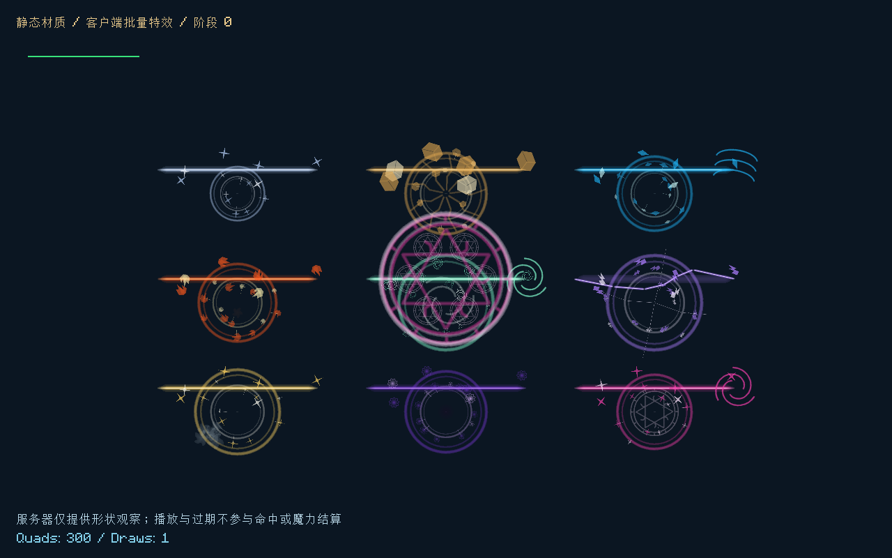

# 施法表现与打击反馈

2026-10-30，模组0.16.0；Minecraft 1.21.1 / NeoForge 21.1.265 / Java 21。分支 `codex/spell-impact-vfx`；未暂存、提交或推送。1.20.1工程及既有0.15.0迁移包保留。

## 表现目标

用户希望施法更明显、更有打击感，参考Iron’s Spells ’n Spellbooks。参考其[官方介绍](https://iron.wiki/)及[释放前手部表现分层](https://github.com/iron431/irons-spells-n-spellbooks/blob/1.21/src/main/java/io/redspace/ironsspellbooks/render/ChargeSpellLayer.java)，本次采用起阵、释放、飞行、接触分阶段的方向，重新制作本项目的美术与几何。没有复制对方贴图、音效、动画或源码，没有新增对该模组、GeckoLib或光影包的依赖，也没有引入新的蓄力等待或改变法阵时序。

原表现以细线和少量柔和光点为主。新版将形状轮廓、亮度层次和瞬间反馈分开：

- 成功起阵出现短暂旋转法环；实际输出出现更快的发射法环与亮核。靠近本机镜头时缩小并降低透明度，位置偏向手前，避免挡住准星。
- 光束包含外沿、元素主体和细亮核；投射物有可辨认的头部与尾迹。雷电采用分段折线，水/风/奥术有各自伴随纹样。
- 接触产生短促核心、扩散双环、向外碎屑和速度线。爆发先强后弱，余效继续扩散，最长0.7秒内自行清理。
- 屏障增加内层纹样、外环和周边符印，保留原实际位置、法线与半径。
- 28种静态声音保留原元素区分，新增低频主体、短促瞬态和少量反射尾声。原预算、空间衰减和声音类别不变。

| 元素 | 形态与运动 |
|---|---|
| 土 | 棱块碎屑、下坠、裂纹扩散 |
| 水 | 晶滴、水波、较低的抛物散落 |
| 火 | 上升火舌、余烬和短烟 |
| 风 | 旋流、切线与快速旋转的碎片 |
| 雷 | 折线亮核、分叉接触线和电弧碎片 |
| 光 | 星芒、放射亮点与明亮内核 |
| 暗 | 深色中心、向内收拢的紫色冠环 |
| 奥术 | 反向旋转符环、几何星形与亮核 |
| 纯净 | 冷白能量星点；只作基础视觉，不将纯净输出变成新元素伤害 |

## 反馈、状态与边界

`SpellFeedback`由实际释放和原版`LivingEntity.hurt`接受伤害时收集确认。同世界步对同一施法者合并为最多一个消息；只发送给当前维度中的该玩家，不把其他玩家的命中显示在本机。无效输出、被拒绝的伤害和单纯撞墙不会显示成功伤害准星。治疗/纯状态作用仍有世界接触表现，不伪装成造成伤害。

客户端`FeedbackPulse`控制短暂准星和轻微后坐，连续反馈有合并间隔，不会无限累加振幅。镜头只修改渲染事件的俯仰和滚转，不写玩家朝向、输入、速度或瞄准数据；不修改FOV，不停止服务器或加入命中停顿。默认镜头强度0.65，俯仰和滚转均受小角度上限约束。暂停不推进本地反馈，换世界或退出清空。

释放后坐只确认当前主手法杖选用的承载者身份（有副手法术书时按书内法阵判断）。固定法阵和背包设备的自动释放不产生后坐；命中滚转还要求近期手持释放，远程设备单独命中只显示伤害准星。

客户端设置文件 `config/elementalcircuits-client.toml`：

```toml
cameraMotion = true
hitMarker = true
motionStrength = 0.65
```

关闭镜头反馈可设置 `cameraMotion = false` 或 `motionStrength = 0`；准星可单独关闭。特效没有全屏闪白。

网络协议升为 `1.21.1-2`，两端都需升级0.16.0。VM、蓝图、玩家魔力和世界法术保存格式不变。新观察只描述画面；没有客户端寻敌、射线检测、补算伤害或改变权限，表现预算满也不影响权威效果。

## 模块与资源

- `SpellVisual`追加START/CAST观察类型；原五种类型的枚举顺序保持。
- `VisualStyles`读取版本2美术配置，将阶段样式及九种元素的形状、颜色、碎片数、扩散、升降与旋转一起验证后原子替换。失败重载保留旧完整配置。
- `SpellGeometry`为纯Java几何规划器，按接触/释放优先顺序生成有界四边形；没有Minecraft、世界或GPU依赖。`SpellVisualRenderer`只负责将顶点交给图形接口。
- `VisualTimeline`合并同位置的完全相同观察。稳定光束/屏障刷新已有表现；同一冲击六个客户端逻辑步内不重新触发核心，避免叠满透明法环。
- 世界队列1024、每玩家每步512、每包128、客户端活动观察2048、每帧8192四边形等上限保持。屏幕外空批次不提交GPU，过载丢弃表现。
- `FeedbackNetwork`只允许服务器到客户端的原生Payload。`SpellFeedback`拥有服务器发件箱；`FeedbackClient`拥有本机表现状态；`FeedbackConfig`只提供本地偏好。
- `textures/effect/spells.png`为原创512×512、4×4图集，含16种白色遮罩，所有特效共享一个纹理和一次绘制。程序化形状只用于离线制作，游戏启动及施法不生成贴图。

美术与制作入口：

```powershell
python tools/bake-effects.py
python tools/bake-art.py
# 音频制作另需 numpy/scipy/soundfile；可安装在本地工具目录
python tools/bake-audio.py --tooling build/audio-tooling
```

`bake-art.py`调用独立特效烘焙器，避免以后重烘界面资源时把16格图集覆盖为旧版4格。原有界面与法杖资源保持。

## 验证

| 项目 | 结果 |
|---|---|
| 核心与构建 | 88,766项通过；`build/vfx-release-check.log` |
| 专用服务端GameTest | 87项通过；同上。包含无敌目标不确认、有效伤害确认、玩家隔离、重复合并、墙面接触三阶段及既有元素/存档契约 |
| 纯几何验证 | 九元素的几何与运动不同、可重复重建、有限坐标与图集索引、命中优先、8192上限及视距裁剪 |
| 时间线与资源 | 重复接触不堆叠、不无限重置爆闪；失败资源重载不部分发布；暂停/过期/退出契约保持 |
| 实际GPU | 九种元素实际绘制、密集8192四边形一次绘制、过期和裁剪后零绘制；`build/vfx-gpu-final.log`，动态截图补采见 `build/vfx-preview.log` |
| 实际集成世界 | 超过40KB的蓝图提交/起阵、无敌目标无确认、接受伤害后的本机准星、维度拒绝、过期和退出清理；`build/vfx-world-final.log` |
| 实际声音引擎 | 新28份OGG全部24kHz单声道解码并实际播放，位置衰减、玩家类别和有限声道寿命通过；同上 |
| Godot工程回归 | 23套，失败0；`build/vfx-godot.log` |

独立客户端测试使用 `build/vfx-smoke/`、`build/audio-world-smoke/`，不进入玩家正式世界。测试中先用生存模式验证原版无敌拒绝；创造模式的原版伤害豁免不被误当作反馈逻辑错误。测试类和录制截图逻辑不打包到正式JAR。




截图与循环仅展示限定场景。GPU采样见 `docs/metrics/spell-impact-gpu.json`，不代表整服TPS、第三方光影兼容或多人长期帧率。实际美术是否符合个人偏好仍需试玩反馈。
