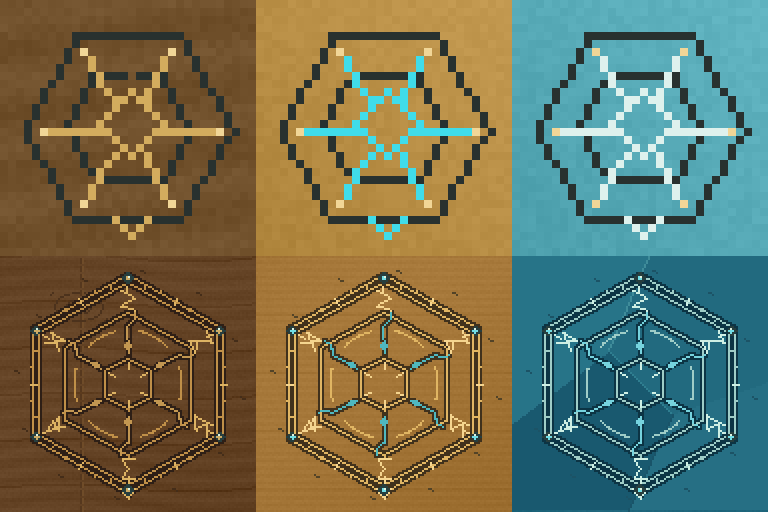
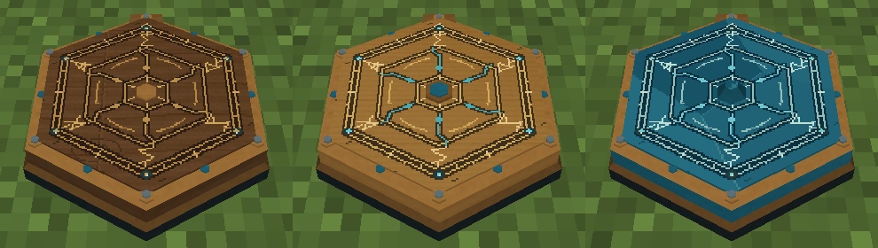

# 法阵贴图细化

2026-10-31 · 0.21.1 · Minecraft 1.21.1 / NeoForge 21.1.265 / Java 21

三种固定阵盘的盘面从32×32有效画稿提升至128×128，并重新绘制符纹与材料，保留六角形、黄铜包边、青蓝导流和深色底座。图集1024×1024，每块画稿四边各64像素外延，UV向内缩半个像素，避免缩小时从邻块采样颜色。



主符纹保留六路放射结构，增加双层刻槽、外圈刻度、六组角形符印、断续内环和封闭触点。大轮廓负责远处辨认，细刻线和磨痕用于近看。盘面的符纹是统一的装饰图案，不冒充实时蓝图或发光状态。

木质盘有细木纹、木节与暖金镶线；黄铜盘有拉丝、暗槽与青蓝导流；水晶盘以深青切面、少量折射边和浅青刻线区分。侧面与底座也使用同密度的材料画稿。



[木质近景](../art/array-texture-detail/array-detail-wood.png) · [黄铜近景](../art/array-texture-detail/array-detail-brass.png) · [水晶近景](../art/array-texture-detail/array-detail-crystal.png) · [远景](../art/array-texture-detail/array-detail-distance.png)

## 制作源

- [Aseprite源文件](../art/aseprite/fixed-circuits.aseprite)：材质底色、沉入刻槽、镶线符文、触点磨损四个可编辑图层。
- [Blender源文件](../art/blender/fixed-circuits.blend)和[场景预览](../art/blender/fixed-circuits-studio.png)：使用与原生OBJ一致的UV。
- `tools/paint-fixed-circuits.lua` 使用指定的本机Aseprite 1.3.15.5实际绘制；`model-fixed-circuits-blender.py` 使用本机Blender 5.2.3 LTS导出。
- 图集留边与半像素内缩按密度计算；普通工作台仍使用原32像素画稿。三个阵盘的顶点及面列表逐行与0.21.0对照完全相同，只有UV与材质画稿变化，无新增渲染器或动态几何。

```powershell
& 'E:/Aseprite-v1.3.15.5/build/bin/aseprite.exe' --batch --script-param "root=$((Get-Location).Path.Replace('\','/'))" --script tools/paint-fixed-circuits.lua
& 'D:/blender/blender-5.2.3-windows-x64/blender.exe' --factory-startup --background --threads 4 --python tools/model-fixed-circuits-blender.py
python tools/check-workstations.py
```

旧的 `paint-workstations.lua --script-param fixed=true` 调用保留为兼容入口，转调专用绘制脚本。

## 验证

- `build/array-texture-contracts.log`：build成功，89,428项核心契约和114项Minecraft集成测试通过。
- `build/array-texture-gpu.log`：真实客户端三材质近景和远景、全部12种阵盘材质/朝向的实际模型烘焙、工作台选框、实际完成刻印按钮与27种法杖桌面支撑验证通过。
- `build/array-texture-godot.log`：统一隔离回归23套通过，`SUITES: 23, FAILED: 0`。
- `tools/check-workstations.py`：UV、半像素内缩、网格边界、资源引用和图集所有留边像素检查通过。
- 三个OBJ的顶点和面列表与修改前逐行相同；旧绘制入口转调检查通过，同一随机种子重绘PNG的SHA256一致。

本次客户端的原生方块图集由1024×1024增至2048×1024，保留四级mipmap；提高画稿密度会增加纹理显存，未增加模型面数或逐帧渲染器。没有进行长期帧率验收。

蓝图、运行状态、基板消费与交付流程保持0.21.0规则，网络协议仍为`1.21.1-7`。

安装包：`../releases/elemental-circuits-1.21.1-0.21.1.jar`，1492761字节，SHA256：`d8e21eea75123534423daa3c69a53d81a55b270caf40133a24f8d8d7e4bf025f`。旧10个安装包大小和校验值保持不变。分支`codex/detailed-array-textures`；未暂存、提交、合并或推送。
