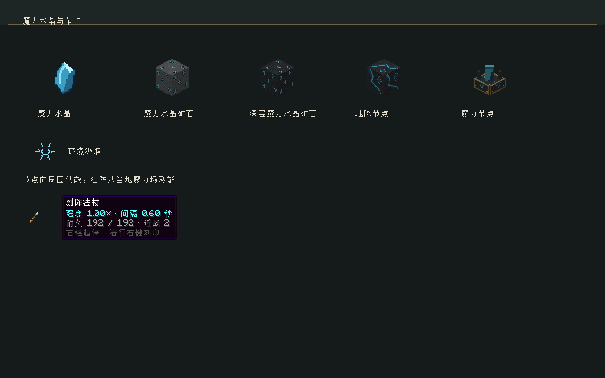
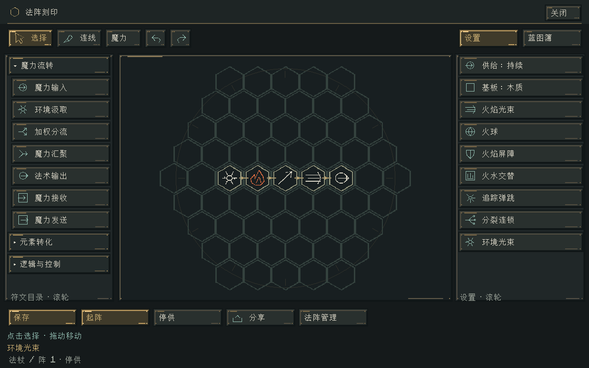
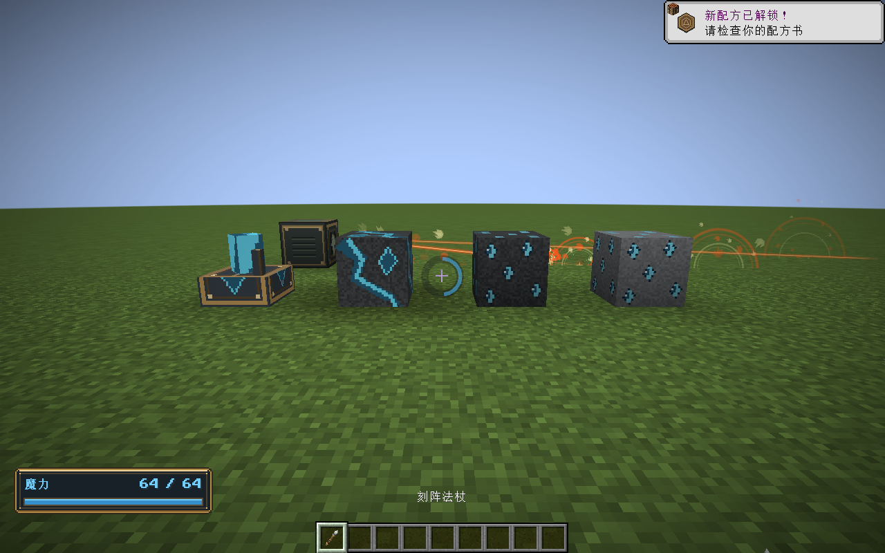

# 魔力场、水晶与汲取法阵

2026-10-31，Minecraft 1.21.1 / NeoForge 21.1.265，模组 v0.19.0。

## 在游戏中使用

主世界的新区块会生成魔力水晶矿石及深层变种，用铁镐或更好的工具采集。普通掉落为魔力水晶，时运增加掉落，精准采集保留矿石。矿石在 Y=-48～48 生成，每区块尝试6次，每簇最多6块；地形及原版放置条件会减少实际数量。已有区块不回填。

地脉节点在 Y=-40～16 的石层中稀疏生成，每12个区块平均尝试一次。地脉初始储量4096，向周围魔力场释放约2点/秒，耗尽后熄灭。它不是无限泉源，也不能用水晶补充。采集最多获得两枚水晶，实际数量受剩余储量限制；耗尽节点不再掉水晶。生存模式不能把地脉节点整块带走。

人工魔力节点的配方如下，需要4铜锭、3石头和1紫水晶碎片。得到魔力水晶时会解锁配方书条目。

```text
铜  紫水晶  铜
石    空    石
铜    石    铜
```

放置后初始为空。手持魔力水晶右键装入，每枚增加64点，容量512；空间不足一枚时不消费物品。节点最多向场中释放4点/秒，场已满时停止消耗。拆除人工节点会保留储量与收支，重新放置不会充满。

右键节点可查看储量和当地场强；手持魔力水晶对空气右键可察看站立处的场强，不消耗水晶。

绘制页“魔力流转”新增**环境汲取**符文，符形为向中心汇入的六向箭头。它只有魔力输出，从载体所在位置取得纯净魔力。转换元素后才能形成有元素作用的法术；原有“魔力输入”仍从玩家槽或固定法阵本地储量取能。

右栏的“环境光束”可直接载入汲取→火元素→指向→光束→输出的持续法阵。保存后手动起阵，把固定法阵放在节点附近即可在本地储量为零时工作。手持法杖与副手法术书也支持汲取，取能位置随玩家移动。一个物理载体的全部槽位及汲取符文共享约4点/秒的取能额度，不能通过堆放符文复制额度；按既有槽位和宿主顺序分配。





## 场的动力学

首期采用纯净魔力的标量场，不把元素伤害值当作环境资源。世界按8×8×8格划分空间单元，每单元容量128。节点、汲取符文和水晶探测会激活附近已加载的3×3×3单元；普通读取不创建资源。

每个空间单元在首次发现时得到8点有限环境余量。记录保存后不会因再次探测、卸载或重新进入世界而补满。探索新地区可以找到未被使用的余量；已抽空的区域需要节点或周边场的扩散补给，没有免费的环境再生。

服务器20Hz推进，场每5步计算一次：

1. 同步读取上一步场值，沿六个面的相邻单元，由高浓度向低浓度转移差值的1/12。同一条界面只结算一次，一次不能跨越多个单元。
2. 结算每单元1/4096的缓慢耗散，使用16.16定点截断，极小余量可能不再耗散。
3. 节点注入真实可接纳的数量，只扣除成功注入的燃料。
4. 法阵按原有确定顺序汲取，再经过缓存、线路损耗、转换和输出。

场与节点分别保留守恒账本：

```text
首次环境余量 + 节点注入 = 场内持有 + 法阵提取 + 环境耗散
节点初始储量 + 水晶装入 = 剩余储量 + 实际释放
```

汲取仍受法阵缓存容量限制，缓存满时不会继续抽取。纯汲取法阵在空场中等待，不回退消耗玩家槽；含信号逻辑的法阵仍须支付控制成本，纯汲取图从场中支付，带“魔力输入”的混合图沿用原供给支付。不能维持控制时按既有断供规则停止，补能后须手动重启。单次图只在输入时刻汲取一次，持续图每逻辑步尝试取能；原注入间隔继续控制“魔力输入”。停止汲取后，已经进入阵内的资源沿用现有残余流转规则。

区块卸载冻结对应场量和节点，不强加载区块，不补算现实离线时间。相邻但尚未发现的单元不参与扩散；当前供能覆盖由已发现区域连接决定，不是自动求解整个无限世界。

## 工程与持久化

- `domain/ManaField`、`ManaNode`、`ManaFieldRules` 是无 Minecraft 依赖的领域类型。数值来自版本化的 `data/elementalcircuits/rules/mana_field_v1.json`。
- `WorldManaField` 拥有各维度的 SavedData、已加载单元索引和节点登记。相位间只推进计数，不在20Hz反复复制整个场；每次扩散最多8192个单元。
- 超过活动预算时按保存的 Minecraft 世界时间轮换批次，跨批次边界当次冻结，节点也随所属批次冻结。此时有效速率降低，不承诺任意规模下仍保持4Hz全场更新。每维度最多保存262144个单元，到限后不创建新的单元，也不驱逐旧记录来刷新环境余量。
- 场版本1保存冻结规则、全部已发现单元、步内相位和四项收支。节点版本1保存冻结规则、种类和完整燃料账本；维度之间不共享场。非法类型、重复单元和不守恒数据停用并保留原始记录，不创建替代满槽。
- 有汲取符文的 VM 现场使用版本5；旧图仍输出版本4，旧版1～4现场按原语义恢复。蓝图仍只保存配置。网络协议升为 `1.21.1-4`，客户端与服务端使用相同版本。
- 矿物和节点使用原版配置特征、放置特征和 [NeoForge 生物群系修改器](https://docs.neoforged.net/docs/1.21.1/worldgen/biomemodifier/)。天然节点用单块替换特征，生成时创建原生方块实体。
- 图片、节点 JSON 模型和矿物资源由 `tools/bake-mana-field.py` 离线生成；加入既有 `bake-art.py` 入口，没有运行时生成贴图。

当前场不区分元素，不模拟流体、地形阻隔或连续空间偏微分方程；没有玩家槽自动吸收、通用发电机、节点所有权或远距离管网。玩家自身的等待恢复、部件冷却和元素世界作用维持原规则。公开节点会给附近所有有资格运行的法阵供能。

## 文本和冷却环

常规法杖说明保留强度/释放间隔、耐久/近战、操作三行。部件名移到高级提示；隐藏与近战行重复的原版属性说明，真实属性仍生效。绘制页左下提示缩短，停供时不显示无意义的零余量；HUD数字不再固定显示两位小数。

冷却底环不透明度从215/255降到82/255，蓝环从255/255降到150/255。同时把底环改为有透明混合的批量绘制，避免 PNG 中的透明度在原绘制路径上失效。黄铜魔力框、蓝色粗体字和冷却规则保留。



## 验证边界

最终结果和命令记录在同目录的实施报告。覆盖核心守恒、确定性恢复、资源真实消费、矿物掉落与世界生成注入，以及真实客户端显示和场运行。自动测试及短时图形检查不等于完整生存平衡验收、长时间大型服务器性能验收或所有第三方保护模组兼容验收。
